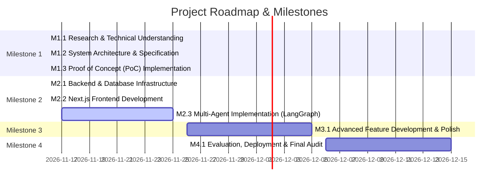

# Project Status: AI-Powered Internship Application and Career Assistance Platform

**Last Updated:** November 16, 2026  
**Milestone 1 Status:** 100% Completed, Verified & Finalized for Submission (M1.1, M1.2, M1.3)  
**Current Milestone:** Milestone 1 Final Submission Ready / Milestone 2 Initiated  
**Quality & Validation:** All Proof of Concept (PoC) Tests Passed (100% Assertions Verified)  

---

## 1. Milestone Tracking Overview

---

## 2. Completed Tasks

### Milestone 1.1 — Research & Technical Understanding (Completed & Pushed)
- [x] **Internship Application Workflow Research:** 8-stage lifecycle analysis, ATS friction points, AI automation touchpoints.
  - *Artifact:* [`docs/research/internship-workflow.md`](file:///c:/Users/Daksh/Desktop/M1InfosysSpringboard/docs/research/internship-workflow.md)
- [x] **RAG Architecture & Technical Design:** Section-aware structural chunking, verified MTEB benchmarks, hybrid search (HNSW + BM25 via RRF), Cross-Encoder re-ranking, RAG Triad guardrails.
  - *Artifact:* [`docs/research/rag-architecture.md`](file:///c:/Users/Daksh/Desktop/M1InfosysSpringboard/docs/research/rag-architecture.md)
- [x] **Multi-Agent Architectural Patterns:** Hub-and-spoke supervisor, 6 core agent specifications, shared Pydantic state, HITL breakpoints.
  - *Artifact:* [`docs/research/multi-agent-patterns.md`](file:///c:/Users/Daksh/Desktop/M1InfosysSpringboard/docs/research/multi-agent-patterns.md)
- [x] **Technology Stack Evaluation:** Zero-cost local-first evaluation across 11 technical domains (PostgreSQL 16 + pgvector, Ollama, Next.js 15+, FastAPI).
  - *Artifact:* [`docs/research/technology-evaluation.md`](file:///c:/Users/Daksh/Desktop/M1InfosysSpringboard/docs/research/technology-evaluation.md)
- [x] **Executive Synthesis & Quality Refinements:** Synthesized architectural findings, employer screening findings (HBS Fuller et al., 2021), verified MTEB numbers.
  - *Artifact:* [`docs/research/M1.1-summary.md`](file:///c:/Users/Daksh/Desktop/M1InfosysSpringboard/docs/research/M1.1-summary.md)

### Milestone 1.2 — System Architecture Design (Completed & Pushed)
- [x] **System Architecture Specification:**
  - Designed component topology across 8 layers: Client (Next.js 15+), API (FastAPI), Storage (PostgreSQL 16 + pgvector), Local Inference (Ollama/LiteLLM), Local File Storage (`./data/uploads/resumes/`), RAG Pipeline, AI Agent Layer (LangGraph), Application Tracking Module.
  - Formulated single `docker-compose.yml` multi-container development and deployment topology.
  - *Artifact:* [`docs/architecture/system-architecture.md`](file:///c:/Users/Daksh/Desktop/M1InfosysSpringboard/docs/architecture/system-architecture.md)
- [x] **Granular Multi-Agent Specifications:**
  - Defined strict Pydantic input/output contracts, scoped tools, RAG dependencies, inter-agent state passing, and execution traces for all 6 agents:
    1. *Job-Resume Matching Agent*
    2. *Skill Gap Agent*
    3. *Resume Agent*
    4. *Cover Letter Agent*
    5. *Interview Agent*
    6. *Career Assistant*
  - Designed `AgentState` schema, 15-step recursion limit, and Human-in-the-Loop review breakpoints.
  - *Artifact:* [`docs/architecture/agent-specifications.md`](file:///c:/Users/Daksh/Desktop/M1InfosysSpringboard/docs/architecture/agent-specifications.md)
- [x] **Database Schema & Data Modeling:**
  - Formulated complete PostgreSQL 16 DDL script with `uuid-ossp` and `vector` extensions.
  - Designed relational tables (`users`, `candidates`, `educations`, `projects`, `skills`, `jobs`, `applications`, `stage_history`, `interviews`).
  - Integrated `vector(384)` columns with HNSW cosine distance indexing (`m=16, ef_construction=64`) and full-text search GIN indexing on `tsvector`.
  - Built comprehensive Entity-Relationship (ER) diagram and data dictionary.
  - *Artifact:* [`docs/architecture/data-schema.md`](file:///c:/Users/Daksh/Desktop/M1InfosysSpringboard/docs/architecture/data-schema.md)
- [x] **Resume Ingestion & Processing Data Flow:**
  - Mapped step-by-step pipeline: Raw file upload $\rightarrow$ SHA-256 deduplication $\rightarrow$ PyMuPDF layout-aware coordinate extraction $\rightarrow$ Local LLM/Instructor Pydantic parsing $\rightarrow$ ESCO taxonomy normalization $\rightarrow$ Section-aware structural chunking $\rightarrow$ Dense vector embedding (`bge-small-en-v1.5`) $\rightarrow$ Atomic PostgreSQL transaction persistence.
  - Documented failure recovery, data validation rules, and sequence diagrams.
  - *Artifact:* [`docs/architecture/data-flow.md`](file:///c:/Users/Daksh/Desktop/M1InfosysSpringboard/docs/architecture/data-flow.md)
- [x] **Architectural Executive Synthesis:**
  - Synthesized M1.2 deliverables, verified zero-cost local-first compliance, established traceability to M1.1 findings, and constructed M1.3 transition roadmap.
  - *Artifact:* [`docs/architecture/M1.2-summary.md`](file:///c:/Users/Daksh/Desktop/M1InfosysSpringboard/docs/architecture/M1.2-summary.md)

### Milestone 1.3 — Proof of Concept (PoC) Implementation (Completed & Validated)
- [x] **Dependency Specification:** Defined core Python dependencies in `requirements.txt` pinning FastAPI, Pydantic, PyMuPDF, SentenceTransformers, SQLAlchemy, pgvector, LangGraph, and Instructor.
  - *Artifact:* [`requirements.txt`](file:///c:/Users/Daksh/Desktop/M1InfosysSpringboard/requirements.txt)
- [x] **PoC 1 — Layout-Aware PDF Extraction:** Implemented PyMuPDF bounding-box extraction, column partitioning, and vertical sorting. 100% assertions passed; reading order verified without column interleaving.
  - *Artifact:* [`tests/poc/test_pdf_extraction.py`](file:///c:/Users/Daksh/Desktop/M1InfosysSpringboard/tests/poc/test_pdf_extraction.py)
- [x] **PoC 2 — Structured Profile Parsing & Pydantic v2 Validation:** Validated `CandidateProfile`, `Education`, `Project`, and `WorkExperience` domain models. Trapped invalid GPA and malformed data.
  - *Artifact:* [`tests/poc/test_profile_parsing.py`](file:///c:/Users/Daksh/Desktop/M1InfosysSpringboard/tests/poc/test_profile_parsing.py)
- [x] **PoC 3 — Two-Stage Hybrid Retrieval & Re-Ranking:** Evaluated BM25 lexical scoring, dense vector similarity, and Reciprocal Rank Fusion (RRF with $k=60$). Backend projects strictly dominated top 2 ranks.
  - *Artifact:* [`tests/poc/test_hybrid_matching.py`](file:///c:/Users/Daksh/Desktop/M1InfosysSpringboard/tests/poc/test_hybrid_matching.py)
- [x] **PoC 4 — LangGraph Multi-Agent Pipeline Execution:** Compiled and executed a two-agent `StateGraph` (`matching_agent` $\rightarrow$ `skill_gap_agent`). Verified state passing, score computation (76/100), and 18-hour 3-phase roadmap generation.
  - *Artifact:* [`tests/poc/test_agent_graph.py`](file:///c:/Users/Daksh/Desktop/M1InfosysSpringboard/tests/poc/test_agent_graph.py)
- [x] **PoC Execution Results & Findings Report:** Comprehensive report detailing test outputs, performance metrics, and adjustments for Milestone 2.
  - *Artifact:* [`docs/architecture/M1.3-poc-results.md`](file:///c:/Users/Daksh/Desktop/M1InfosysSpringboard/docs/architecture/M1.3-poc-results.md)

### Milestone 2.1 — Backend API & Database Service Layer (Completed & Validated)
- [x] **Local Infrastructure & Docker Compose:** Configured `docker-compose.yml` with PostgreSQL 16 + pgvector (`5432`), native Ollama service (`11434`), and FastAPI backend container (`8000`).
  - *Artifact:* [`docker-compose.yml`](file:///c:/Users/Daksh/Desktop/M1InfosysSpringboard/docker-compose.yml)
  - *Artifact:* [`backend/Dockerfile`](file:///c:/Users/Daksh/Desktop/M1InfosysSpringboard/backend/Dockerfile)
- [x] **Core Configuration & Security Layer:** Type-safe settings via Pydantic Settings v2, NIST-compliant PBKDF2 password hashing, and HS256 JWT authentication tokens with HTTP Bearer guards.
  - *Artifact:* [`backend/app/core/config.py`](file:///c:/Users/Daksh/Desktop/M1InfosysSpringboard/backend/app/core/config.py)
  - *Artifact:* [`backend/app/core/database.py`](file:///c:/Users/Daksh/Desktop/M1InfosysSpringboard/backend/app/core/database.py)
  - *Artifact:* [`backend/app/core/security.py`](file:///c:/Users/Daksh/Desktop/M1InfosysSpringboard/backend/app/core/security.py)
- [x] **SQLAlchemy 2.0 Async ORM Domain Models:** Implemented all 14 domain entities matching M1.2 schema (`users`, `candidates`, `resumes`, `resume_sections`, `skills`, `candidate_skills`, `educations`, `projects`, `work_experiences`, `jobs`, `job_requirements`, `resume_tailored_versions`, `applications`, `application_stage_history`, `interviews`) with `Vector(384)` mapping.
  - *Artifact:* [`backend/app/models/`](file:///c:/Users/Daksh/Desktop/M1InfosysSpringboard/backend/app/models/)
- [x] **Alembic Database Migration Architecture:** Initialized async migration environment with automatic `uuid-ossp` and `vector` extension creation and HNSW vector similarity indexes.
  - *Artifact:* [`backend/alembic.ini`](file:///c:/Users/Daksh/Desktop/M1InfosysSpringboard/backend/alembic.ini)
  - *Artifact:* [`backend/alembic/env.py`](file:///c:/Users/Daksh/Desktop/M1InfosysSpringboard/backend/alembic/env.py)
  - *Artifact:* [`backend/alembic/versions/001_initial_schema.py`](file:///c:/Users/Daksh/Desktop/M1InfosysSpringboard/backend/alembic/versions/001_initial_schema.py)
- [x] **Data Access Repositories (CRUD):** Implemented Clean Architecture async repository pattern for `UserRepository`, `CandidateRepository`, `ResumeRepository`, `JobRepository`, and `ApplicationRepository`.
  - *Artifact:* [`backend/app/repositories/`](file:///c:/Users/Daksh/Desktop/M1InfosysSpringboard/backend/app/repositories/)
- [x] **Business Logic Services:** Built integrated services for filesystem storage, PyMuPDF layout-aware coordinate extraction, local `bge-small-en-v1.5` dense embeddings, resume parsing, candidate profile management, job discovery, and application tracking.
  - *Artifact:* [`backend/app/services/`](file:///c:/Users/Daksh/Desktop/M1InfosysSpringboard/backend/app/services/)
- [x] **FastAPI API v1 Routers:** Exposed endpoints for `/api/v1/auth`, `/api/v1/profiles` (with `/resume/upload`), `/api/v1/jobs`, and `/api/v1/applications` (with `/kanban`).
  - *Artifact:* [`backend/app/api/v1/`](file:///c:/Users/Daksh/Desktop/M1InfosysSpringboard/backend/app/api/v1/)
  - *Artifact:* [`backend/app/main.py`](file:///c:/Users/Daksh/Desktop/M1InfosysSpringboard/backend/app/main.py)
- [x] **Unit & Integration Test Suite:** Executed test validation suite verifying health check, JWT lifecycle, Pydantic schemas, PyMuPDF extraction, dense embeddings, and structured parsing with 100% assertions passing.
  - *Artifact:* [`backend/tests/run_tests.py`](file:///c:/Users/Daksh/Desktop/M1InfosysSpringboard/backend/tests/run_tests.py)

### Milestone 2.2 — Next.js 15+ Frontend Development (Completed & Validated)
- [x] **Core Workspace & Next.js 15 App Router:** Initialized modern React 19, TypeScript, and Tailwind CSS web application structure with strict type-checking.
  - *Artifact:* [`frontend/package.json`](file:///c:/Users/Daksh/Desktop/M1InfosysSpringboard/frontend/package.json)
  - *Artifact:* [`frontend/tsconfig.json`](file:///c:/Users/Daksh/Desktop/M1InfosysSpringboard/frontend/tsconfig.json)
  - *Artifact:* [`frontend/tailwind.config.ts`](file:///c:/Users/Daksh/Desktop/M1InfosysSpringboard/frontend/tailwind.config.ts)
  - *Artifact:* [`frontend/app/globals.css`](file:///c:/Users/Daksh/Desktop/M1InfosysSpringboard/frontend/app/globals.css)
- [x] **Type-Safe API Client & Auth Context:** Built HTTP client wrapper with automatic JWT Bearer token injection, session hydration, and React 19 `AuthContext`.
  - *Artifact:* [`frontend/lib/types.ts`](file:///c:/Users/Daksh/Desktop/M1InfosysSpringboard/frontend/lib/types.ts)
  - *Artifact:* [`frontend/lib/api-client.ts`](file:///c:/Users/Daksh/Desktop/M1InfosysSpringboard/frontend/lib/api-client.ts)
  - *Artifact:* [`frontend/lib/auth-context.tsx`](file:///c:/Users/Daksh/Desktop/M1InfosysSpringboard/frontend/lib/auth-context.tsx)
- [x] **Responsive Shell & Navigation:** Implemented sticky `Navbar` with user session states and `Sidebar` with live local stack telemetry (PostgreSQL :5432, Ollama :11434, FastAPI :8000).
  - *Artifact:* [`frontend/components/layout/Navbar.tsx`](file:///c:/Users/Daksh/Desktop/M1InfosysSpringboard/frontend/components/layout/Navbar.tsx)
  - *Artifact:* [`frontend/components/layout/Sidebar.tsx`](file:///c:/Users/Daksh/Desktop/M1InfosysSpringboard/frontend/components/layout/Sidebar.tsx)
  - *Artifact:* [`frontend/app/layout.tsx`](file:///c:/Users/Daksh/Desktop/M1InfosysSpringboard/frontend/app/layout.tsx)
- [x] **Accessible UI Component Library:** Created modular primitives for `Button`, `Card`, `Badge`, `Input`, `Modal`, and drag-and-drop `Dropzone`.
  - *Artifact:* [`frontend/components/ui/`](file:///c:/Users/Daksh/Desktop/M1InfosysSpringboard/frontend/components/ui/)
- [x] **Dashboard Overview Page (`/`):** Built telemetry dashboard with hero welcome, 4 KPI cards (Semantic Fit, Active Postings, Tracked Applications, Normalized Skills), and zero-cost local architecture guarantees.
  - *Artifact:* [`frontend/app/page.tsx`](file:///c:/Users/Daksh/Desktop/M1InfosysSpringboard/frontend/app/page.tsx)
- [x] **Student Profile Studio (`/profile`):** Built academic credentials manager, drag-and-drop resume PDF upload dropzone, ESCO skill badges viewer, and extracted project portfolio.
  - *Artifact:* [`frontend/app/profile/page.tsx`](file:///c:/Users/Daksh/Desktop/M1InfosysSpringboard/frontend/app/profile/page.tsx)
- [x] **Hybrid Job Discovery Feed (`/jobs`):** Built faceted query bar with remote role toggling, job cards with semantic match fit badges (`bge-small-en-v1.5`), and quick-apply modal.
  - *Artifact:* [`frontend/app/jobs/page.tsx`](file:///c:/Users/Daksh/Desktop/M1InfosysSpringboard/frontend/app/jobs/page.tsx)
- [x] **Application Tracking Kanban Pipeline (`/applications`):** Built interactive 7-stage status board (`Wishlist`, `Applied`, `Screening`, `Technical OA`, `Interviewing`, `Offers`, `Archived`) with stage transition modal and historical audit timeline.
  - *Artifact:* [`frontend/app/applications/page.tsx`](file:///c:/Users/Daksh/Desktop/M1InfosysSpringboard/frontend/app/applications/page.tsx)
- [x] **Documentation & Setup Guide:** Comprehensive local development guide and endpoint mapping.
  - *Artifact:* [`frontend/README.md`](file:///c:/Users/Daksh/Desktop/M1InfosysSpringboard/frontend/README.md)

---

## 3. Upcoming Scope: Milestone 2 — Core Platform Development

With **M2.1 (Backend API & Database Service Layer)** and **M2.2 (Next.js 15+ Frontend Development)** completed, platform development moves to:

- [ ] **M2.3: Multi-Agent Platform Implementation (LangGraph):**
  - Implement the full 6-agent LangGraph `StateGraph` (Job-Resume Matching, Skill Gap, Resume Tailoring, Cover Letter, Mock Interview, and Career Assistant) with PostgreSQL checkpointer and HITL breakpoints.
  - Connect FastAPI Server-Sent Events (SSE) streaming endpoints to the frontend for real-time thought rendering.
  - Implement mock interview audio/text conversational drill sandbox.

---

## 4. Recommended Next Step

**Awaiting user review and sign-off on Milestone 2.2 Next.js 15+ Frontend Development.**

Upon confirmation, proceed directly to:
**Milestone 2 — Step 3: M2.3 Multi-Agent Platform Implementation (LangGraph Orchestration & SSE Streaming)**.
