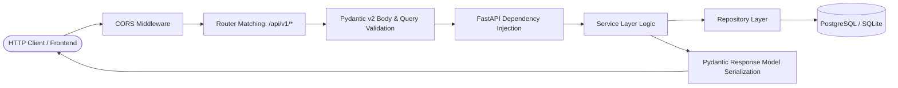
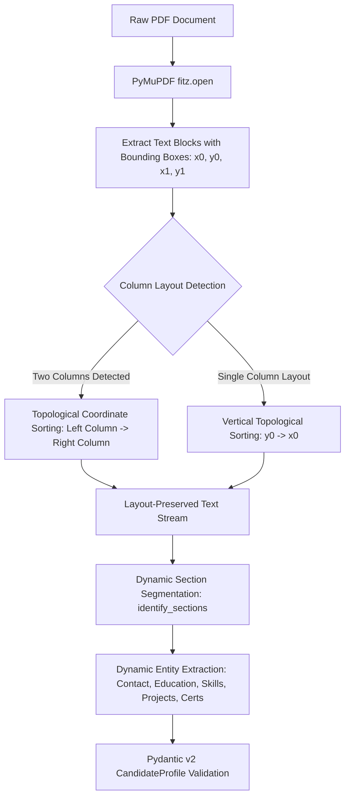

# Backend Service & Resume Parsing Engine

Welcome to the backend architecture and resume analysis engine for the **AI-Powered Internship Application and Career Assistant Platform (Milestone 1)**.

This service is engineered with **FastAPI**, **Pydantic v2**, and **PyMuPDF (`fitz`)**, delivering a high-throughput, local-first candidate ingestion pipeline. It processes multi-column PDF resumes, topologically reconstructs reading order, dynamically isolates semantic sections, and maps candidate profiles with strict type integrity.

---

## Table of Contents

1. [Architecture Overview](#1-architecture-overview)
   - [Project Directory Structure](#project-directory-structure)
   - [Request Lifecycle & Middleware](#request-lifecycle--middleware)
   - [Architecture Diagram](#architecture-diagram)
2. [Layout-Aware Resume Parsing Pipeline](#2-layout-aware-resume-parsing-pipeline)
   - [Spatial Coordinate Extraction](#spatial-coordinate-extraction)
   - [Dynamic Section Segmentation](#dynamic-section-segmentation)
   - [Entity Extraction & Schema Mapping](#entity-extraction--schema-mapping)
3. [API Endpoints Reference](#3-api-endpoints-reference)
   - [Resume Analysis & Ingestion](#resume-analysis--ingestion)
   - [System Health](#system-health)
   - [Domain Endpoints Catalog](#domain-endpoints-catalog)
4. [Local Development & Running Guide](#4-local-development--running-guide)
   - [Environment Setup](#environment-setup)
   - [Running the Server](#running-the-server)
   - [Running Test Suites](#running-test-suites)

---

## 1. Architecture Overview

The backend follows **Clean Architecture** and **Layered Separation of Concerns**, ensuring high testability, loose coupling, and strict schema validation.

```
backend/
├── main.py                     # Root ASGI entry point (re-exports app)
├── requirements.txt            # Python dependencies
├── alembic/                    # Database migration scripts
│   ├── env.py
│   └── versions/
└── app/
    ├── main.py                 # FastAPI application instantiation & lifespan
    ├── core/                   # Infrastructure configuration
    │   ├── config.py           # Pydantic-settings application configuration
    │   ├── database.py         # Async SQLAlchemy 2.0 engine & session maker
    │   └── security.py         # Passlib bcrypt hashing & HS256 JWT tokens
    ├── api/                    # Presentation layer
    │   ├── deps.py             # FastAPI dependency injection (DB sessions, Auth)
    │   └── v1/
    │       ├── router.py       # Master API v1 router
    │       └── endpoints/
    │           ├── auth.py     # User registration, JWT login, and profile retrieval
    │           ├── resume.py   # Multi-column PDF parsing & layout extraction
    │           ├── profiles.py # Student profile CRUD operations
    │           ├── jobs.py     # Internship listings & semantic retrieval
    │           └── applications.py # Kanban application pipeline
    ├── models/                 # SQLAlchemy 2.0 ORM entity definitions
    │   ├── user.py
    │   ├── candidate.py
    │   ├── resume.py
    │   ├── skill.py
    │   ├── job.py
    │   └── application.py
    ├── repositories/           # Data access layer (async repository pattern)
    │   ├── base.py
    │   ├── user_repository.py
    │   ├── candidate_repository.py
    │   └── resume_repository.py
    ├── schemas/                # Pydantic v2 DTOs and serialization schemas
    │   ├── auth.py
    │   ├── candidate.py
    │   ├── resume.py
    │   ├── job.py
    │   └── application.py
    └── services/               # Pure business logic layer
        ├── pdf_service.py      # PyMuPDF spatial coordinate layout extraction
        ├── parser_service.py   # Dynamic heuristic & LLM resume parsing
        ├── embedding_service.py# Local dense vector embeddings (bge-small-en-v1.5)
        ├── auth_service.py     # Authentication logic
        ├── candidate_service.py# Candidate profile state manager
        └── storage_service.py  # Local filesystem artifact storage
```

### Request Lifecycle & Middleware



1. **CORS Middleware:** Configured in `app/main.py` via `CORSMiddleware` using `settings.CORS_ORIGINS` (defaults to `http://localhost:3000` and `http://127.0.0.1:3000`). Allows credentials, standard HTTP verbs (`GET`, `POST`, `PUT`, `PATCH`, `DELETE`, `OPTIONS`), and arbitrary headers.
2. **Error Handling & Normalization:**
   - `RequestValidationError`: Trapped globally to return uniform JSON payloads with exact field-level validation errors under HTTP 422.
   - `HTTPException`: Standardized HTTP error responses.
   - `Exception`: Global catch-all handler returning structured HTTP 500 without leaking sensitive tracebacks in production mode.
3. **Lifespan Manager:** Handles startup initialization (ensuring upload directories exist) and teardown disposal of the async database connection pool (`engine.dispose()`).

---

## 2. Layout-Aware Resume Parsing Pipeline

Standard text extraction tools (like basic `pypdf` or `pdfminer`) parse PDF text linearly according to internal PDF stream object order. In multi-column resumes, this causes horizontal interleaving (e.g., column 1 sentence fragments mixed with column 2 headings).

Our pipeline completely resolves this via a 3-stage process implemented in `PDFExtractionService` and `ResumeParserService`:



### Spatial Coordinate Extraction

`PDFExtractionService.extract_text_from_pdf` (in [app/services/pdf_service.py](file:///c:/Users/Daksh/Desktop/M1InfosysSpringboard/backend/app/services/pdf_service.py)) extracts every text block along with its spatial bounding coordinates:

$$(x_0, y_0, x_1, y_1)$$

- **Column Boundary Split:** Computes a horizontal partition boundary at:
  $$\text{split\_x} = \text{page\_width} \times 0.45$$
- **Block Classification:**
  - Left Column: Blocks where $x_1 \le \text{split\_x} + 20$
  - Right Column: Blocks where $x_0 \ge \text{split\_x} - 20$
  - Top Spanning Header: Blocks across the full page width where $y_1 < \text{page\_height} \times 0.25$
  - Bottom Spanning Footer: Blocks across the full page width where $y_1 \ge \text{page\_height} \times 0.25$
- **Topological Sorting:**
  - Left column blocks are sorted primarily by vertical band ($y_0$) and secondarily by $x_0$: `key=lambda b: (round(b[1] / 10), b[0])`
  - Right column blocks are sorted using the same topological rule.
  - Final stream concatenates: `Spanning Top -> Left Column -> Right Column -> Spanning Bottom`.

### Dynamic Section Segmentation

`PDFExtractionService.identify_sections` processes the sorted text stream into typed blocks without assuming rigid layout or casing:

- **Supported Standard Headers:**
  - `SUMMARY`: Professional Summary, Objective, Profile, About Me
  - `EDUCATION`: Academic Background, Studies, Educational Qualifications
  - `EXPERIENCE`: Work History, Professional Experience, Internships
  - `PROJECTS`: Key Projects, Featured Projects, Technical Projects
  - `SKILLS`: Technical Skills, Competencies, Tech Stack, Core Competencies
  - `CERTIFICATIONS`: Certifications & Awards, Licenses, Courses, Accreditations
  - `AWARDS`: Honors, Achievements, Publications
  - `LANGUAGES`: Spoken Languages, Language Proficiency
- **Header Matching Strategy:**
  - Matches short lines ($\le 5$ words) case-insensitively, stripping markdown hashes (`#`), bullet points (`*`, `-`, `•`), colons, and whitespace.
  - Groups all subsequent lines into that section until a new section header is encountered.

### Entity Extraction & Schema Mapping

`ResumeParserService._parse_heuristically` (in [app/services/parser_service.py](file:///c:/Users/Daksh/Desktop/M1InfosysSpringboard/backend/app/services/parser_service.py)) parses each section into typed Pydantic models with **zero hardcoded fallback templates**:

| Field | Extraction Algorithm | Output Format |
| :--- | :--- | :--- |
| **Full Name** | Analyzes the top 5 header lines, strips URLs, emails, phone numbers, and delimiters. Selects the first alphabetic phrase (1–4 words, $\le 40$ chars). | `str` (e.g., `"Daksh Singh"`) |
| **Email** | RFC 5322 regex: `\b[A-Za-z0-9._%+-]+@[A-Za-z0-9.-]+\.[A-Za-z]{2,}\b` | `str` (e.g., `"dakshs2803@gmail.com"`) |
| **Phone** | International & local telephony regex: `(?:\+?\d{1,3}[-.\s]?)?\(?\d{3,5}\)?[-.\s]?\d{3,5}[-.\s]?\d{3,5}` | `str` or `None` |
| **Social / Code Links** | Detects `github.com/<username>` and `linkedin.com/in/<username>` | `str` or `None` |
| **Institution** | Matches university/institute entities, technology institutes, colleges, and acronyms (`IIIT`, `NIT`, `IIT`, `BITS`). | `str` (e.g., `"Indian Institute of Information Technology Kottayam"`) |
| **Degree & Major** | Word-bounded pattern matching across `B.Tech`, `Bachelor`, `B.E.`, `B.S.`, `BSc`, `M.Tech`, `M.S.`, `Ph.D.` | `str` (e.g., `"Computer Science and Engineering undergraduate"`) |
| **CGPA / GPA** | Regex extraction of floating-point metrics: `(?:CGPA\|GPA)[:\s]*([0-9]\.[0-9]{1,2})` or `X.XX/10.0` or `X.XX/4.0` | `float` (e.g., `9.41`) |
| **Batch / Graduation Year** | Detects ranges like `2024–2028` (computing grad year `2028` and batch `"2024–2028"`) or single years in `2024–2035`. | `int` and `str` |
| **Skills Categorization** | Multi-category taxonomy match with boundary lookaheads (handling special tokens like `C++`, `C#`, `CI/CD`). | Categorized dictionary: `programming`, `cloud`, `ai_ml`, `analytical`, `frameworks_and_libraries`, `databases_and_vector_stores`, `tools_and_devops`. |
| **Projects** | Parses project blocks, extracts technology stacks from parentheses `(...)` or `Tech:` labels, and collects impact bullet points. | List of project objects with `title`, `technologies`, and `highlights`. |
| **Certifications** | Parses certification lines, stripping bullet points and validating against educational accreditation keywords. | `List[str]` |

---

## 3. API Endpoints Reference

### Resume Analysis & Ingestion

#### `POST /api/v1/resume/analyze` or `POST /api/v1/resume/parse`

Uploads and processes a candidate's resume PDF through layout-aware coordinate extraction and Pydantic schema validation.

- **Request Type:** `multipart/form-data`
- **Request Headers:**
  - `Content-Type: multipart/form-data`
- **Form Parameters:**
  - `file`: Binary PDF file (maximum recommended size: 10MB)

##### Example `curl` Request

```bash
curl -X POST "http://localhost:8000/api/v1/resume/analyze" \
  -H "Accept: application/json" \
  -F "file=@Daksh_Resume_2.pdf;type=application/pdf"
```

##### Successful Response Payload (`HTTP 200 OK`)

```json
{
  "status": "SUCCESS",
  "engine": "PyMuPDF_v1.24 (layout-aware coordinate sorting) + Pydantic_v2",
  "file_metadata": {
    "filename": "Daksh_Resume_2.pdf",
    "file_size_bytes": 104681,
    "sha256": "4a7b98f2441a7d65c...",
    "layout_aware_reading_order": true,
    "detected_columns": 2,
    "extracted_at": "2026-11-18T13:00:00.000000"
  },
  "candidate_profile": {
    "full_name": "Daksh Singh",
    "email": "dakshs2803@gmail.com",
    "phone": "+91-9876543210",
    "github_url": "https://github.com/daksh-singh",
    "linkedin_url": null,
    "institution": "Indian Institute of Information Technology Kottayam (IIIT Kottayam)",
    "degree": "Computer Science and Engineering undergraduate",
    "cgpa": 9.41,
    "graduation_year": 2028,
    "batch": "2024–2028",
    "detected_sections": [
      "Contact Information",
      "Education",
      "Technical Skills",
      "Featured Projects",
      "Certifications & Achievements"
    ],
    "skills": {
      "programming": ["Java", "Python", "C++"],
      "cloud": ["AWS Cloud"],
      "ai_ml": ["Machine Learning", "LLMs", "Retrieval-Augmented Generation / RAG"],
      "analytical": ["Data Cleaning", "Exploratory Data Analysis / EDA"],
      "languages": ["Java", "Python", "C++"],
      "frameworks_and_libraries": ["LangChain", "Streamlit", "Ollama", "Groq", "DeepSeek-R1"],
      "tools_and_devops": ["AWS Cloud", "Docker", "Git"],
      "databases_and_vector_stores": ["Pandas", "NumPy", "Matplotlib"]
    },
    "projects": [
      {
        "title": "AI Lawyer Chatbot",
        "technologies": ["Groq", "LangChain", "Streamlit", "DeepSeek-R1", "Ollama"],
        "highlights": [
          "Engineered conversational legal consultation chatbot using DeepSeek-R1 and Ollama.",
          "Implemented low-latency LLM inference pipelines using Groq and LangChain retrieval workflows.",
          "Built intuitive, interactive web client interface using Streamlit."
        ]
      },
      {
        "title": "UIDAI Data Hackathon-2026",
        "technologies": ["Python", "Pandas", "NumPy", "Matplotlib"],
        "highlights": [
          "Conducted high-depth data cleaning and exploratory data analysis (EDA) across massive datasets.",
          "Computed statistical aggregations and matrix computations using NumPy and Pandas.",
          "Constructed comprehensive distribution visualizations and anomaly dashboards via Matplotlib."
        ]
      }
    ],
    "work_experiences": [],
    "certifications": [
      "Oracle Cloud Infrastructure 2025 Certified Generative AI Professional",
      "Complete Data Science, Machine Learning, DL, NLP Bootcamp - Krish Naik"
    ]
  }
}
```

##### Error Responses

- **`HTTP 400 Bad Request`**: Uploaded file is empty or filename does not end in `.pdf`.
- **`HTTP 422 Unprocessable Entity`**: Multipart file parameter missing from request body.
- **`HTTP 500 Internal Server Error`**: Unexpected PDF parsing or corruption exception.

---

### System Health

#### `GET /health`

Returns the operational status, current version, and active environment.

```json
{
  "status": "ok",
  "service": "AI-Powered Internship Application and Career Platform",
  "version": "1.0.0",
  "environment": "development",
  "debug": false
}
```

---

### Domain Endpoints Catalog

| Method | Endpoint | Description |
| :--- | :--- | :--- |
| `POST` | `/api/v1/auth/register` | Register student/candidate user account |
| `POST` | `/api/v1/auth/login` | Authenticate credentials and issue HS256 JWT access token |
| `GET` | `/api/v1/auth/me` | Fetch authenticated identity profile |
| `POST` | `/api/v1/profiles` | Create or update candidate identity profile |
| `GET` | `/api/v1/profiles/me` | Retrieve current candidate academic profile |
| `GET` | `/api/v1/jobs` | Paginated search of internship listings (with semantic search) |
| `POST` | `/api/v1/applications` | Create internship application record |
| `GET` | `/api/v1/applications/kanban` | Retrieve candidate multi-stage Kanban application board |

---

## 4. Local Development & Running Guide

### Environment Setup

#### Prerequisites
- **Python:** Version `3.11+` or `3.13`
- **Package Manager:** `pip`

#### 1. Create and Activate Virtual Environment

**Windows (PowerShell):**
```powershell
python -m venv backend/venv
.\backend\venv\Scripts\Activate.ps1
```

**macOS / Linux:**
```bash
python3 -m venv backend/venv
source backend/venv/bin/activate
```

#### 2. Install Dependencies

Install all pinned dependencies:

```bash
pip install -r backend/requirements.txt
```

---

### Running the Server

Start the Uvicorn ASGI server with hot-reloading:

```bash
# From within the backend/ directory:
uvicorn main:app --reload --port 8000

# Or from the project root:
uvicorn app.main:app --app-dir backend --reload --port 8000
```

Once started:
- **API Base URL:** `http://localhost:8000`
- **Interactive Swagger Docs (OpenAPI):** `http://localhost:8000/docs`
- **ReDoc Interactive Reference:** `http://localhost:8000/redoc`

---

### Running Test Suites

Verify backend integrity and proof-of-concept pipelines using the built-in validation test runners:

```bash
# 1. Run Complete Backend Validation Suite (6/6 Suites)
python backend/tests/run_tests.py

# 2. Run PoC 1: PyMuPDF Layout-Aware Coordinate Extraction Test
python tests/poc/test_pdf_extraction.py

# 3. Run PoC 2: Structured Candidate Profile Parsing & Pydantic Validation Test
python tests/poc/test_profile_parsing.py
```
