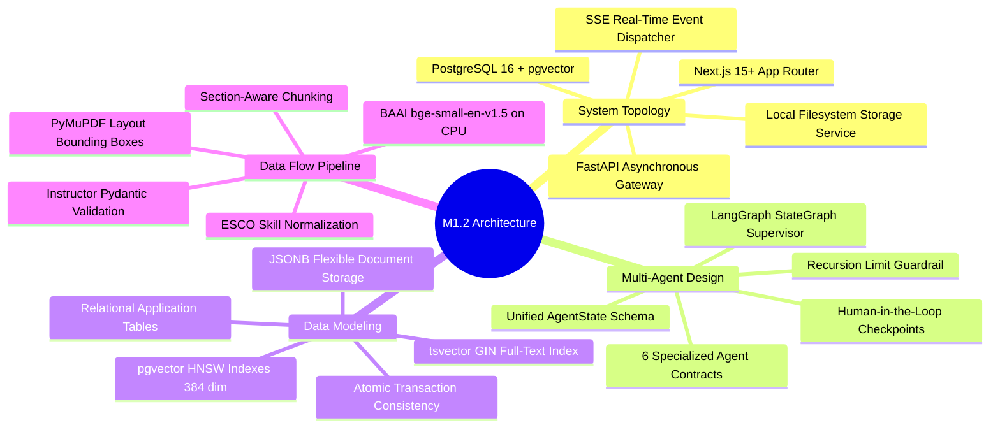

# Executive Summary — Milestone 1.2: System Architecture Design

**Document Version:** 1.0.0  
**Status:** Completed  
**Author:** Senior AI Systems Architect  
**Project:** AI-Powered Internship Application and Career Assistance Platform  
**Target Milestone:** Milestone 1 — M1.2 System Architecture  

---

## 1. Executive Summary

Milestone 1.2 establishes the comprehensive system architecture, data models, multi-agent coordination contracts, and resume processing pipelines for the **AI-Powered Internship Application and Career Assistance Platform**.

Building directly upon the foundational research completed in Milestone 1.1, the architectural specifications delivered in this milestone provide an actionable, production-grade technical blueprint. The system balances **agentic intelligence**, **relational consistency**, and **strict zero-cost, local-first execution constraints**.

---

## 2. Core Architectural Decisions Summary

| Architectural Domain | Selected Technology / Design | Decisive Design Justification | Zero-Cost & Anti-Overengineering Guarantee |
| :--- | :--- | :--- | :--- |
| **User Interface Layer** | **Next.js 15+ (React 19, TypeScript, Tailwind CSS, shadcn/ui)** | Native Server Components (RSC) for public job SEO + Server-Sent Events (SSE) for streaming agent reasoning without UI blocking. | Free open-source client; runs locally on Node.js 20 LTS. |
| **Backend & API Layer** | **FastAPI (Python 3.11+, Pydantic v2)** | High-performance asynchronous event loop; native in-process access to Python AI/ML ecosystem; automatic OpenAPI 3.1 generation. | Free open-source runtime; sub-millisecond route execution. |
| **Database & Vector Engine** | **PostgreSQL 16 + `pgvector`** | Unified relational and vector database. Embeddings stored as native `vector(384)` columns; ACID consistency prevents data drift. | Eliminates dedicated external vector database clusters ($0.00 infrastructure cost). |
| **AI Multi-Agent Framework** | **LangGraph (`StateGraph`)** | Deterministic computational graphs; explicit conditional edges; native Human-in-the-Loop breakpoints; hard recursion ceiling. | Prevents non-deterministic runaway agent loops and excessive token drain. |
| **LLM & Inference Engine** | **LiteLLM + Local Ollama (`llama3.2` / `qwen2.5`)** | Standardized OpenAI-compatible interface backed by local open-weight instruction models; Instructor enforces Pydantic schemas. | **100% Free & Local**; zero API keys; zero credit cards; runs entirely offline. |
| **Embedding Generation** | **`BAAI/bge-small-en-v1.5` (CPU via SentenceTransformers)** | Verified 62.17 overall MTEB v1 average (56 tasks), 51.68 BEIR retrieval average (15 datasets); compact 384 dimensions. | Runs locally in-memory on CPU ($0.00 API cost). |
| **Document Layout Extraction** | **`PyMuPDF` (`fitz`)** | Spatial bounding-box coordinate extraction resolves multi-column resume layout interleaving bugs without legacy regex. | High-speed C-compiled local binary; zero external cloud parsing fees. |
| **File Storage Layer** | **Local Filesystem Service (`LocalStorageService`)** | Abstract Python storage driver storing uploaded PDFs under `./data/uploads/resumes/` with SHA-256 deduplication. | **Zero Cloud Dependencies**; replaces Cloudflare R2 as a required component; $0.00 cost. |
| **Search & Retrieval** | **Hybrid Search (Dense HNSW + Sparse BM25 via RRF)** | Combines semantic concept matching with exact keyword recall; re-ranked via local Cross-Encoder (`ms-marco-MiniLM-L-6-v2`). | Fully implemented within PostgreSQL and local CPU transformers. |

---

## 3. Traceability to Milestone 1.1 Research Findings

Every architectural component designed in M1.2 maps directly to a proven finding or requirement from M1.1:

1. **Harvard Employer Finding Addressed:** Research proved that 88% of surveyed employers filter out qualified candidates due to rigid keyword screening. The architecture solves this via **ESCO/O*NET taxonomy normalization** and **two-stage hybrid search**, ensuring candidates matching concepts rather than exact lexical tokens are surfaced.
2. **Elimination of Multi-Column ATS Failures:** M1.1 highlighted that multi-column CVs scramble text order. The M1.2 data flow pipeline introduces **PyMuPDF bounding-box sorting** to linearize text columns before passing to the LLM.
3. **Prevention of Hallucinated Credentials:** In accordance with M1.1 hallucination guardrails, the `Resume Agent` incorporates automated **Natural Language Inference (NLI) entailment checks** to verify rewritten bullets against source profile chunks.
4. **Preservation of Zero-Cost Mandate:** All architectural designs strictly prohibit mandatory paid cloud services, proprietary embedding APIs, or credit-card-gated infrastructure.

---

## 4. Deliverables Index & Artifact Map

| Artifact Name | Workspace Path | Content Summary |
| :--- | :--- | :--- |
| **System Architecture** | [`docs/architecture/system-architecture.md`](file:///c:/Users/Daksh/Desktop/M1InfosysSpringboard/docs/architecture/system-architecture.md) | Component topology, layer decomposition, network security, Docker Compose deployment model. |
| **Agent Specifications** | [`docs/architecture/agent-specifications.md`](file:///c:/Users/Daksh/Desktop/M1InfosysSpringboard/docs/architecture/agent-specifications.md) | Granular contracts for all 6 agents (Pydantic schemas, tools, RAG needs, workflows, state machine). |
| **Data Schema & DDL** | [`docs/architecture/data-schema.md`](file:///c:/Users/Daksh/Desktop/M1InfosysSpringboard/docs/architecture/data-schema.md) | PostgreSQL 16 DDL, `pgvector` HNSW index definitions, ER diagram, and data dictionary. |
| **Data Flow Pipeline** | [`docs/architecture/data-flow.md`](file:///c:/Users/Daksh/Desktop/M1InfosysSpringboard/docs/architecture/data-flow.md) | Step-by-step resume extraction, normalization, section-aware chunking, and embedding persistence. |
| **Executive Summary** | [`docs/architecture/M1.2-summary.md`](file:///c:/Users/Daksh/Desktop/M1InfosysSpringboard/docs/architecture/M1.2-summary.md) | Architectural synthesis, traceability matrix, and M1.3 transition roadmap. |

---

## 5. Transition Roadmap to Milestone 1.3 (Proof of Concept Implementation)

With the system architecture, schemas, agent contracts, and data flows formally specified, the project is ready to proceed to **Milestone 1.3: Proof of Concept (PoC) Implementation**.

### Milestone 1.3 Action Items:
1. **Local PDF Ingestion PoC (`tests/poc/test_pdf_extraction.py`):**
   - Implement `PyMuPDF` coordinate-based text extraction.
   - Verify layout reconstruction on single-column and multi-column student resumes.
2. **Structured Profile Extraction PoC (`tests/poc/test_profile_parsing.py`):**
   - Connect LiteLLM to local Ollama (`llama3.2` or `qwen2.5`).
   - Validate Instructor Pydantic schema enforcement on sample raw resumes.
3. **Local Hybrid Matcher PoC (`tests/poc/test_hybrid_matching.py`):**
   - Embed extracted project chunks using `BAAI/bge-small-en-v1.5` on CPU.
   - Execute dense vector search and BM25 lexical search over sample job descriptions.
   - Measure Cross-Encoder re-ranking precision on target developer hardware.
4. **LangGraph Micro-Workflow PoC (`tests/poc/test_agent_graph.py`):**
   - Compile a minimal LangGraph StateGraph executing the `Job-Resume Matching Agent` $\rightarrow$ `Skill Gap Agent` sequential pipeline.

---

**Milestone 1.2 is complete and awaiting your review before initiating Milestone 1.3.**
