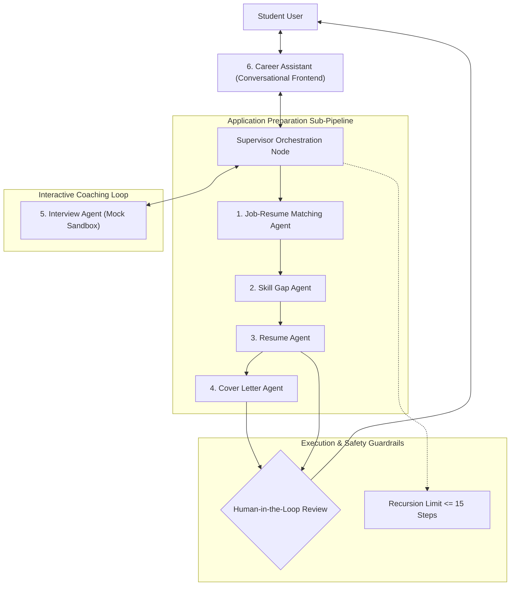
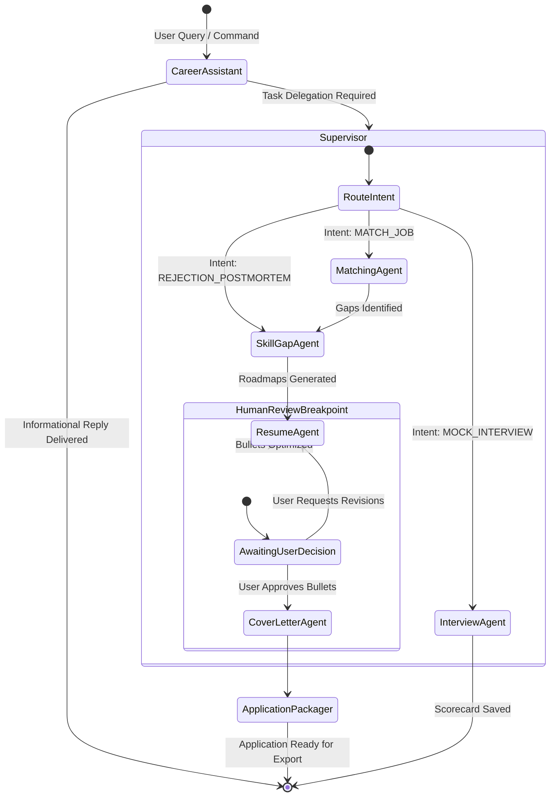

# Multi-Agent Specifications & Coordination Architecture

**Document Version:** 1.0.0  
**Status:** Completed  
**Author:** Senior AI Systems Architect  
**Project:** AI-Powered Internship Application and Career Assistance Platform  
**Target Milestone:** Milestone 1 — M1.2 System Architecture  

---

## 1. Multi-Agent Orchestration Architecture

The platform's intelligence is distributed across six specialized, autonomous agents coordinated via **LangGraph**. Rather than relying on a single monolithic prompt with bloated instructions, each agent possesses bounded cognitive scope, dedicated input/output schemas, scoped tool definitions, and explicit state transition boundaries.



### 1.1 Central Orchestrator & State Schema (`AgentState`)

All agent interactions share a centralized, type-safe Pydantic state object passed between nodes in the LangGraph graph:

```python
from datetime import datetime
from typing import Annotated, Any, Dict, List, Literal, Optional
from pydantic import BaseModel, Field


class AgentState(BaseModel):
  """Unified state schema managed across the LangGraph multi-agent execution pipeline."""

  # Session & User Identity
  session_id: str = Field(description="Unique session identifier for the run")
  candidate_id: str = Field(description="Target student candidate UUID")
  created_at: datetime = Field(default_factory=datetime.utcnow)

  # Context Payloads
  candidate_profile: Dict[str, Any] = Field(
      default_factory=dict, description="Structured parsed profile of student"
  )
  target_job: Optional[Dict[str, Any]] = Field(
      default=None, description="Target job description and requirements"
  )

  # Intermediate Agent Deliverables
  match_report: Optional[Dict[str, Any]] = Field(
      default=None, description="Diagnostic output from Matching Agent"
  )
  skill_gap_report: Optional[Dict[str, Any]] = Field(
      default=None, description="Actionable gap roadmap from Skill Gap Agent"
  )
  tailored_resume_bullets: Optional[List[Dict[str, Any]]] = Field(
      default=None, description="Optimized STAR bullets from Resume Agent"
  )
  cover_letter_markdown: Optional[str] = Field(
      default=None, description="Drafted narrative from Cover Letter Agent"
  )
  interview_transcript: List[Dict[str, str]] = Field(
      default_factory=list, description="Multi-turn interview dialogue"
  )
  interview_scorecard: Optional[Dict[str, Any]] = Field(
      default=None, description="Grading report from Interview Agent"
  )

  # Execution Routing & Guardrails
  current_agent: str = Field(
      default="CareerAssistant", description="Currently executing node"
  )
  next_agent: Optional[str] = Field(
      default=None, description="Next node designated by Supervisor"
  )
  is_human_review_required: bool = Field(
      default=False, description="Flag pausing execution for student acceptance"
  )
  execution_steps: int = Field(
      default=0, ge=0, le=15, description="Guardrail step counter"
  )
  error_trace: Optional[str] = Field(
      default=None, description="Captured exception diagnostic"
  )
```

### 1.2 Loop Termination & Human-in-the-Loop (HITL) Checkpoints
1. **Hard Recursion Ceiling:** The LangGraph engine enforces `recursion_limit=15`. If the step count exceeds 15 without a terminal state, execution halts immediately and routes to an error recovery handler.
2. **Approval Breakpoint on Resume Tailoring:** When the `Resume Agent` optimizes bullet points, the state machine sets `is_human_review_required=True` and pauses. The student must approve or edit the proposed bullets before the changes can update the master profile or be ingested by the `Cover Letter Agent`.
3. **Application Export Breakpoint:** Generated cover letters and customized application packets cannot be exported without student review.

---

## 2. In-Depth Specifications for the Six Core Agents

---

### Agent 1: Job-Resume Matching Agent

#### 1. Primary Responsibility
Analyzes candidate qualifications against target job descriptions, computing multidimensional semantic and lexical fit scores (0–100) and generating an explainable, audit-grade alignment diagnostic.

#### 2. Input and Output Schemas

- **Input Contract (`MatchingInput`):**
```python
class MatchingInput(BaseModel):
  candidate_id: str
  candidate_skills: List[str]
  candidate_projects: List[Dict[str, Any]]
  candidate_education: Dict[str, Any]
  job_id: str
  job_title: str
  job_requirements: List[str]
  preferred_qualifications: List[str] = Field(default_factory=list)
```

- **Output Contract (`MatchingOutput`):**
```python
class SkillAlignment(BaseModel):
  skill_name: str
  status: Literal["DIRECT_MATCH", "TRANSFERABLE_MATCH", "MISSING"]
  evidence: Optional[str] = None
  substitute_skill: Optional[str] = None


class MatchingOutput(BaseModel):
  overall_match_score: int = Field(
      ge=0, le=100, description="Weighted composite match score"
  )
  technical_skill_score: int = Field(ge=0, le=100)
  project_alignment_score: int = Field(ge=0, le=100)
  education_eligibility_score: int = Field(ge=0, le=100)
  skills_breakdown: List[SkillAlignment]
  matching_strengths: List[str]
  critical_missing_skills: List[str]
  cross_encoder_semantic_confidence: float = Field(ge=0.0, le=1.0)
  match_verdict: Literal["STRONG_MATCH", "COMPETITIVE_MATCH", "SKILL_GAP_HEAVY"]
```

#### 3. Required Tools
- `vector_search_tool(query_vector: List[float], top_k: int = 25) -> List[ChunkResult]`: Queries `pgvector` HNSW index for semantically relevant candidate project chunks.
- `lexical_bm25_tool(query_terms: str) -> List[TextMatch]`: Performs full-text SQL matching across PostgreSQL `tsvector` indexes for exact skill strings.
- `cross_encoder_rerank_tool(query: str, documents: List[str]) -> List[RerankResult]`: Invokes local `ms-marco-MiniLM-L-6-v2` transformer to score cross-attention relevance between resume text and JD clauses.
- `taxonomy_normalizer_tool(raw_skills: List[str]) -> List[StandardSkill]`: Maps arbitrary user skill tags to standard ESCO / O*NET taxonomy concepts.

#### 4. RAG Utilization
- **Needs RAG:** **Yes**.
- **Corpus:** Target job description requirements, employer tech stack chunks, and candidate project repository embeddings.
- **Retrieval Strategy:** Two-stage hybrid search (Dense HNSW + BM25 combined via Reciprocal Rank Fusion, followed by Cross-Encoder re-ranking).

#### 5. Inter-Agent Communication
- **Triggered By:** Supervisor Node (upon user selecting a job or requesting automated discovery).
- **Emits State To:** `Skill Gap Agent` (passes `critical_missing_skills`) and `Resume Agent` (passes `skills_breakdown` and `matching_strengths`).

#### 6. Sample Execution Workflow
1. Ingests candidate profile and JD from `AgentState`.
2. Normalizes skills (e.g., maps `FastAPI` $\rightarrow$ `Python REST Frameworks`).
3. Executes hybrid search on candidate project chunks against JD requirements.
4. Re-ranks top-25 chunks with the Cross-Encoder.
5. Computes composite formula:
   $$\text{Score} = 0.40(\text{Tech Skills}) + 0.35(\text{Project Alignment}) + 0.15(\text{Education}) + 0.10(\text{Soft Skills})$$
6. Emits `MatchingOutput` to `AgentState`.

---

### Agent 2: Skill Gap Agent

#### 1. Primary Responsibility
Translates missing and weak competencies identified by the Matching Agent into a structured, actionable 30/60/90-day learning roadmap complete with vetted, free learning resources and portfolio project ideas.

#### 2. Input and Output Schemas

- **Input Contract (`SkillGapInput`):**
```python
class SkillGapInput(BaseModel):
  candidate_id: str
  target_role: str
  critical_missing_skills: List[str]
  skills_breakdown: List[SkillAlignment]
  student_available_hours_per_week: int = Field(
      default=10, ge=1, le=40, description="Available study hours"
  )
```

- **Output Contract (`SkillGapOutput`):**
```python
class ActionItem(BaseModel):
  skill: str
  priority: Literal["HIGH", "MEDIUM", "LOW"]
  remediation_hours: int
  curated_resource_title: str
  curated_resource_url: str
  hands_on_project_spec: str


class RoadmapPhase(BaseModel):
  timeframe: Literal["IMMEDIATE_7_DAYS", "SHORT_TERM_30_DAYS", "EXTENDED_60_DAYS"]
  actions: List[ActionItem]


class SkillGapOutput(BaseModel):
  gap_severity: Literal["MINIMAL", "MODERATE", "SUBSTANTIAL"]
  total_remediation_hours_estimated: int
  roadmap_phases: List[RoadmapPhase]
  reassurance_statement: str
```

#### 3. Required Tools
- `learning_resource_retriever_tool(skill: str) -> List[Resource]`: Queries local vector index of vetted, free open-source tutorials, official documentation (e.g., Python docs, Docker guides, MDN), and YouTube courses.
- `project_architecture_ideator_tool(missing_skills: List[str]) -> ProjectSpec`: Formulates portfolio-grade project ideas that integrate the missing technologies into the candidate's existing projects.

#### 4. RAG Utilization
- **Needs RAG:** **Yes**.
- **Corpus:** Curated database of free technical learning materials, official documentation links, and project architectural templates.
- **Retrieval Strategy:** Dense semantic search matching missing skill concepts against documentation chunks.

#### 5. Inter-Agent Communication
- **Triggered By:** `Job-Resume Matching Agent` (upon completion of match breakdown) or `Application Tracking Module` (upon rejection post-mortem event).
- **Emits State To:** `Resume Agent` (to inform which newly learned skills or projects to highlight) and `Career Assistant` (for conversational student mentoring).

#### 6. Sample Execution Workflow
1. Receives `critical_missing_skills: ["Docker", "Redis"]` from `AgentState`.
2. Evaluates time requirement: 6 hours for Docker fundamentals, 4 hours for Redis caching.
3. Queries resource database for official Docker getting-started lab and Redis documentation.
4. Generates project spec: *"Containerize existing FastAPI task queue and add Redis caching layer."*
5. Compiles 30-day roadmap partitioned into weekly milestones.
6. Emits `SkillGapOutput` to `AgentState`.

---

### Agent 3: Resume Agent

#### 1. Primary Responsibility
Optimizes, reformats, and tailors candidate resume bullet points to align with target job requirements using Google's STAR/XYZ impact formula, enforcing strict anti-hallucination guardrails (never fabricating employers, dates, or skills).

#### 2. Input and Output Schemas

- **Input Contract (`ResumeOptimizationInput`):**
```python
class ProjectBulletToOptimize(BaseModel):
  project_id: str
  project_title: str
  original_bullet: str
  technologies_used: List[str]


class ResumeOptimizationInput(BaseModel):
  candidate_id: str
  target_job_title: str
  target_keywords_to_emphasize: List[str]
  bullets_to_optimize: List[ProjectBulletToOptimize]
```

- **Output Contract (`ResumeOptimizationOutput`):**
```python
class TailoredBullet(BaseModel):
  project_id: str
  original_bullet: str
  optimized_bullet: str
  action_verb_used: str
  measured_impact_highlighted: str
  keywords_incorporated: List[str]
  factual_grounding_verified: bool


class ATSAuditReport(BaseModel):
  syntactic_formatting_valid: bool
  estimated_keyword_density_score: int = Field(ge=0, le=100)
  formatting_warnings: List[str]


class ResumeOptimizationOutput(BaseModel):
  optimized_bullets: List[TailoredBullet]
  ats_audit: ATSAuditReport
  markdown_full_resume: str
```

#### 3. Required Tools
- `ats_linter_tool(markdown_content: str) -> ATSAuditReport`: Validates formatting against single-column ATS parsing rules, checking for non-standard characters, table structures, and hierarchy.
- `factual_grounding_checker_tool(original_text: str, rewritten_text: str) -> bool`: Computes Natural Language Inference (NLI) / semantic entailment between source facts and rewritten text to verify no external claims were fabricated.

#### 4. RAG Utilization
- **Needs RAG:** **Selective / Internal**.
- **Corpus:** The student's own verified project notes, course syllabi, and GitHub commit logs stored in their candidate profile. Does not query external open-web knowledge.

#### 5. Inter-Agent Communication
- **Triggered By:** `Supervisor Node` following `Matching Agent` execution.
- **Emits State To:** `Cover Letter Agent` and triggers a **Human-in-the-Loop review breakpoint** for student approval.

#### 6. Sample Execution Workflow
1. Ingests raw project bullet: *"Made a task queue in Python with Redis to process jobs."*
2. Identifies target JD keywords: `Asynchronous`, `Redis`, `Throughput`, `Latency`.
3. Restructures bullet using XYZ formula: *"Engineered an asynchronous task queue in Python and Redis, reducing background task latency by 35% through non-blocking I/O and connection pooling."*
4. Passes bullet to `factual_grounding_checker_tool` to confirm technologies match genuine candidate profile.
5. Runs ATS formatting linter.
6. Commits optimized bullets to `AgentState` and flags `is_human_review_required=True`.

---

### Agent 4: Cover Letter Agent

#### 1. Primary Responsibility
Drafts authentic, compelling, company-specific cover letters that connect the student's genuine academic projects and motivations directly to the employer's stated technical mission and requirements, eliminating generic template boilerplate.

#### 2. Input and Output Schemas

- **Input Contract (`CoverLetterInput`):**
```python
class CoverLetterInput(BaseModel):
  candidate_name: str
  candidate_degree: str
  candidate_university: str
  company_name: str
  target_job_title: str
  top_candidate_projects: List[Dict[str, Any]]
  company_mission_summary: Optional[str] = None
  preferred_tone: Literal["PROFESSIONAL_TECHNICAL", "STARTUP_ENTHUSIASTIC", "ACADEMIC_RESEARCH"] = "PROFESSIONAL_TECHNICAL"
```

- **Output Contract (`CoverLetterOutput`):**
```python
class CoverLetterOutput(BaseModel):
  cover_letter_markdown: str
  primary_technical_hook: str
  project_synergies_referenced: List[str]
  word_count: int
```

#### 3. Required Tools
- `prose_linter_tool(text: str) -> CleanText`: Audits drafted prose to strip clichéd phrases ("I am the ideal candidate", "thinking outside the box"), passive voice, and redundant filler.

#### 4. RAG Utilization
- **Needs RAG:** **Yes**.
- **Corpus:** Company technical blogs, mission statements, and target JD requirement paragraphs.

#### 5. Inter-Agent Communication
- **Triggered By:** Completion and student acceptance of `Resume Agent` outputs.
- **Emits State To:** `Application Tracking Module` (bundles into export package).

#### 6. Sample Execution Workflow
1. Ingests student's approved tailored project highlights and target company context.
2. Identifies technical overlap: Candidate's Redis queue project maps to Company's real-time metric ingestion engine.
3. Generates 3-paragraph structured letter (Hook $\rightarrow$ Deep Technical Demonstration $\rightarrow$ Professional Call to Action).
4. Runs prose linter to enforce concise, active voice.
5. Emits `CoverLetterOutput` to `AgentState`.

---

### Agent 5: Interview Agent

#### 1. Primary Responsibility
Conducts interactive, multi-turn mock interviews (behavioral and technical) customized to the target JD and candidate's resume, grading responses in real time using objective rubrics (STAR adherence, technical precision, communication).

#### 2. Input and Output Schemas

- **Input Contract (`InterviewTurnInput`):**
```python
class InterviewTurnInput(BaseModel):
  session_id: str
  interview_type: Literal["TECHNICAL_SYSTEMS", "BEHAVIORAL_STAR", "CODING_CONCEPTS"]
  target_job_title: str
  target_jd_text: str
  candidate_resume_summary: str
  current_turn_index: int = Field(ge=0, le=10)
  student_response_text: Optional[str] = None
  dialogue_history: List[Dict[str, str]] = Field(default_factory=list)
```

- **Output Contract (`InterviewTurnOutput`):**
```python
class TurnEvaluation(BaseModel):
  score_out_of_10: int = Field(ge=1, le=10)
  technical_accuracy_rating: Literal["ACCURATE", "PARTIALLY_ACCURATE", "INACCURATE", "NOT_APPLICABLE"]
  star_method_adherence: Optional[Literal["EXCELLENT", "ADEQUATE", "MISSING_RESULT", "UNSTRUCTURED"]]
  constructive_critique: str
  exemplar_response: str


class InterviewTurnOutput(BaseModel):
  turn_evaluation: Optional[TurnEvaluation] = None
  next_interviewer_question: Optional[str] = None
  is_interview_complete: bool
  cumulative_scorecard: Optional[Dict[str, Any]] = None
```

#### 3. Required Tools
- `interview_rubric_evaluator_tool(answer: str, question: str, rubric_type: str) -> TurnEvaluation`: Evaluates candidate answers against standardized engineering assessment criteria.
- `question_bank_retriever_tool(role_category: str, difficulty: str) -> List[Question]`: Retrieves curated, realistic interview questions asked for comparable student software engineering internships.

#### 4. RAG Utilization
- **Needs RAG:** **Yes**.
- **Corpus:** Curated interview question repositories, system design rubrics, and company-specific interview debriefs.

#### 5. Inter-Agent Communication
- **Triggered By:** Student initiating a mock interview session from the UI.
- **Emits State To:** Direct WebSocket/SSE connection to frontend, and persists final scorecards to PostgreSQL.

#### 6. Sample Execution Workflow
1. Synthesizes target JD tech stack with candidate's listed projects.
2. Selects opening technical question: *"In your task queue project, how did you handle worker crashes?"*
3. Ingests student's response.
4. Evaluates response against technical rubric (points out absence of dead-letter queue or heartbeat monitoring).
5. Provides encouraging constructive critique with an exemplar answer demonstrating production patterns.
6. Formulates adaptive follow-up question.
7. Upon completing 5 turns, generates a composite readiness scorecard.

---

### Agent 6: Career Assistant

#### 1. Primary Responsibility
Acts as the front-of-house conversational mentor and intent classifier. It answers student career questions, interprets platform diagnostics, provides emotional reassurance against rejection fatigue, and routes complex requests to specialized worker agents.

#### 2. Input and Output Schemas

- **Input Contract (`CareerAssistantInput`):**
```python
class CareerAssistantInput(BaseModel):
  candidate_id: str
  user_natural_language_query: str
  conversation_history: List[Dict[str, str]] = Field(default_factory=list)
```

- **Output Contract (`CareerAssistantOutput`):**
```python
class SuggestedAction(BaseModel):
  action_label: str
  target_agent_to_trigger: Optional[str] = None
  parameters: Dict[str, Any] = Field(default_factory=dict)


class CareerAssistantOutput(BaseModel):
  conversational_reply: str
  intent_classified: Literal["GENERAL_ADVICE", "MATCH_JOB", "TAILOR_RESUME", "MOCK_INTERVIEW", "EXPLAIN_GAP"]
  delegation_required: bool
  suggested_actions: List[SuggestedAction]
```

#### 3. Required Tools
- `intent_classifier_tool(query: str) -> ClassifiedIntent`: Maps free-text user messages to system commands and agent dispatch routes.
- `career_faq_retriever_tool(query: str) -> FAQContext`: Queries local knowledge base of university career center guidelines, internship application timelines, and visa/stipend FAQs.

#### 4. RAG Utilization
- **Needs RAG:** **Yes**.
- **Corpus:** Career advisory documents, internship timelines, and platform capability FAQs.

#### 5. Inter-Agent Communication
- **Triggered By:** Student sending a natural language message in the global chat drawer.
- **Emits State To:** Dispatches tasks to `Supervisor Node` to execute worker agents.

#### 6. Sample Execution Workflow
1. Ingests student query: *"I'm overwhelmed by backend requirements. What should I do first?"*
2. Classifies intent: `GENERAL_ADVICE` + `EXPLAIN_GAP`.
3. Ingests student's current profile from `AgentState`.
4. Formulates empathetic response highlighting that 88% of employers acknowledge screening filters are overly rigid, and reassures the student that focusing on core fundamentals (HTTP, relational DBs, Git) bridges most entry-level gaps.
5. Provides interactive action buttons: `[Review My 30-Day Skill Roadmap]` and `[Practice Beginner Backend Interview]`.

---

## 3. Multi-Agent System State Machine & Edge Transitions



---

## 4. Architectural References & Standards

1. **LangGraph StateGraph API:** *Stateful agent coordination with conditional edges*. [LangGraph Docs](https://langchain-ai.github.io/langgraph/)
2. **Pydantic v2 Core:** *Fast, Rust-backed data validation and schema generation*. [Pydantic Docs](https://docs.pydantic.dev/latest/)
3. **Instructor Library:** *Enforcing structured JSON outputs from local LLMs*. [Instructor Docs](https://python.useinstructor.com/)
4. **Google Careers Guidance:** *The STAR and XYZ Resume Formulas*. [Grow with Google](https://www.google.com/about/careers/applications/students/)
