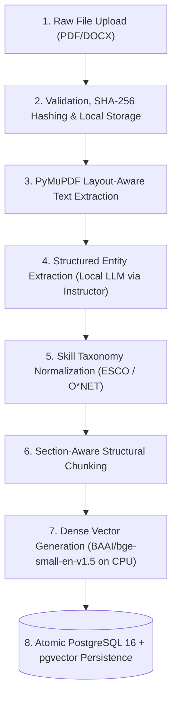
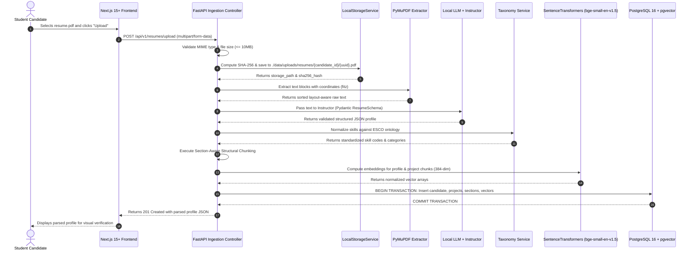
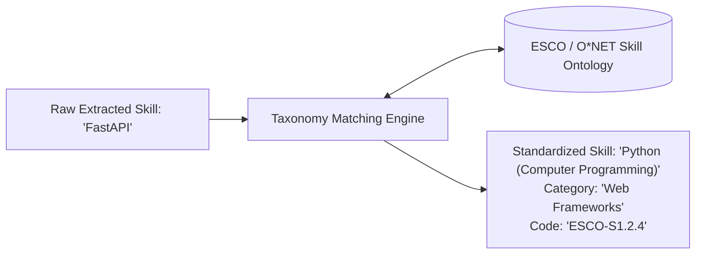

# Resume Ingestion, Extraction & Embedding Data Flow

**Document Version:** 1.0.0  
**Status:** Completed  
**Author:** Senior AI Systems Architect  
**Project:** AI-Powered Internship Application and Career Assistance Platform  
**Target Milestone:** Milestone 1 — M1.2 System Architecture  

---

## 1. Pipeline Overview & Objectives

The resume processing pipeline transforms unstructured candidate documents (PDF/DOCX) into normalized, queryable, and semantically embedded relational entities in PostgreSQL. 

The pipeline guarantees:
1. **Zero External Data Leakage:** All document parsing, extraction, normalization, and embedding execute 100% locally on developer hardware.
2. **Deterministic Schema Enforcement:** Raw text is validated into strict Pydantic v2 data models.
3. **Atomic Relational & Vector Persistence:** Profile attributes, project records, section chunks, and dense vectors (`vector(384)`) are committed within a single database transaction.
4. **Layout Preservation:** Multi-column layouts are parsed using visual bounding-box coordinates to eliminate column-interleaving errors.



---

## 2. Step-by-Step Data Flow Specifications



---

### Step 1: Raw File Upload & Input Validation

- **Client Action:** The student uploads a resume via the Next.js `ResumeUploadDropzone` component.
- **Payload:** `multipart/form-data` containing the binary stream and `candidate_id`.
- **Validation Rules:**
  1. *File Format:* Must be `application/pdf` or `application/vnd.openxmlformats-officedocument.wordprocessingml.document`. Binary magic bytes are inspected (`%PDF-` for PDF, `PK\x03\x04` for DOCX) rather than trusting client file extensions.
  2. *Size Ceiling:* Maximum file size is strictly capped at **10 MB**.
  3. *Zero Execution Risk:* File is treated purely as an inert binary stream; scripts and embedded macros are rejected.

---

### Step 2: Checksum Hashing & Local Filesystem Storage

- **Integrity Hashing:** A SHA-256 digest is computed over the raw byte stream:
  $$\text{Digest} = \text{SHA256}(\text{FileBytes})$$
- **Deduplication Check:** The database is queried for an existing `resumes` record matching `(candidate_id, sha256_hash)`. If found, redundant re-processing is aborted, and the existing profile is returned.
- **Local Storage Operation:** The file is persisted using the `LocalStorageService`:
  ```
  ./data/uploads/resumes/{candidate_id}/{file_uuid}.pdf
  ```
- **Security Control:** Path separators (`/`, `\`) are stripped from user-provided filenames, and the target path is cryptographically randomized via UUIDv4 to eliminate directory traversal vulnerabilities.

---

### Step 3: PyMuPDF Layout-Aware Text Extraction

Traditional parsers extract text in document stream order, which causes multi-column resumes to interleave horizontally across columns (e.g., reading line 1 of column 1, then line 1 of column 2).


- **Extraction Logic (`fitz` / `PyMuPDF`):**
  1. Iterate over PDF pages and extract text blocks with their coordinates: `(x0, y0, x1, y1, text, block_no, block_type)`.
  2. Cluster blocks by horizontal $x$-coordinates to identify physical columns.
  3. Sort text vertically within column boundaries ($y$-axis sorting), then concatenate columns from left to right.
  4. Perform Unicode normalization (`unicodedata.normalize('NFKD', text)`), resolving non-standard ligatures (e.g., converting `fi` to `fi`, `fl` to `fl`) and removing non-printable control characters.

---

### Step 4: Structured Entity Extraction via Local LLM & Instructor

The sanitized text stream is passed to the local LLM via `Instructor` to populate a strongly typed `Pydantic` schema:

```python
class EducationEntry(BaseModel):
  institution: str
  degree: str
  major: str
  gpa: Optional[float] = None
  graduation_year: int
  coursework: List[str] = Field(default_factory=list)


class ProjectEntry(BaseModel):
  title: str
  summary: str
  technologies: List[str]
  bullets: List[str]
  repo_url: Optional[str] = None


class WorkEntry(BaseModel):
  company: str
  role: str
  start_date: str
  end_date: Optional[str] = None
  bullets: List[str]
  technologies: List[str]


class ParsedResumeProfile(BaseModel):
  full_name: str
  email: str
  phone: Optional[str] = None
  linkedin_url: Optional[str] = None
  github_url: Optional[str] = None
  skills: List[str]
  education: List[EducationEntry]
  projects: List[ProjectEntry]
  work_experience: List[WorkEntry]
```

- **Execution Engine:** Local **Ollama** running `llama3.2:3b` or `qwen2.5:7b` via `LiteLLM`.
- **Validation Resilience:** If the local LLM generates invalid JSON or fails a Pydantic typing constraint (e.g., passing a string for `graduation_year`), `Instructor` catches the validation error and automatically re-prompts the model with the exact field failure message up to 2 times.

---

### Step 5: Skill Taxonomy Normalization

Raw extracted skill strings are frequently non-standard or synonymous (e.g., `FastAPI`, `fastapi-framework`, `Python Web`).



- **Normalization Workflow:**
  1. Exact string match against pre-compiled ESCO / O*NET dictionary.
  2. If exact match fails, compute character trigram cosine similarity against taxonomy concepts.
  3. If still unmapped, query local embedding similarity against skill category vectors.
  4. Persist mapped skills to `candidate_skills` table with confidence scores.

---

### Step 6: Section-Aware Structural Chunking

Rather than applying arbitrary sliding-window token chunking (which fractures semantic sentences), chunking is performed along functional document boundaries:

| Chunk Type | Content Payload | Metadata Attached |
| :--- | :--- | :--- |
| **Profile Summary Chunk** | Candidate name, degree, target career aspiration, top 10 verified skills. | `section_type: "SUMMARY"`, `candidate_id` |
| **Education Chunk** | University, major, GPA, core computer science curriculum courses. | `section_type: "EDUCATION"`, `gpa` |
| **Project Chunk (Atomic)** | Project title, problem solved, technologies used, XYZ impact bullets. | `section_type: "PROJECT"`, `tech_stack` |
| **Work Experience Chunk** | Employer, role title, duration, responsibilities, quantifiable metrics. | `section_type: "EXPERIENCE"`, `company` |

---

### Step 7: Dense Vector Generation (`BAAI/bge-small-en-v1.5`)

- **Model Execution:** Local execution on CPU via `sentence_transformers.SentenceTransformer("BAAI/bge-small-en-v1.5")`.
- **Embedding Generation:**
  $$\vec{v} = \text{Embed}(\text{ChunkText}) \in \mathbb{R}^{384}$$
- **Normalization:** Vectors are $L_2$-normalized:
  $$\vec{v}_{\text{norm}} = \frac{\vec{v}}{\|\vec{v}\|_2}$$
  Ensuring that inner product ($\vec{u} \cdot \vec{v}$) equals cosine similarity.
- **Mean-Pooled Overall Profile Vector:** An aggregate profile vector is computed by mean-pooling the project and skill chunk vectors, representing the student's holistic technical footprint in vector space for fast candidate-to-job recommendation indexing.

---

### Step 8: Atomic Database Persistence in PostgreSQL + pgvector

All parsed entities, relational rows, and dense vectors are persisted inside a **single atomic PostgreSQL transaction**:

```sql
BEGIN TRANSACTION;

-- 1. Insert primary resume record
INSERT INTO resumes (id, candidate_id, file_name, storage_path, sha256_hash, file_size_bytes, parsed_json)
VALUES ($1, $2, $3, $4, $5, $6, $7);

-- 2. Insert candidate skills
INSERT INTO candidate_skills (candidate_id, skill_id, proficiency)
VALUES ($2, $skill_id, 'INTERMEDIATE')
ON CONFLICT DO NOTHING;

-- 3. Insert individual projects with dense vectors
INSERT INTO projects (candidate_id, title, summary, bullets, technologies_used, embedding)
VALUES ($2, $title, $summary, $bullets, $tech_array, $vector_array);

-- 4. Insert section chunks with vectors for RAG retrieval
INSERT INTO resume_sections (resume_id, section_type, section_title, raw_text, embedding)
VALUES ($1, 'PROJECTS', $title, $raw_text, $vector_array);

-- 5. Update overall profile vector on candidate table
UPDATE candidates 
SET overall_profile_vector = $mean_pooled_vector,
    updated_at = CURRENT_TIMESTAMP
WHERE id = $2;

COMMIT TRANSACTION;
```

If any step fails (e.g., disk I/O error or constraint violation), the transaction rolls back completely, ensuring zero orphaned vectors or corrupt profiles.

---

## 3. Error Handling, Validation Rules & Recovery Logic

| Failure Mode | Trigger Condition | System Recovery Action |
| :--- | :--- | :--- |
| **Corrupted / Password-Protected PDF** | `PyMuPDF` throws `FileDataError` or `PasswordRequired`. | Immediate HTTP 422 Unprocessable Entity returned to client with user-facing message: *"Uploaded PDF is encrypted or corrupted. Please upload an unlocked PDF."* |
| **LLM Output Parsing Failure** | Local Ollama returns malformed JSON or times out. | `Instructor` catches failure; executes retry with schema correction prompt; if 2 retries fail, falls back to deterministic rule-based section regex extraction. |
| **Duplicate Resume Upload** | SHA-256 hash matches existing candidate upload. | System skips redundant re-parsing and embedding generation; returns existing parsed profile with HTTP 200 OK. |
| **Out-of-Memory (OOM) during Vectorization** | Excessive batch size passed to SentenceTransformers. | Extraction pipeline enforces batch size of 1 on CPU; chunks are embedded sequentially to maintain memory footprint $< 500\text{ MB}$. |

---

## 4. Architectural References & Standards

1. **PyMuPDF Documentation:** *Text Extraction with Spatial Geometry and Bounding Boxes*. [PyMuPDF Docs](https://pymupdf.readthedocs.io/)
2. **Pydantic v2 Documentation:** *Data Validation and Schema Enforcement*. [Pydantic Docs](https://docs.pydantic.dev/latest/)
3. **Sentence-Transformers:** *Computing Sentence and Text Embeddings with BGE*. [SBERT Docs](https://sbert.net/)
4. **PostgreSQL Documentation:** *Transaction Processing and Atomicity in PostgreSQL 16*. [Postgres Docs](https://www.postgresql.org/docs/16/tutorial-transactions.html)
