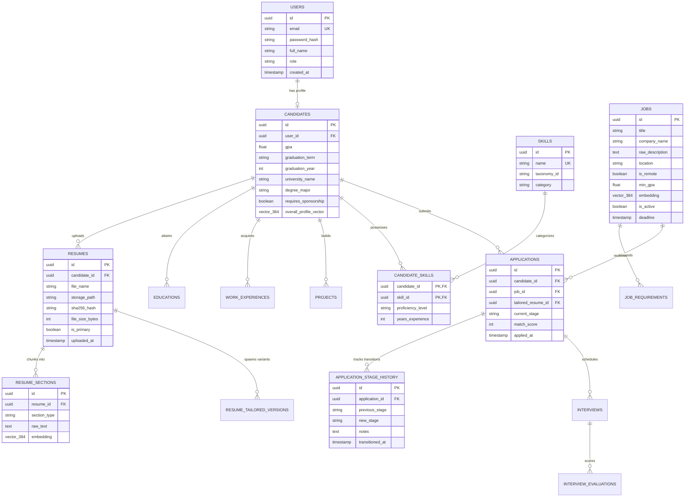

# Database Schema & Data Modeling Specification

**Document Version:** 1.0.0  
**Status:** Completed  
**Author:** Senior AI Systems Architect  
**Project:** AI-Powered Internship Application and Career Assistance Platform  
**Target Milestone:** Milestone 1 — M1.2 System Architecture  

---

## 1. Architectural Philosophy & Unified Database Strategy

The platform unifies **relational operational data** (users, jobs, applications, stage histories) and **high-dimensional vector embeddings** within a single **PostgreSQL 16** database equipped with the **`pgvector`** extension.

### Why Unified PostgreSQL + pgvector?
1. **Zero Dual-Database Synchronization Drift:** Storing vector embeddings as native columns (`vector(384)`) inside the same database engine as candidate and job records ensures atomic, transactional consistency (ACID). When a job is updated or deleted, its embedding vector is updated or pruned in the same transaction.
2. **Relational + Vector Query Fusion in Single SQL Statements:** Enables combining strict relational filters (e.g., minimum GPA, visa authorization, location) with approximate nearest neighbor (ANN) vector similarity in a single query:
   ```sql
   SELECT j.id, j.title, 1 - (j.embedding <=> candidate.embedding) AS similarity
   FROM jobs j, candidates candidate
   WHERE candidate.id = $1
     AND j.is_active = TRUE
     AND j.min_gpa <= candidate.gpa
   ORDER BY j.embedding <=> candidate.embedding
   LIMIT 10;
   ```
3. **Zero Operational Overhead:** Eliminates the operational complexity, memory bloat, and cost of deploying and managing a separate vector database cluster (such as Pinecone or Qdrant) alongside relational PostgreSQL.

---

## 2. Entity-Relationship (ER) Diagram



---

## 3. Production PostgreSQL 16 DDL Script

The following SQL script defines the complete, production-ready schema including extensions, domains, tables, constraints, foreign keys, and indexes:

```sql
-- ============================================================================
-- AI-Powered Internship Platform — Database Schema Definition (PostgreSQL 16)
-- ============================================================================

-- 1. Enable Required Extensions
CREATE EXTENSION IF NOT EXISTS "uuid-ossp";
CREATE EXTENSION IF NOT EXISTS "vector";

-- 2. Define Custom Enumerated Types
CREATE TYPE user_role_enum AS ENUM ('STUDENT', 'RECRUITER', 'ADMIN');
CREATE TYPE application_stage_enum AS ENUM (
    'WISHLIST',
    'APPLIED',
    'SCREENING',
    'TECHNICAL_ASSESSMENT',
    'INTERVIEW',
    'OFFER',
    'REJECTED',
    'WITHDRAWN'
);
CREATE TYPE resume_section_type_enum AS ENUM (
    'EDUCATION',
    'EXPERIENCE',
    'PROJECTS',
    'SKILLS',
    'CERTIFICATIONS',
    'SUMMARY'
);
CREATE TYPE skill_proficiency_enum AS ENUM ('BEGINNER', 'INTERMEDIATE', 'ADVANCED', 'EXPERT');

-- ============================================================================
-- 3. Identity & Candidate Profile Tables
-- ============================================================================

CREATE TABLE users (
    id UUID PRIMARY KEY DEFAULT uuid_generate_v4(),
    email VARCHAR(255) NOT NULL UNIQUE,
    password_hash VARCHAR(255) NOT NULL,
    full_name VARCHAR(255) NOT NULL,
    role user_role_enum NOT NULL DEFAULT 'STUDENT',
    is_active BOOLEAN NOT NULL DEFAULT TRUE,
    created_at TIMESTAMPTZ NOT NULL DEFAULT CURRENT_TIMESTAMP,
    updated_at TIMESTAMPTZ NOT NULL DEFAULT CURRENT_TIMESTAMP
);

CREATE TABLE candidates (
    id UUID PRIMARY KEY DEFAULT uuid_generate_v4(),
    user_id UUID NOT NULL UNIQUE REFERENCES users(id) ON DELETE CASCADE,
    university_name VARCHAR(255) NOT NULL,
    degree_major VARCHAR(255) NOT NULL,
    gpa NUMERIC(3, 2) CHECK (gpa >= 0.00 AND gpa <= 4.00),
    graduation_term VARCHAR(20) NOT NULL, -- e.g. "Spring"
    graduation_year INTEGER NOT NULL CHECK (graduation_year >= 2024 AND graduation_year <= 2032),
    requires_sponsorship BOOLEAN NOT NULL DEFAULT FALSE,
    preferred_locations TEXT[] DEFAULT '{}',
    overall_profile_vector vector(384), -- BAAI/bge-small-en-v1.5 embedding
    created_at TIMESTAMPTZ NOT NULL DEFAULT CURRENT_TIMESTAMP,
    updated_at TIMESTAMPTZ NOT NULL DEFAULT CURRENT_TIMESTAMP
);

-- ============================================================================
-- 4. Resume & Document Ingestion Tables
-- ============================================================================

CREATE TABLE resumes (
    id UUID PRIMARY KEY DEFAULT uuid_generate_v4(),
    candidate_id UUID NOT NULL REFERENCES candidates(id) ON DELETE CASCADE,
    file_name VARCHAR(255) NOT NULL,
    storage_path VARCHAR(512) NOT NULL, -- e.g. "./data/uploads/resumes/{candidate_id}/{uuid}.pdf"
    sha256_hash CHAR(64) NOT NULL,
    file_size_bytes INTEGER NOT NULL,
    mime_type VARCHAR(100) NOT NULL DEFAULT 'application/pdf',
    is_primary BOOLEAN NOT NULL DEFAULT TRUE,
    parsed_json JSONB NOT NULL DEFAULT '{}'::jsonb, -- Structured output from PyMuPDF + Instructor
    uploaded_at TIMESTAMPTZ NOT NULL DEFAULT CURRENT_TIMESTAMP
);

CREATE TABLE resume_sections (
    id UUID PRIMARY KEY DEFAULT uuid_generate_v4(),
    resume_id UUID NOT NULL REFERENCES resumes(id) ON DELETE CASCADE,
    section_type resume_section_type_enum NOT NULL,
    section_title VARCHAR(100) NOT NULL,
    raw_text TEXT NOT NULL,
    structured_data JSONB DEFAULT '{}'::jsonb,
    embedding vector(384), -- Chunk-level dense embedding
    created_at TIMESTAMPTZ NOT NULL DEFAULT CURRENT_TIMESTAMP
);

-- ============================================================================
-- 5. Standardized Skills & Candidate Competencies
-- ============================================================================

CREATE TABLE skills (
    id UUID PRIMARY KEY DEFAULT uuid_generate_v4(),
    name VARCHAR(100) NOT NULL UNIQUE,
    taxonomy_standard VARCHAR(50) DEFAULT 'ESCO', -- ESCO, O*NET, or INTERNAL
    taxonomy_code VARCHAR(100),
    category VARCHAR(100) NOT NULL, -- e.g. "Programming Languages", "Cloud & DevOps"
    created_at TIMESTAMPTZ NOT NULL DEFAULT CURRENT_TIMESTAMP
);

CREATE TABLE candidate_skills (
    candidate_id UUID NOT NULL REFERENCES candidates(id) ON DELETE CASCADE,
    skill_id UUID NOT NULL REFERENCES skills(id) ON DELETE CASCADE,
    proficiency skill_proficiency_enum NOT NULL DEFAULT 'INTERMEDIATE',
    years_experience NUMERIC(3, 1) DEFAULT 1.0,
    is_verified BOOLEAN NOT NULL DEFAULT FALSE,
    PRIMARY KEY (candidate_id, skill_id)
);

CREATE TABLE educations (
    id UUID PRIMARY KEY DEFAULT uuid_generate_v4(),
    candidate_id UUID NOT NULL REFERENCES candidates(id) ON DELETE CASCADE,
    institution_name VARCHAR(255) NOT NULL,
    degree VARCHAR(255) NOT NULL,
    major VARCHAR(255) NOT NULL,
    start_date DATE NOT NULL,
    end_date DATE,
    gpa NUMERIC(3, 2),
    relevant_coursework TEXT[] DEFAULT '{}',
    created_at TIMESTAMPTZ NOT NULL DEFAULT CURRENT_TIMESTAMP
);

CREATE TABLE projects (
    id UUID PRIMARY KEY DEFAULT uuid_generate_v4(),
    candidate_id UUID NOT NULL REFERENCES candidates(id) ON DELETE CASCADE,
    title VARCHAR(255) NOT NULL,
    role VARCHAR(100) DEFAULT 'Developer',
    summary TEXT NOT NULL,
    bullets TEXT[] NOT NULL DEFAULT '{}',
    technologies_used TEXT[] NOT NULL DEFAULT '{}',
    repo_url VARCHAR(512),
    live_url VARCHAR(512),
    embedding vector(384), -- Project-level embedding for semantic matching
    created_at TIMESTAMPTZ NOT NULL DEFAULT CURRENT_TIMESTAMP
);

CREATE TABLE work_experiences (
    id UUID PRIMARY KEY DEFAULT uuid_generate_v4(),
    candidate_id UUID NOT NULL REFERENCES candidates(id) ON DELETE CASCADE,
    company_name VARCHAR(255) NOT NULL,
    role_title VARCHAR(255) NOT NULL,
    location VARCHAR(255),
    start_date DATE NOT NULL,
    end_date DATE, -- NULL indicates current
    bullets TEXT[] NOT NULL DEFAULT '{}',
    technologies_used TEXT[] NOT NULL DEFAULT '{}',
    embedding vector(384),
    created_at TIMESTAMPTZ NOT NULL DEFAULT CURRENT_TIMESTAMP
);

-- ============================================================================
-- 6. Job Postings & Requirements
-- ============================================================================

CREATE TABLE jobs (
    id UUID PRIMARY KEY DEFAULT uuid_generate_v4(),
    title VARCHAR(255) NOT NULL,
    company_name VARCHAR(255) NOT NULL,
    location VARCHAR(255) NOT NULL,
    is_remote BOOLEAN NOT NULL DEFAULT FALSE,
    raw_description TEXT NOT NULL,
    cleaned_markdown TEXT NOT NULL,
    min_gpa NUMERIC(3, 2) DEFAULT 0.00,
    required_graduation_years INTEGER[] DEFAULT '{}',
    visa_sponsorship_available BOOLEAN NOT NULL DEFAULT TRUE,
    monthly_stipend_cents INTEGER, -- Stored in lowest currency unit (e.g. cents/paise)
    is_active BOOLEAN NOT NULL DEFAULT TRUE,
    deadline TIMESTAMPTZ,
    embedding vector(384), -- Full JD semantic vector
    search_tsv tsvector, -- Lexical search vector for BM25
    created_at TIMESTAMPTZ NOT NULL DEFAULT CURRENT_TIMESTAMP,
    updated_at TIMESTAMPTZ NOT NULL DEFAULT CURRENT_TIMESTAMP
);

CREATE TABLE job_requirements (
    id UUID PRIMARY KEY DEFAULT uuid_generate_v4(),
    job_id UUID NOT NULL REFERENCES jobs(id) ON DELETE CASCADE,
    requirement_type VARCHAR(50) NOT NULL, -- 'HARD_SKILL', 'SOFT_SKILL', 'EDUCATION', 'PROJECT'
    description TEXT NOT NULL,
    is_mandatory BOOLEAN NOT NULL DEFAULT TRUE,
    embedding vector(384)
);

-- ============================================================================
-- 7. Application Tracking & Interview Prep
-- ============================================================================

CREATE TABLE resume_tailored_versions (
    id UUID PRIMARY KEY DEFAULT uuid_generate_v4(),
    candidate_id UUID NOT NULL REFERENCES candidates(id) ON DELETE CASCADE,
    job_id UUID NOT NULL REFERENCES jobs(id) ON DELETE CASCADE,
    version_label VARCHAR(100) NOT NULL,
    tailored_markdown TEXT NOT NULL,
    tailored_bullets JSONB NOT NULL DEFAULT '[]'::jsonb,
    ats_score INTEGER CHECK (ats_score >= 0 AND ats_score <= 100),
    is_approved_by_student BOOLEAN NOT NULL DEFAULT FALSE,
    created_at TIMESTAMPTZ NOT NULL DEFAULT CURRENT_TIMESTAMP
);

CREATE TABLE applications (
    id UUID PRIMARY KEY DEFAULT uuid_generate_v4(),
    candidate_id UUID NOT NULL REFERENCES candidates(id) ON DELETE CASCADE,
    job_id UUID NOT NULL REFERENCES jobs(id) ON DELETE CASCADE,
    tailored_resume_id UUID REFERENCES resume_tailored_versions(id) ON DELETE SET NULL,
    current_stage application_stage_enum NOT NULL DEFAULT 'WISHLIST',
    overall_match_score INTEGER CHECK (overall_match_score >= 0 AND overall_match_score <= 100),
    match_breakdown JSONB DEFAULT '{}'::jsonb, -- Output from Job-Resume Matching Agent
    skill_gap_roadmap JSONB DEFAULT '{}'::jsonb, -- Output from Skill Gap Agent
    cover_letter_markdown TEXT,
    applied_at TIMESTAMPTZ,
    created_at TIMESTAMPTZ NOT NULL DEFAULT CURRENT_TIMESTAMP,
    updated_at TIMESTAMPTZ NOT NULL DEFAULT CURRENT_TIMESTAMP,
    UNIQUE (candidate_id, job_id)
);

CREATE TABLE application_stage_history (
    id UUID PRIMARY KEY DEFAULT uuid_generate_v4(),
    application_id UUID NOT NULL REFERENCES applications(id) ON DELETE CASCADE,
    previous_stage application_stage_enum,
    new_stage application_stage_enum NOT NULL,
    notes TEXT,
    transitioned_at TIMESTAMPTZ NOT NULL DEFAULT CURRENT_TIMESTAMP
);

CREATE TABLE interviews (
    id UUID PRIMARY KEY DEFAULT uuid_generate_v4(),
    application_id UUID REFERENCES applications(id) ON DELETE CASCADE,
    candidate_id UUID NOT NULL REFERENCES candidates(id) ON DELETE CASCADE,
    round_type VARCHAR(50) NOT NULL, -- 'TECHNICAL', 'BEHAVIORAL', 'SYSTEM_DESIGN'
    dialogue_history JSONB NOT NULL DEFAULT '[]'::jsonb,
    final_scorecard JSONB DEFAULT '{}'::jsonb,
    is_completed BOOLEAN NOT NULL DEFAULT FALSE,
    created_at TIMESTAMPTZ NOT NULL DEFAULT CURRENT_TIMESTAMP
);

-- ============================================================================
-- 8. Indexing Architecture (Vector HNSW, Full-Text GIN, B-Tree)
-- ============================================================================

-- Vector Indexes (HNSW using Cosine Distance)
CREATE INDEX idx_jobs_embedding 
ON jobs 
USING hnsw (embedding vector_cosine_ops) 
WITH (m = 16, ef_construction = 64);

CREATE INDEX idx_job_reqs_embedding 
ON job_requirements 
USING hnsw (embedding vector_cosine_ops) 
WITH (m = 16, ef_construction = 64);

CREATE INDEX idx_resume_sections_embedding 
ON resume_sections 
USING hnsw (embedding vector_cosine_ops) 
WITH (m = 16, ef_construction = 64);

CREATE INDEX idx_projects_embedding 
ON projects 
USING hnsw (embedding vector_cosine_ops) 
WITH (m = 16, ef_construction = 64);

-- Full-Text Lexical Search Indexes (GIN on tsvector)
CREATE INDEX idx_jobs_search_tsv 
ON jobs 
USING gin (search_tsv);

-- B-Tree Indexes on Foreign Keys and Query Filters
CREATE INDEX idx_applications_candidate_id ON applications(candidate_id);
CREATE INDEX idx_applications_job_id ON applications(job_id);
CREATE INDEX idx_applications_stage ON applications(current_stage);
CREATE INDEX idx_stage_history_app_id ON application_stage_history(application_id);
CREATE INDEX idx_jobs_active_deadline ON jobs(is_active, deadline);
CREATE INDEX idx_resumes_candidate_id ON resumes(candidate_id);

-- Automated Full-Text Search Vector Generator Trigger
CREATE OR REPLACE FUNCTION update_job_search_tsv() RETURNS trigger AS $$
BEGIN
    NEW.search_tsv := setweight(to_tsvector('english', COALESCE(NEW.title, '')), 'A') ||
                      setweight(to_tsvector('english', COALESCE(NEW.company_name, '')), 'B') ||
                      setweight(to_tsvector('english', COALESCE(NEW.cleaned_markdown, '')), 'C');
    RETURN NEW;
END
$$ LANGUAGE plpgsql;

CREATE TRIGGER trg_jobs_search_tsv_update
BEFORE INSERT OR UPDATE ON jobs
FOR EACH ROW EXECUTE FUNCTION update_job_search_tsv();
```

---

## 4. Data Dictionary & Field Specifications

| Table | Column | Type | Nullable | Description / Business Rule |
| :--- | :--- | :--- | :---: | :--- |
| `candidates` | `overall_profile_vector` | `vector(384)` | Yes | Mean-pooled embedding representing candidate's entire normalized skill and project profile. |
| `resumes` | `sha256_hash` | `CHAR(64)` | No | SHA-256 binary digest ensuring deduplication and file immutability. |
| `resumes` | `storage_path` | `VARCHAR(512)`| No | Relative filesystem path to stored PDF under `./data/uploads/resumes/`. |
| `resume_sections`| `embedding` | `vector(384)` | Yes | Chunk-level embedding used by RAG to retrieve specific project or work history evidence. |
| `jobs` | `embedding` | `vector(384)` | Yes | Dense semantic representation of the full cleaned job description. |
| `jobs` | `search_tsv` | `tsvector` | Yes | Pre-computed weighted lexical search index powering sparse BM25 queries. |
| `applications` | `current_stage` | `enum` | No | Kanban state machine column (`WISHLIST`, `APPLIED`, `SCREENING`, `INTERVIEW`, `OFFER`, `REJECTED`). |
| `applications` | `match_breakdown`| `JSONB` | Yes | Structured explainable diagnostic payload from the Job-Resume Matching Agent. |

---

## 5. Architectural References & Standards

1. **pgvector Documentation:** *Vector Similarity Search for PostgreSQL*. [pgvector GitHub](https://github.com/pgvector/pgvector)
2. **PostgreSQL 16 Manual:** *Full-Text Search and Inverted Indexes (GIN)*. [PostgreSQL Docs](https://www.postgresql.org/docs/16/textsearch.html)
3. **Malkov & Yashunin (2018):** *Efficient and Robust Approximate Nearest Neighbor Search Using HNSW Graphs*. [IEEE TPAMI](https://doi.org/10.1109/TPAMI.2018.2889473)
