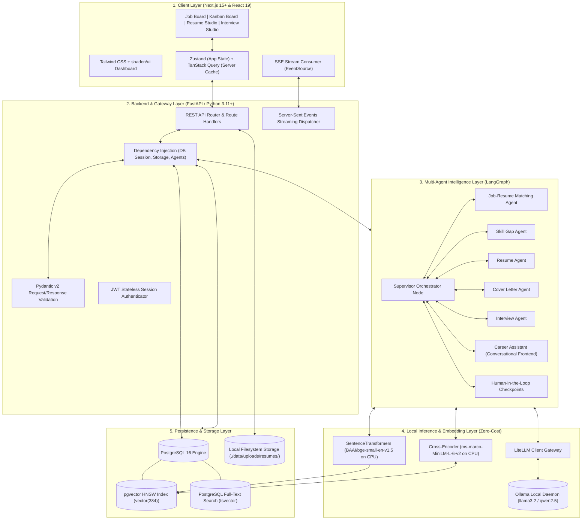
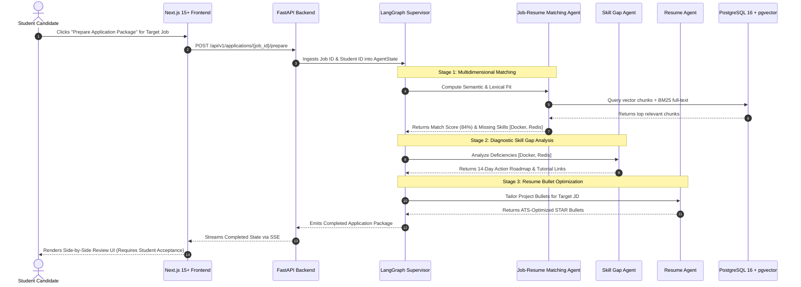
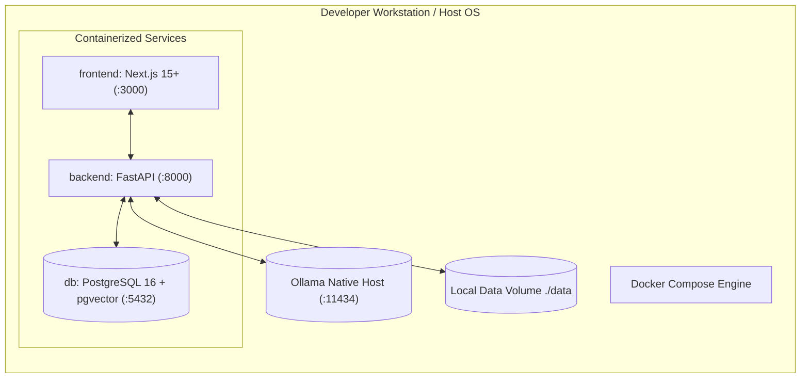

# System Architecture & Component Topology Specification

**Document Version:** 1.0.0  
**Status:** Completed  
**Author:** Senior AI Systems Architect  
**Project:** AI-Powered Internship Application and Career Assistance Platform  
**Target Milestone:** Milestone 1 — M1.2 System Architecture  

---

## 1. Architectural Philosophy & Guiding Principles

The **AI-Powered Internship Application and Career Assistance Platform** is designed to provide high-leverage career intelligence, automated resume tailoring, explainable job matching, and interactive interview coaching for university students. 

To maintain academic accessibility, developer velocity, and operational reliability, the system architecture adheres to six core principles established in Milestone 1.1:

1. **Zero-Cost, Local-First Foundation:** The platform runs entirely on developer workstations without paid third-party API dependencies, cloud subscriptions, or credit card requirements. All inference, vector storage, and relational persistence execute locally.
2. **Unified Storage Engine (Anti-Overengineering):** Relational application tracking data and high-dimensional vector embeddings coexist within a single **PostgreSQL 16** database equipped with the **`pgvector`** extension, eliminating dual-database synchronization bugs and extra container overhead.
3. **Modular Monolithic Backend with Decoupled Frontend:** The core backend is authored as an asynchronous **FastAPI** service in Python 3.11+, providing native in-process access to AI/ML libraries, while the frontend is a modern **Next.js 15+** application communicating via type-safe REST contracts and Server-Sent Events (SSE).
4. **Deterministic Multi-Agent Coordination:** Multi-agent workflows are modeled as computational state graphs using **LangGraph**, preventing non-deterministic runaway agent loops through explicit conditional edges, finite recursion limits, and Human-in-the-Loop (HITL) checkpoints.
5. **Two-Stage Hybrid Information Retrieval:** Information retrieval fuses sparse lexical search (BM25) with dense vector embeddings (`BAAI/bge-small-en-v1.5`) via Reciprocal Rank Fusion (RRF), followed by local Cross-Encoder re-ranking (`ms-marco-MiniLM-L-6-v2`) for optimal precision.
6. **Strict Typing & Schema Validation:** End-to-end data integrity is enforced via **TypeScript** on the client and **Pydantic v2** on the backend.

---

## 2. End-to-End System Component Topology

---

## 3. Layer-by-Layer Architectural Decomposition

### 3.1 Student / User Interface Layer
- **Framework & Runtime:** Next.js 15+ (App Router architecture) running React 19 on Node.js 20 LTS.
- **Styling & Component System:** Tailwind CSS paired with `shadcn/ui` accessible primitives (built on Radix UI) and Lucide React icons.
- **Client State Management:**
  - *Server State & Caching:* TanStack Query (React Query v5) for automatic background refetching, request deduplication, and cache invalidation across job feeds and application pipelines.
  - *Ephemeral UI State:* Zustand for lightweight modal states, active Kanban filters, and audio/text interview drawer controls.
- **Real-Time Streaming Consumer:** Native browser `EventSource` and ReadableStream readers consuming Server-Sent Events (SSE) from FastAPI to render progressive agent thought processes, match score calculations, and conversational responses without UI blocking.
- **Primary Views:**
  1. *Student Profile Studio:* Visual CV manager with drag-and-drop PDF upload, inline schema verification, and ESCO skill badge editors.
  2. *Hybrid Job Discovery Feed:* Semantic search query bar with faceted filtering (remote, stipend, location) and explainable match cards.
  3. *Application Pipeline (Kanban Board):* Drag-and-drop tracking columns (`Wishlist`, `Applied`, `Screening`, `Interview`, `Offer`, `Rejected`).
  4. *Application Tailoring Studio:* Side-by-side view comparing original candidate resume bullets with STAR/XYZ-optimized variants.
  5. *Mock Interview Sandbox:* Audio/text conversational interface delivering real-time STAR rubrics and follow-up drills.

### 3.2 Backend & API Gateway Layer
- **Framework & Runtime:** FastAPI running on Python 3.11+ managed by an ASGI server (`uvicorn` with `httptools` and `uvloop`).
- **Data Validation & Serialization:** Pydantic v2 (Rust-compiled core) enforcing strict request and response schemas, input sanitization, and automated OpenAPI 3.1 specification generation.
- **Architecture Pattern:** Clean Onion / Hexagonal Architecture:
  - `api/v1/routes/`: Thin HTTP controllers handling parameter binding, status codes, and SSE response streaming.
  - `services/`: Business logic coordinators (IngestionService, MatchingService, ApplicationService, AgentService).
  - `repositories/`: Data access layer encapsulating SQLAlchemy 2.0 async queries against PostgreSQL.
  - `core/`: Global configuration, exception handlers, dependency injection containers, and security utilities.
- **Session & Authentication Handling:** Stateless JWT token verification. The Next.js frontend issues cryptographically signed JWTs (via NextAuth.js or custom OAuth); FastAPI middleware validates signatures, token expiration, and user claims via dependency injection (`get_current_user`).

### 3.3 Database Layer (PostgreSQL 16 + pgvector)
- **Database Engine:** PostgreSQL 16 standard relational server.
- **Vector Search Extension:** `pgvector` ($\ge 0.5.0$) enabling high-dimensional vector similarity operations.
- **Schema Strategy:**
  - *Relational Core:* Normalised tables for `users`, `candidates`, `jobs`, `applications`, and `stage_history` maintaining strict foreign key constraints and ACID guarantees.
  - *Semi-Structured Flexibility:* PostgreSQL `JSONB` columns for storing arbitrary extracted resume sections, parsed course syllabi, and raw agent diagnostic payloads.
  - *Vector Columns:* Fixed-length dense vector columns (`vector(384)`) on `job_requirements` and `candidate_sections` indexed via Hierarchical Navigable Small World (**HNSW**) graphs.
- **Indexing Strategy:**
  - `CREATE INDEX USING hnsw (embedding vector_cosine_ops) WITH (m = 16, ef_construction = 64);` for logarithmic nearest neighbor vector search.
  - `CREATE INDEX USING gin (to_tsvector('english', search_text));` for BM25-equivalent sparse lexical full-text search.
  - Standard B-tree indexes on foreign keys, application statuses, and candidate timestamps.

### 3.4 LLM & Embedding Integration Layer (Zero-Cost Local Architecture)
- **Primary LLM Engine (100% Free):** Local **Ollama** daemon running open-weight instruction models:
  - *Baseline Model:* `llama3.2:3b` or `qwen2.5:7b` (configured for low VRAM/RAM footprints on commodity developer laptops).
  - *Inference Protocol:* Standard REST endpoint on `http://localhost:11434/v1`.
- **LLM Gateway & Gateway Abstraction:** **LiteLLM** + **Instructor**. LiteLLM provides a standardized OpenAI-compatible calling signature, while Instructor enforces guaranteed Pydantic output validation, automatically re-asking the model if JSON syntax or typing constraints fail.
- **Local Dense Embedding Engine:** `BAAI/bge-small-en-v1.5` loaded locally in memory via the Python `sentence-transformers` library running on CPU:
  - *Dimensionality:* 384 dimensions.
  - *Cost:* **\$0.00**; zero external network calls; runs offline.
  - *MTEB Benchmark:* Verified 62.17 overall average across 56 tasks, 51.68 BEIR retrieval average across 15 datasets.
- **Local Re-Ranking Engine:** `cross-encoder/ms-marco-MiniLM-L-6-v2` running locally on CPU. Scores query-document token cross-attention for top-25 candidate sets to maximize precision.
- **Optional Cloud Provider Fallback (Non-Required):** LiteLLM configuration supports an optional toggle to **Google AI Studio (Gemini 1.5/2.0 Flash)** free tier (up to 15 RPM) for developers with internet access who wish to reduce local CPU utilization.

### 3.5 File Storage Layer (Local Filesystem Service)
- **Storage Strategy:** Local Filesystem Service (`LocalStorageService`) adhering to an abstract Python base class (`StorageService`).
- **Storage Location:** Dedicated, git-ignored local directory (`./data/uploads/resumes/{candidate_id}/`).
- **File Integrity & Security:**
  - Uploaded files are validated for MIME type (`application/pdf`, `application/vnd.openxmlformats-officedocument.wordprocessingml.document`).
  - Binary content is hashed via SHA-256 to detect duplicate uploads and ensure immutability.
  - Files are renamed using cryptographic UUIDs (`{file_uuid}.pdf`) to eliminate directory traversal attacks (`../../`).
- **Portability:** The abstraction layer allows seamless drop-in replacement with an S3-compatible driver (such as MinIO or Cloudflare R2) in the future without changing application business logic.

### 3.6 Retrieval-Augmented Generation (RAG) Pipeline Integration
- **Ingestion & Parsing:** `PyMuPDF` (`fitz`) extracts layout-aware text blocks from PDFs, passing raw strings to an Instructor-wrapped Pydantic schema parser.
- **Structural Chunking:** Document chunking is section-aware (Education, Work Experience, Projects, Skills, Minimum Requirements) rather than arbitrary token windows.
- **Hybrid Search Fusion:**
  1. *Vector Query:* Dense HNSW search computes cosine similarity over candidate project chunks:
     $$\text{Sim}_{\text{dense}}(q, d) = 1 - (\vec{u} \cdot \vec{v})$$
  2. *Lexical Query:* PostgreSQL Full-Text Search calculates sparse BM25-equivalent rank:
     $$\text{Rank}_{\text{sparse}}(q, d) = \text{ts\_rank\_cd}(\text{to\_tsvector}(d), \text{plainto\_tsquery}(q))$$
  3. *Fusion:* Reciprocal Rank Fusion (RRF with $k=60$) combines dense and sparse ranks into a single priority list:
     $$RRF(d) = \frac{1}{60 + r_{\text{dense}}(d)} + \frac{1}{60 + r_{\text{sparse}}(d)}$$
  4. *Re-ranking:* The Cross-Encoder scores the top-25 fused candidates, producing the final top-5 high-precision matches.
- **Hallucination Guardrails:** Low inference temperature ($\le 0.2$), negative prompt constraints, and automated semantic entailment audits.

### 3.7 AI Multi-Agent Intelligence Layer
- **Orchestration Framework:** **LangGraph** (`StateGraph`).
- **Topology:** Hybrid Supervisor with Compiled Deterministic Sub-Pipelines.
- **State Schema:** Centrally managed `AgentState` Pydantic model recording candidate profiles, active job IDs, match reports, skill gap roadmaps, and step counts.
- **Loop Prevention:** Hard ceiling of 15 execution steps per user interaction (`recursion_limit=15`).
- **Human-in-the-Loop (HITL):** Breakpoint interruptions requiring explicit student confirmation before updating a master resume or exporting application files.

### 3.8 Application Tracking Module
- **State Machine Core:** Formally defined finite-state transition graph:
  $$\text{Wishlist} \longrightarrow \text{Applied} \longrightarrow \text{Screening} \longrightarrow \text{Interview} \longrightarrow \{\text{Offer}, \text{Rejected}\}$$
- **Audit Logging:** Every state change records an immutable `stage_history` entry capturing timestamp, previous stage, new stage, and notes.
- **Rejection Post-Mortem Hook:** Triggering an application state change to `Rejected` automatically queues an asynchronous event dispatching the **Skill Gap Agent** to compute diagnostic feedback and an upskilling roadmap.
- **Deadline Sentinel:** Scheduled background task monitoring upcoming job application deadlines and alerting candidates 7, 3, and 1 day prior to closing.

---

## 4. Multi-Agent System Execution & Interaction Model

---

## 5. Security, Isolation & Data Privacy Model

Because this platform processes personal biographical documents, academic records, and career aspirations, strict local isolation controls are enforced:

1. **Zero External Data Leakage:** When operating on the default local stack (Ollama + local `bge-small-en-v1.5`), zero candidate data or resume text leaves the developer workstation.
2. **Path Traversal Prevention:** Uploaded file names are strictly stripped of directory separators and stored using randomly generated UUIDv4 tokens. File paths are resolved against an immutable root base directory.
3. **CORS Boundary Enforcement:** The FastAPI backend restricts Cross-Origin Resource Sharing (CORS) explicitly to `http://localhost:3000` (Next.js development server) with strict header and method whitelisting.
4. **Input Sanitization:** Resumes extracted via `PyMuPDF` undergo Unicode normalization (NFKD), ligature stripping, and control character filtering before ingestion into Pydantic models.

---

## 6. Development & Deployment Topology (Single `docker-compose.yml`)

The platform is designed for turnkey local development and evaluation. A single `docker-compose.yml` file provisions the complete multi-tier system with one command:

- **Service `web`:** Next.js 15+ Node.js container with Turbopack hot-reloading mounted to `./frontend`.
- **Service `api`:** FastAPI Python 3.11 container with Uvicorn auto-reload mounted to `./backend`.
- **Service `db`:** Official `pgvector/pgvector:pg16` Docker image persisting to a local named Docker volume or bind mount.
- **Ollama Integration:** The containerized backend communicates directly with the host machine's Ollama daemon via `host.docker.internal:11434`, maximizing GPU/CPU acceleration without complex container passthrough configurations.

---

## 7. Architectural References & Technical Standards

1. **FastAPI Architecture Guide:** *Building High-Performance Async APIs with Python*. [FastAPI Docs](https://fastapi.tiangolo.com/)
2. **Next.js 15 Documentation:** *App Router, React 19 Server Components, and Streaming Architecture*. [Next.js Docs](https://nextjs.org/docs)
3. **pgvector Project:** *Vector similarity search for PostgreSQL*. [pgvector GitHub](https://github.com/pgvector/pgvector)
4. **LangGraph StateGraph Documentation:** *Controllable, Stateful Agent Workflows*. [LangGraph Docs](https://langchain-ai.github.io/langgraph/)
5. **Ollama Project:** *Local Open-Source Large Language Model Runner*. [Ollama Docs](https://ollama.com/)
6. **Sentence-Transformers Library:** *Computing Dense Vector Embeddings on CPU*. [SBERT.net](https://www.sbert.net/)
