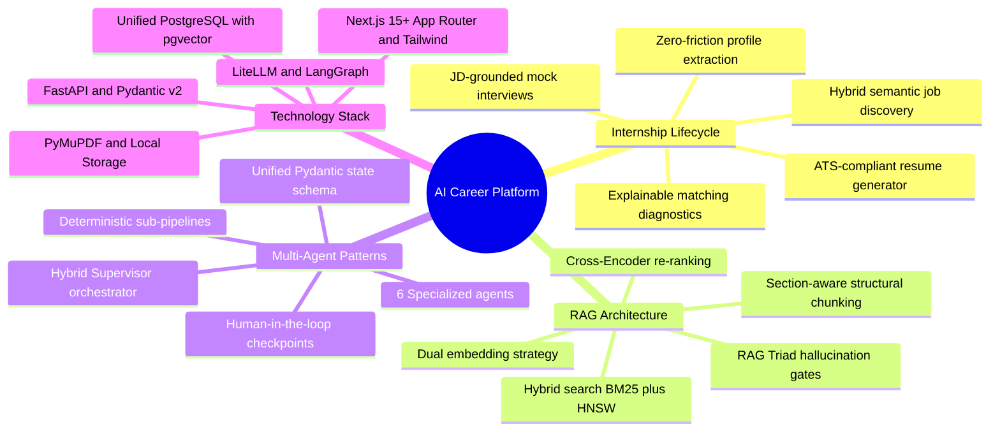

# Executive Summary & Architectural Synthesis — Milestone 1.1

**Document Version:** 1.0.0  
**Status:** Completed  
**Author:** Senior AI Systems Architect  
**Project:** AI-Powered Internship Application and Career Assistance Platform  
**Deliverable:** Milestone 1.1 — Research & Technical Understanding Summary  

---

## 1. Executive Summary

Milestone 1.1 establishes the research foundation and technical blueprint for the **AI-powered Internship Application and Career Assistance Platform**. University students pursuing technology internships face a fragmented, high-friction job search ecosystem characterized by manual application overhead, opaque "ATS black holes," and generic rejections devoid of actionable diagnostic feedback.

Our technical investigation confirms that combining **Retrieval-Augmented Generation (RAG)**, **Multi-Agent Orchestration**, and a **modern, unified web stack** solves these structural bottlenecks without requiring cost-prohibitive enterprise infrastructure.

---

## 2. Core Architectural Pillars & Key Findings

### Pillar 1: Internship Application Workflow Modernization
- **Finding:** Commercial surveys report that 70% to 75% of candidate resumes are filtered out before human review due to rigid automated screening rules and non-standard layouts. This issue is empirically grounded by Harvard Business School's research (*Hidden Workers: Untapped Talent*, Fuller et al., 2021), where **88% of surveyed employers** agreed that automated hiring systems screen out qualified high-skills candidates because they do not match the exact criteria of the job description (and 94% for middle-skills candidates). Standard rejections universally lack diagnostic value.
- **Architectural Solution:**
  - Automated resume-to-profile ingestion normalized against **ESCO and O*NET skill taxonomies**.
  - Structured, single-column ATS-compliant resume compilation using Google's STAR/XYZ impact formula.
  - Multi-dimensional explainable matching providing a transparent breakdown across hard skills, project alignment, and coursework eligibility.
  - Context-aware mock interview agent grounding technical and behavioral questions in the candidate's actual projects and the target employer's tech stack.

### Pillar 2: RAG Architecture & Career Intelligence
- **Finding:** Raw LLMs hallucinate candidate skills, suffer from knowledge cutoffs, and cannot reliably evaluate resumes against dynamic job postings without severe context degradation.
- **Architectural Solution:**
  - **Section-Aware Structural Chunking:** Eliminates arbitrary text slicing by segmenting resumes and job descriptions by functional sections (Education, Projects, Minimum Qualifications).
  - **Zero-Cost Local Embedding Baseline:** `BAAI/bge-small-en-v1.5` (384 dimensions) running locally on CPU via SentenceTransformers (verified MTEB v1 overall score across 56 tasks: 62.17, BEIR retrieval across 15 datasets: 51.68), eliminating external API costs.
  - **Two-Stage Hybrid Retrieval:** Dense HNSW vector search fused with BM25 sparse lexical search via Reciprocal Rank Fusion (RRF), followed by a local `cross-encoder/ms-marco-MiniLM-L-6-v2` re-ranker. This achieves high recall on conceptual matches while preserving exact keyword precision.
  - **RAG Triad Guardrails:** Programmatic verification of Context Relevance, Faithfulness, and Answer Relevance (via `Ragas`) to prevent fabricated achievements.

### Pillar 3: Multi-Agent Architecture & The 6 Core Agents
- **Finding:** Monolithic prompt chains fail on multi-step workflows. Fully decentralized swarms suffer from non-deterministic ping-pong loops and token drain.
- **Architectural Solution:**
  - **Hybrid Supervisor Pattern:** A central Supervisor coordinates high-level user routing and conversational state, delegating structured multi-step tasks to compiled, deterministic sub-pipelines.
  - **The 6 Specialized Agents:**
    1. *Job-Resume Matching Agent:* Computes multi-dimensional fit scores (0–100) and explainable gap reports using cross-encoders.
    2. *Skill Gap Agent:* Translates missing competencies into time-boxed 30/60/90-day learning roadmaps with vetted resources.
    3. *Resume Agent:* Tailors bullet points to highlight JD-aligned keywords using the STAR/XYZ formula without hallucinating facts.
    4. *Cover Letter Agent:* Crafts authentic narratives connecting student projects to company technical missions.
    5. *Interview Agent:* Conducts interactive, multi-turn mock interviews with real-time rubric feedback.
    6. *Career Assistant:* The empathetic front-of-house conversational guide that triages user intents to specialized agents.
  - **Human-in-the-Loop (HITL):** Enforces user review before any resume overwrite or job application export.

### Pillar 4: Pragmatic, Zero-Cost Scalable Technology Stack
- **Finding:** Microservices, paid SaaS APIs, and standalone external vector databases introduce financial and operational friction for a student project.
- **Architectural Solution:**
  - **Frontend:** Next.js 15+ (App Router, React 19, TypeScript, Tailwind CSS, shadcn/ui) for SSR job discovery and native streaming AI UI.
  - **Backend:** FastAPI (Python 3.11+, Pydantic v2) for native, high-performance in-process interoperability with AI/ML tools.
  - **Unified Database:** PostgreSQL 16 with native `JSONB` and the `pgvector` extension running locally (in Docker or native host). Stores relational application records and vector embeddings in a single transactional system with zero cloud cost.
  - **Agent Framework:** LangGraph for fine-grained graph-based state machines, cyclic execution, and checkpointing.
  - **LLM Gateway:** LiteLLM + Instructor for lightweight, provider-agnostic LLM calls, defaulting to local **Ollama** (`llama3.2`/`qwen2.5`) for 100% free, private execution.
  - **Document Extraction:** PyMuPDF (`fitz`) for fast local text layout extraction.
  - **File Storage:** Local Filesystem Storage (abstracted behind a `StorageService` interface) for zero cloud cost and zero external accounts.
  - **Deployment:** Local Docker Compose for turnkey, 100% free development and evaluation.

---

## 3. Risk Assessment & Engineering Mitigations

| Risk / Architectural Challenge | Root Cause | Engineering Mitigation |
| :--- | :--- | :--- |
| **LLM Latency on Multi-Agent Pipelines** | Sequential LLM calls compound response latency. | Stream intermediate status tokens to UI via Server-Sent Events (SSE); parallelize independent agent tasks via LangGraph `Send` branching. |
| **Token Budget & API Costs** | Reliance on paid cloud APIs (OpenAI/Anthropic). | Default to local open-weight models via Ollama (`llama3.2:3b`, `qwen2.5:7b`) and local CPU embeddings (`bge-small-en-v1.5`) for a strictly **\$0.00 development and execution footprint**. |
| **Parsing Variances in PDF Resumes** | Multi-column, graphical, or creative resume layouts scrambles text order. | Use PyMuPDF block coordinate extraction; pass layout-aware text to Instructor schema parser; provide students with an in-app verification & correction UI. |
| **Hallucinated Resume Credentials** | Generative models inventing skills or exaggerating work metrics. | Enforce system prompt negative constraints; run automated semantic entailment check comparing output bullets against source profile chunks. |
| **Database Synchronization Drift** | Splitting data across relational DB and external vector database. | Adopt `pgvector` in PostgreSQL, storing embeddings as native columns in the same tables as relational entities. |

---

## 4. Unresolved Decisions & Open Questions for User Review

The following decisions are surfaced for your input and review before proceeding to Milestone 1.2:

1. **Default Zero-Cost LLM Engine:**
   - *Option A (Recommended Zero-Cost):* **Local Ollama** (e.g., `llama3.2:3b` or `qwen2.5:7b` running 100% locally on CPU/GPU; zero internet access, zero API keys, zero rate limits).
   - *Option B (Cloud Free-Tier):* **Google AI Studio (Gemini 1.5/2.0 Flash)** (Free tier up to 15 RPM; faster on low-spec laptops, but subject to 15 RPM rate limits and data policies).
   - *Option C (Hybrid Switch):* Local Ollama by default, with one-click `.env` toggle to Gemini Flash for cloud testing.

2. **Local PostgreSQL Setup Preference:**
   - *Option A (Recommended):* **Docker Compose** (`docker compose up` spins up PostgreSQL 16 + pgvector container automatically).
   - *Option B:* **Native Local PostgreSQL** (Installed directly on the host OS via installer/package manager).

3. **Inbound Email Application Tracking Depth:**
   - *Option A (Recommended for Student Scope):* **Mock Email Parser & Forwarding Webhook** (Students can paste or forward recruiter emails to a dedicated ingest address; system automatically parses status and updates the Kanban board).
   - *Option B:* **Full Google Gmail & Microsoft Outlook OAuth Integration** (Direct mailbox scanning; requires extensive OAuth verification, privacy disclosures, and security reviews).

---

## 5. Transition Plan to Milestone 1.2

Upon your review and approval of M1.1 research deliverables, we will proceed immediately to **Milestone 1.2: System Architecture & Specification**, which encompasses:

1. **System Architecture Diagrams:** Component topology, network boundaries, and service interaction models.
2. **Database Schema Design:** Entity-Relationship (ER) models for users, student profiles, jobs, applications, vector chunks, and agent states.
3. **API Contract Specification:** RESTful OpenAPI specifications, request/response Pydantic models, and Server-Sent Event (SSE) streaming endpoints.
4. **RAG Pipeline Specification:** Concrete chunking boundaries, embedding dimensions, vector distance thresholds, and RRF formula parameters.
5. **Multi-Agent State Graph Specification:** Detailed LangGraph state schemas, node definitions, conditional routing functions, and error interceptors.

---

## 6. Deliverables Reference Index

| Deliverable Document | Target Path | Content Description |
| :--- | :--- | :--- |
| **Internship Workflow** | [`docs/research/internship-workflow.md`](file:///c:/Users/Daksh/Desktop/M1InfosysSpringboard/docs/research/internship-workflow.md) | Comprehensive 8-phase lifecycle analysis, ATS friction points, and platform automations. |
| **RAG Architecture** | [`docs/research/rag-architecture.md`](file:///c:/Users/Daksh/Desktop/M1InfosysSpringboard/docs/research/rag-architecture.md) | Ingestion, chunking, embeddings, vector DBs, hybrid search, re-ranking, and hallucination gates. |
| **Multi-Agent Patterns** | [`docs/research/multi-agent-patterns.md`](file:///c:/Users/Daksh/Desktop/M1InfosysSpringboard/docs/research/multi-agent-patterns.md) | Supervisor pattern analysis, full specifications for all 6 agents, tools, schemas, and traces. |
| **Technology Evaluation** | [`docs/research/technology-evaluation.md`](file:///c:/Users/Daksh/Desktop/M1InfosysSpringboard/docs/research/technology-evaluation.md) | 11-category technology evaluation comparing multiple alternatives with explicit rationales. |
| **Executive Summary** | [`docs/research/M1.1-summary.md`](file:///c:/Users/Daksh/Desktop/M1InfosysSpringboard/docs/research/M1.1-summary.md) | Architectural synthesis, risk mitigations, unresolved questions, and transition plan. |
