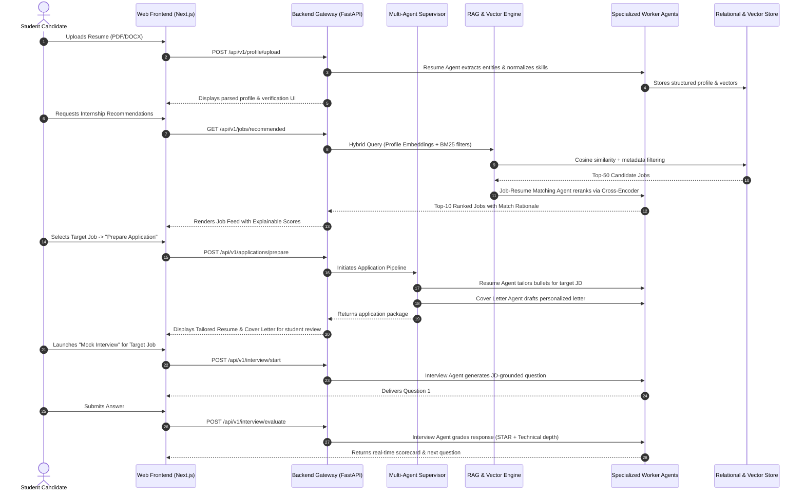

# Internship Application Lifecycle & AI-Powered Automation Workflow

**Document Version:** 1.0.0  
**Status:** Completed  
**Author:** Senior AI Systems Architect  
**Project:** AI-Powered Internship Application and Career Assistance Platform  
**Target Milestone:** Milestone 1 — M1.1 Research & Technical Understanding  

---

## 1. Executive Summary & Problem Context

Securing an internship is a critical inflection point for university students entering the technology and engineering workforce. However, the traditional internship application process is fragmented, opaque, and inefficient for both candidates and hiring organizations. 

Undergraduate and graduate students routinely submit 50 to 200+ applications across disparate job boards, encountering:
1. **High Transactional Overhead:** Repetitive manual data entry across disparate Applicant Tracking Systems (ATS) such as Workday, Greenhouse, Lever, and Taleo.
2. **The "ATS Black Hole" & Automated Exclusion:** Widely cited commercial industry surveys estimate that 70% to 75% of online candidate resumes are filtered out before reaching a human recruiter due to rigid keyword screening, binary knock-out questions, and non-standard document formatting. While commercial scanner vendors often cite this figure to highlight parsing failures, academic research reveals a deeper structural issue: in Harvard Business School's seminal study *Hidden Workers: Untapped Talent* (Fuller et al., 2021), **88% of surveyed employers** agreed that their company's automated hiring tools screen out qualified high-skills candidates simply because their resumes do not match the exact, rigid criteria configured in the job description (with 94% of employers reporting the same exclusion for middle-skills candidates). Automated screening algorithms prioritize rigid lexical filtering over holistic competence, excluding capable students whose coursework or projects use synonymous or adjacent terminology.
3. **Information Asymmetry:** Job descriptions are often bloated with unrealistic requirements for entry-level positions, while students struggle to articulate their academic coursework, hackathons, and personal projects in industry-aligned terminology.
4. **Lack of Feedback & Stagnant Rejections:** Rejection notifications are universally generic ("We have decided to move forward with other candidates"), offering zero actionable diagnostic feedback on skill gaps.
5. **Fragmented Preparation:** Interview preparation is decoupled from the actual target job description, leaving candidates to practice generic algorithms rather than the specific tech stacks demanded by the role.

This research document analyzes each phase of the traditional internship lifecycle, identifies key friction points, and defines how our **AI-powered Internship Application and Career Assistance Platform** transforms this lifecycle through agentic orchestration, semantic search, and Retrieval-Augmented Generation (RAG).

---

## 2. Phase-by-Phase Comparative Analysis

```mermaid
flowchart TD
    subgraph Traditional["Traditional Student Lifecycle (Manual & Fragmented)"]
        T1["Manual Data Entry on Job Boards"] --> T2["Static, Generic PDF Resume"]
        T2 --> T3["Keyword-Only Search ('Python Intern')"]
        T3 --> T4["Repetitive Application Forms"]
        T4 --> T5["Automated ATS Screening & Knockout"]
        T5 --> T6["Messy Spreadsheets / Ghosted"]
        T6 --> T7["Generic LeetCode / Glassdoor Prep"]
        T7 --> T8["Generic Rejection or Blind Acceptance"]
    end

    subgraph Platform["Our AI-Powered Agentic Platform"]
        P1["Intelligent Profile Ingestion & O*NET Taxonomy Extraction"] --> P2["ATS-Optimized, Dynamic Structured Resume Engine"]
        P2 --> P3["Semantic & Hybrid Vector Matching (BM25 + Dense RAG)"]
        P3 --> P4["1-Click Tailored Application Package (Resume + Cover Letter)"]
        P4 --> P5["Explainable Match Score & Skill Fit Diagnostics"]
        P5 --> P6["Automated Kanban Tracker & Follow-Up Generator"]
        P6 --> P7["Targeted Mock Interview Agent (JD + Resume Grounded)"]
        P7 --> P8["Rejection Post-Mortem Gap Analysis & Offer Evaluation Matrix"]
    end
```

---

### Phase 1: Student Registration and Profile Creation

#### Traditional Workflow & Friction Points
- Students manually type biographical information, university details, GPA, graduation dates, and past coursework into unstructured web forms.
- Skills are self-reported via free-text tags, leading to severe taxonomy fragmentation (e.g., one student enters `React.js`, another `reactjs`, another `React`, and another simply `Frontend`).
- Non-traditional experience (open-source contributions, academic research, capstone projects, competitive programming) is either omitted or poorly categorized because standard forms lack accommodating schemas.

#### AI-Powered Transformation
1. **Zero-Friction Ingestion:** The student uploads an existing resume or connects their GitHub/LinkedIn. An intelligent document ingestion pipeline extracts entities (contact details, degrees, projects, work history, technical proficiencies).
2. **Taxonomy Normalization:** Extracted skills are automatically normalized against standardized taxonomies such as **ESCO (European Skills, Competences, Qualifications and Occupations)** and **O*NET (Occupational Information Network)**. A user listing `FastAPI` is automatically mapped under `Python`, `REST APIs`, and `Backend Web Development`.
3. **Dynamic Discovery Questionnaire:** The system identifies profile blind spots (e.g., missing project deployment links, unspecified cloud platforms) and prompts the student with targeted micro-questions to complete their semantic profile.

---

### Phase 2: Resume Preparation and Submission

#### Traditional Workflow & Friction Points
- Students design resumes using tools like Canva, Microsoft Word, or LaTeX templates with complex multi-column layouts, graphics, tables, and custom icons.
- Traditional ATS parsers (using simple heuristics or legacy regex parsers) misparse multi-column layouts, concatenating text horizontally across columns, resulting in scrambled work histories and unread skills.
- Students maintain one single static resume ("one-size-fits-all") that fails to reflect the nuanced keywords demanded by different job subfields (e.g., Data Science vs. Data Engineering vs. Machine Learning).

#### AI-Powered Transformation
1. **ATS-Compliant Document Generation:** Resumes are authored and maintained in structured JSON/Markdown formats and compiled into ATS-bulletproof single-column PDFs with standard font encodings (Type 1 / TrueType) and predictable semantic hierarchies (`# Experience`, `## Project Title`).
2. **STAR / XYZ Formula Bullet Optimization:** A dedicated **Resume Agent** analyzes project bullets and refactors them using Google's XYZ formula (*Accomplished [X] as measured by [Y], by doing [Z]*), ensuring measurable impact metrics are highlighted without inventing unperformed work.
3. **Multi-Version Domain Management:** Students can maintain base profiles from which tailored variants (e.g., *Frontend Focus*, *Systems/DevOps Focus*) are spawned and synchronized.

---

### Phase 3: Internship & Job Discovery

#### Traditional Workflow & Friction Points
- Job boards (LinkedIn, Indeed, Handshake) rely predominantly on exact lexical matching. If a student searches for "Backend Engineer Intern", postings titled "Cloud Software Developer - Student Co-op" or "Junior Platform Associate" are excluded.
- Postings frequently suffer from keyword stuffing or misleading titles where "Entry-Level" positions demand 3+ years of professional experience.
- Students spend 10–15 hours weekly sifting through duplicate postings, expired listings, and sponsored spam.

#### AI-Powered Transformation
1. **Dense Semantic & Hybrid Search:** The platform indexes job postings in a vector database paired with an inverted lexical index (BM25). The student's normalized profile vector is compared against job description embeddings, surfacing opportunities based on conceptual overlap rather than superficial title matches.
2. **Context-Aware Eligibility Filtering:** Hard constraints (e.g., graduation year requirements, work authorization/visa sponsorship, remote vs. on-site, minimum stipend requirements) are applied as strict metadata filters before semantic ranking, eliminating irrelevant listings.
3. **Proactive Match Notifications:** Rather than requiring manual polling, a background worker alerts the student when newly ingested positions cross a defined match threshold (e.g., $>85\%$ semantic alignment).

---

### Phase 4: Job Application Process

#### Traditional Workflow & Friction Points
- Applying to 10 companies requires repeating 80% of identical information across proprietary portals.
- Students submit generic cover letters copied from internet templates, where only company names and dates are changed. Recruiters immediately discard generic boilerplate.
- Students lose track of submission links, deadlines, and required attachments.

#### AI-Powered Transformation
1. **One-Click Application Packaging:** The platform bundles an optimized resume variant, tailored cover letter, and direct portfolio/GitHub project links into a standardized export package or clipboard assistant.
2. **Contextual Cover Letter Generation:** A **Cover Letter Agent** ingests the candidate's actual completed projects and maps them specifically to the target company's stated mission, engineering challenges, and technical stack. The narrative highlights authentic synergy rather than sycophantic flattery.
3. **Application Deadline Sentinel:** Deadlines are tracked via scheduled background monitors that alert students 7, 3, and 1 day prior to application closing windows.

---

### Phase 5: Resume-Job Matching & Explainable AI

#### Traditional Workflow & Friction Points
- Commercial matching systems provide arbitrary scores or pass/fail flags without diagnostic transparency.
- Candidates have no visibility into *why* they were filtered out or what specific keyword/conceptual discrepancy caused the rejection.

#### AI-Powered Transformation
1. **Multi-Dimensional Matching Engine:** Matching is decomposed into four explicit dimensions:
   - **Hard Technical Skills (40%):** Programming languages, frameworks, databases, developer tools.
   - **Project & Domain Relevance (30%):** Alignment of past personal/academic projects with the employer's domain (e.g., FinTech, distributed systems, mobile development).
   - **Educational & Coursework Alignment (15%):** Degree program, expected graduation timeline, core computer science curriculum (Algorithms, Operating Systems, Networks).
   - **Soft Skills & Collaborative Attributes (15%):** Teamwork, agile methodologies, leadership, documentation.
2. **Explainable AI (XAI) Match Breakdown:** Instead of a single opaque number, the student receives a granular breakdown:
   - *Direct Matches:* Skills verified in both resume and JD.
   - *Adjacent/Transferable Skills:* Skills the student possesses that substitute for JD requirements (e.g., proficiency in `FastAPI` when the JD requests `Flask`).
   - *Critical Gaps:* Essential hard requirements absent from the candidate profile (e.g., `Docker`, `Kubernetes`).
   - *Cross-Encoder Semantic Alignment:* Deep semantic relevance score computed via a re-ranking transformer.

---

### Phase 6: Application Tracking & Pipeline Management

#### Traditional Workflow & Friction Points
- Students track dozens of applications using manual spreadsheets (Excel, Google Sheets, Notion) that quickly become outdated.
- Candidates forget to follow up, miss screening invitations buried in email spam folders, or lose track of which resume version was sent to which company.

#### AI-Powered Transformation
1. **Interactive Kanban Pipeline:** Visual workflow states: `Wishlist` $\rightarrow$ `Applied` $\rightarrow$ `Screening` $\rightarrow$ `Technical Assessment` $\rightarrow$ `Onsite / Interview` $\rightarrow$ `Offer` / `Rejected`.
2. **Email Status Detection & Auto-Sync:** Inbound recruiter communications can be parsed via an email parsing webhook/agent to automatically advance Kanban card states and log interview dates.
3. **Automated Follow-Up Drafter:** If an application remains in `Applied` status for $>14$ days without response, the platform drafts a polite, professionally worded follow-up message customized with the recruiter's name and original submission date.

---

### Phase 7: Interview Preparation

#### Traditional Workflow & Friction Points
- Students practice on disconnected platforms (LeetCode, HackerRank, YouTube mock videos) without knowing which questions are relevant to the specific role.
- Behavioral interview preparation is neglected; students struggle to structure responses using the STAR method (Situation, Task, Action, Result).
- Students lack an objective feedback loop to evaluate response quality, conciseness, and technical precision.

#### AI-Powered Transformation
1. **JD-Grounded Mock Interview Agent:** The **Interview Agent** ingests both the candidate's resume and the target JD. If the JD emphasizes "asynchronous message queues" and the candidate lists "RabbitMQ project", the agent generates targeted technical questions probing race conditions, message durability, and consumer acknowledgments.
2. **Real-Time Response Evaluation:** The student submits text or audio responses. The agent evaluates:
   - *STAR Method Adherence:* Did the student describe a clear action and measurable result?
   - *Technical Depth:* Did the candidate mention specific architectural decisions, or did they speak in vague generalities?
   - *Conciseness & Tone:* Identifies rambling, filler words, or defensive phrasing.
3. **Targeted Drill Generation:** Identifies weak technical answers and generates follow-up drills to solidify conceptual mastery.

---

### Phase 8: Offer and Rejection Management

#### Traditional Workflow & Friction Points
- Rejections cause emotional burnout and demoralization because students receive no constructive feedback.
- When multiple offers are received, students struggle to compare compensation, cost-of-living adjustments, learning curves, and full-time return offer (PPO) conversion probabilities.
- Students feel unequipped to negotiate stipends, housing allowances, or relocation support.

#### AI-Powered Transformation
1. **Rejection Post-Mortem & Gap Analysis:** When an application is marked `Rejected`, the **Skill Gap Agent** computes the delta between the student's profile and the role's criteria, generating a constructive 30-day action plan (e.g., "Build a microservice project using gRPC and Redis to bridge your backend gap").
2. **Offer Comparison Matrix:** Evaluates competing offers across multidimensional metrics: normalized monthly compensation (adjusted for local rent/living costs), tech stack modernization score, mentorship reputation, and historical PPO conversion rates.
3. **Negotiation Script Assistant:** Provides students with ethical, realistic negotiation scripts tailored to their circumstances (e.g., leveraging competing deadlines to request expedited decisions or housing allowances).

---

## 3. End-to-End System Workflow Architecture

---

## 4. Illustrative Baselines & Target Engineering Objectives

> [!NOTE]
> The figures below represent **illustrative design assumptions and target engineering objectives** formulated to guide platform development. They are hypotheses to be experimentally benchmarked during user testing and proof-of-concept validation, rather than established empirical industry constants.

| Metric Category | Illustrative Baseline (Manual Process) | Platform Target (AI-Assisted) | Measurement Method |
| :--- | :--- | :--- | :--- |
| **Profile Creation Time** | ~45–60 minutes (Estimated manual entry) | $< 3$ minutes | Ingestion completion telemetry |
| **ATS Formatting Pass Rate** | Low on multi-column / graphic CVs | $> 95\%$ valid ATS structure | Syntactic ATS validation testing |
| **Application Tailoring Time** | ~90 minutes / application | $< 2$ minutes / application | End-to-end generation duration |
| **Relevance of Discovery Feed** | Fragmented keyword noise | High semantic alignment | NDCG@10 and user bookmark rate |
| **Interview Readiness Score** | Subjective / Unmeasured | Objective rubric (0–100) | STAR and technical rubric scoring |
| **Student Diagnostic Feedback** | Minimal / Generic rejection emails | 100% feedback on rejections | Automated gap roadmap generation |

---

## 5. Architectural References & Sources

1. **Fuller, J. B., Raman, M., Sage-Gavin, E., & Hines, K. (2021):** *Hidden Workers: Untapped Talent - How leaders can improve talent pipeline by tapping 'hidden' workers*. Harvard Business School and Accenture. [HBS Report Link](https://www.hbs.edu/managing-the-future-of-work/Documents/hidden-workers-untapped-talent.pdf)
2. **National Association of Colleges and Employers (NACE):** *Job Outlook 2024 - Key Attributes Employers Seek on College Graduates' Resumes*. [NACE Center](https://www.naceweb.org)
3. **European Commission:** *ESCO (European Skills, Competences, Qualifications and Occupations) Classification*. [ESCO Portal](https://esco.ec.europa.eu/)
4. **U.S. Department of Labor:** *O*NET OnLine - Occupational Information Network*. [O*NET Resource Center](https://www.onetcenter.org/)
5. **Society for Human Resource Management (SHRM):** *The Impact of Applicant Tracking Systems on Talent Acquisition*. [SHRM Research](https://www.shrm.org)
6. **Google Careers Guidance:** *Creating Your Resume: The XYZ Formula*. [Grow with Google](https://www.google.com/about/careers/applications/students/)
