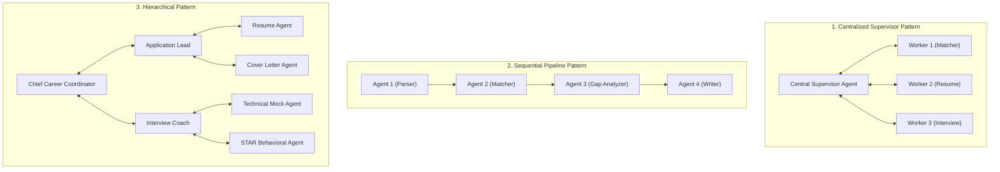
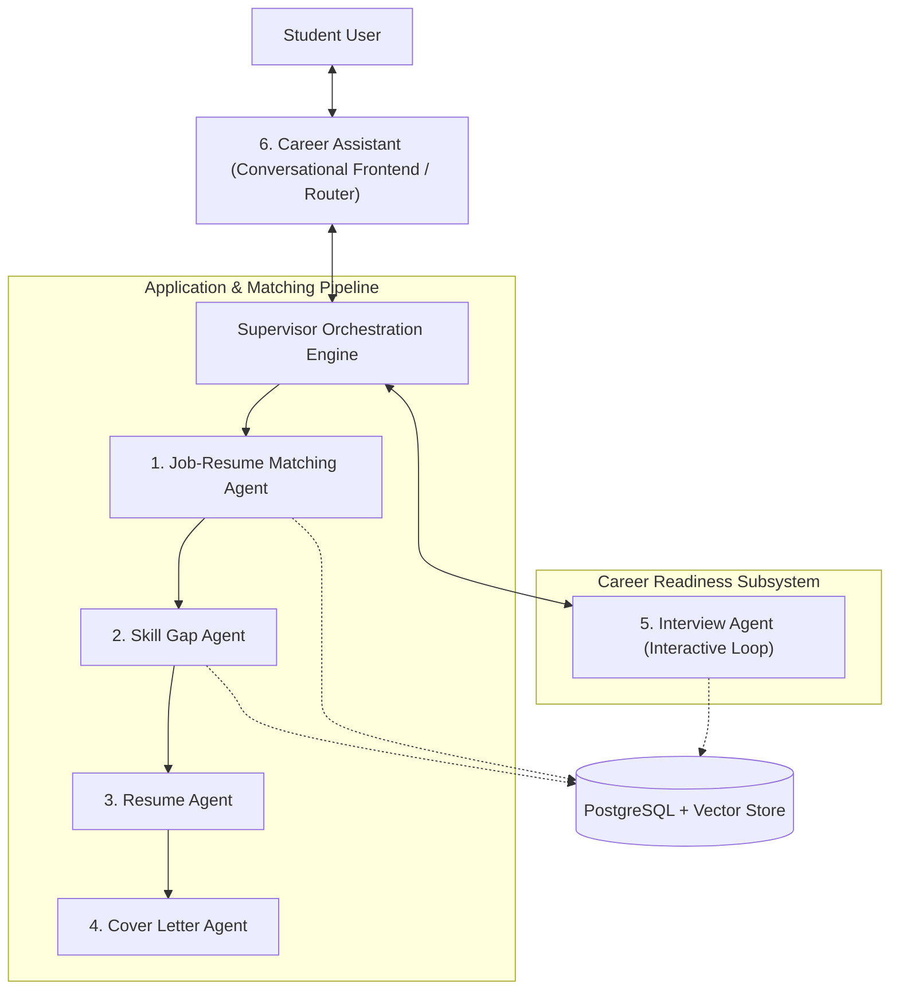
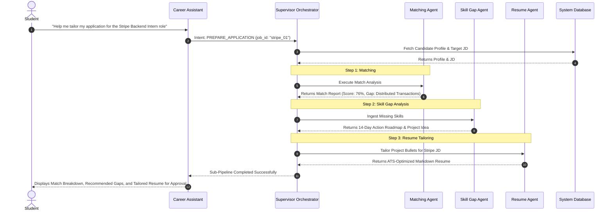

# Multi-Agent Architectural Patterns & Agent Specifications

**Document Version:** 1.0.0  
**Status:** Completed  
**Author:** Senior AI Systems Architect  
**Project:** AI-Powered Internship Application and Career Assistance Platform  
**Target Milestone:** Milestone 1 — M1.1 Research & Technical Understanding  

---

## 1. Multi-Agent Design Pattern Evaluation

Multi-agent architectures decompose complex, monolithic prompt chains into discrete, specialized autonomous workers. Rather than burdening a single general-purpose LLM with conflicting instructions, each agent encapsulates domain-specific system prompts, scoped tools, and bounded operational state.

### 1.1 Comparative Analysis of Architectural Patterns



| Architectural Pattern | Mechanism | Strengths | Weaknesses | Suitability for Platform |
| :--- | :--- | :--- | :--- | :--- |
| **Sequential (Pipeline)** | Deterministic conveyor belt: output of Agent $N$ becomes input of Agent $N+1$. | Simple to reason about; zero routing latency; highly deterministic. | Inflexible; cannot branch conditionally or iterate backwards if an error occurs. | ⚠️ Suitable only for rigid sub-workflows (e.g., Document Ingestion). |
| **Peer-to-Peer Swarm** | Agents post to a shared board or message each other directly without a coordinator. | High emergence; resilient to single-node failures. | Unpredictable control flow; prone to infinite conversational loops; high token consumption. | ❌ Inappropriate for recruitment systems requiring strict compliance. |
| **Hierarchical (Tree of Supervisors)** | Top-level executive routes to departmental leads who manage granular workers. | Scales gracefully to 20+ specialized agents; strict scope isolation. | High latency overhead (multi-hop routing); overengineered for a student project. | ⚠️ Excessive complexity for current milestone scope. |
| **Centralized Supervisor (Hub-and-Spoke)** | Single Orchestrator routes tasks to specialized workers based on user intent and state. | Clear single source of truth; trivial to debug and trace; robust state management. | Supervisor is an architectural bottleneck if overloaded with too many agents. | **✅ Highly Recommended Baseline** |

### 1.2 The Recommended Pattern: Hybrid Supervisor with Sub-Pipelines

For the **AI-powered Internship Application and Career Assistance Platform**, we recommend a **Hybrid Supervisor with Deterministic Sub-Pipelines**:

1. **Top-Level Orchestrator (Supervisor):** Operates as the user-facing router. It parses intent from the student's requests (e.g., *"Help me apply for this Datadog internship"* vs. *"Mock interview me for backend engineering"*), selects the appropriate subsystem, and tracks overall mission progress.
2. **Deterministic Sub-Pipelines for Compound Tasks:** When a task requires sequential execution with zero ambiguity (such as generating an application package: `Job-Resume Match` $\rightarrow$ `Skill Gap Analysis` $\rightarrow$ `Resume Tailoring` $\rightarrow$ `Cover Letter Generation`), the orchestrator triggers a compiled linear sub-graph rather than executing costly, non-deterministic routing calls at every micro-step.
3. **Conversational Loops for Interactive Agents:** For the `Interview Agent` and `Career Assistant`, the orchestrator hands off the session to an interactive stateful loop, resuming supervisor control only when the session concludes or when the student invokes another capability.

---

## 2. Comprehensive Specifications for the Six Core Agents



---

### Agent 1: Job-Resume Matching Agent

#### 1. Primary Responsibility
Performs rigorous, multi-dimensional semantic and lexical alignment between a student candidate's structured profile and a target job description (JD). It produces a 0–100 match score accompanied by an explainable, granular breakdown of matched, transferable, and absent competencies.

#### 2. Inputs and Outputs
- **Input Schema:**
  ```json
  {
    "candidate_id": "usr_9812",
    "candidate_profile": {
      "education": [{"degree": "B.S. Computer Science", "graduation_year": 2026, "gpa": 3.8}],
      "skills": ["Python", "FastAPI", "PostgreSQL", "Docker", "Git"],
      "projects": [{"title": "Distributed Task Queue", "technologies": ["Python", "Redis", "Celery"], "bullets": ["..."]}],
      "work_experience": []
    },
    "job_id": "job_441",
    "job_description": {
      "title": "Backend Engineering Intern",
      "company": "CloudScale",
      "requirements": ["Proficiency in Python or Go", "Experience with relational databases", "Familiarity with containerization (Docker/K8s)"]
    }
  }
  ```
- **Output Schema:**
  ```json
  {
    "overall_match_score": 88,
    "breakdown": {
      "hard_technical_skills": {"score": 90, "matched": ["Python", "PostgreSQL", "Docker"], "missing": ["Kubernetes"], "transferable": []},
      "project_domain_fit": {"score": 85, "rationale": "Strong alignment in backend systems via distributed task queue project."},
      "education_eligibility": {"score": 100, "status": "Eligible (Class of 2026)"}
    },
    "recommendation": "HIGH_MATCH",
    "actionable_summary": "Strong candidate for backend engineering. Highlighting the Redis/Celery queue will offset lack of formal Kubernetes experience."
  }
  ```

#### 3. Required Tools
- `vector_similarity_tool`: Queries the embedding space for semantic cosine proximity.
- `cross_encoder_rerank_tool`: Computes deep cross-attention alignment between resume bullet points and JD requirement clauses.
- `skill_taxonomy_lookup_tool`: Queries the ESCO/O*NET knowledge base to identify synonymous or parent/child skill relations (e.g., mapping `PostgreSQL` $\rightarrow$ `Relational Databases`).

#### 4. RAG Dependency
- **Needs RAG:** **Yes**.
- **Corpus:** Target job postings, historical matching benchmarks, and standardized skill ontologies.

#### 5. Inter-Agent Communication
- Receives job and candidate payloads from the **Supervisor**.
- Emits its match diagnostic payload to the **Skill Gap Agent** and the **Resume Agent**.

#### 6. Execution Workflow
1. Ingests candidate profile and JD from shared state.
2. Runs `skill_taxonomy_lookup_tool` to normalize all candidate skills and JD requirements.
3. Computes lexical intersection for mandatory hard requirements.
4. Invokes `cross_encoder_rerank_tool` to calculate semantic similarity scores between candidate project descriptions and JD responsibility statements.
5. Applies weighted scoring formula: $\text{Score} = 0.40(\text{Skills}) + 0.35(\text{Projects}) + 0.15(\text{Education}) + 0.10(\text{Soft Skills})$.
6. Formulates structured diagnostic report and commits results to `AgentState`.

---

### Agent 2: Skill Gap Agent

#### 1. Primary Responsibility
Identifies the delta between a student's existing competencies and the explicit/implicit demands of a target role or career trajectory. It translates technical deficiencies into a prioritized, actionable 30/60/90-day learning roadmap complete with vetted learning resources and hands-on project concepts.

#### 2. Inputs and Outputs
- **Input Schema:**
  ```json
  {
    "candidate_id": "usr_9812",
    "target_role": "Backend Engineering Intern",
    "match_breakdown": {
      "missing_skills": ["Kubernetes", "gRPC", "CI/CD Pipelines"],
      "weak_areas": ["System Design Fundamentals"]
    },
    "available_time_hours_per_week": 10
  }
  ```
- **Output Schema:**
  ```json
  {
    "gap_severity": "MODERATE",
    "critical_deficiencies": [
      {
        "skill": "CI/CD Pipelines",
        "importance": "HIGH",
        "remediation_effort_hours": 8,
        "recommended_resource": "GitHub Actions Documentation & Official Lab",
        "action_item": "Add automated GitHub Actions workflow running pytest and flake8 to existing Task Queue repo."
      }
    ],
    "learning_roadmap": {
      "phase_1_immediate_7_days": ["CI/CD with GitHub Actions"],
      "phase_2_short_term_30_days": ["Docker Compose to multi-stage Dockerfiles", "Basic Kubernetes Pods & Deployments"],
      "phase_3_medium_term_60_days": ["gRPC service-to-service communication"]
    }
  }
  ```

#### 3. Required Tools
- `curriculum_retriever_tool`: Queries a curated repository of free, high-quality technical tutorials, official documentation, and open-source sandboxes.
- `project_ideator_tool`: Generates portfolio-grade project specifications designed to demonstrate the missing skill in code.

#### 4. RAG Dependency
- **Needs RAG:** **Yes**.
- **Corpus:** Curated engineering learning repositories, documentation indexes, and project rubrics.

#### 5. Inter-Agent Communication
- Consumes output from the **Job-Resume Matching Agent**.
- Forwards recommended project concepts and prioritized skill focuses to the **Career Assistant** and **Resume Agent**.

#### 6. Execution Workflow
1. Reads `missing_skills` and `weak_areas` from state.
2. Filters out low-priority requirements (e.g., nice-to-haves that can be learned on the job).
3. Queries vector store for vetted tutorials and hands-on project architectures that bridge the gaps.
4. Generates an incremental, time-boxed learning roadmap calibrated to the student's available weekly study hours.
5. Appends the diagnostic roadmap to `AgentState`.

---

### Agent 3: Resume Agent

#### 1. Primary Responsibility
Optimizes, reformats, and tailors the candidate's resume for a specific job application or ATS domain standard. It rewrites accomplishment bullet points using the STAR/XYZ formula to maximize impact while enforcing strict anti-hallucination guardrails (never fabricating employers, dates, or technologies).

#### 2. Inputs and Outputs
- **Input Schema:**
  ```json
  {
    "base_resume": {
      "projects": [
        {
          "title": "Distributed Task Queue",
          "raw_bullet": "Made a Python project with Redis to process background jobs fast."
        }
      ]
    },
    "target_job": {
      "title": "Backend Engineering Intern",
      "keywords_to_emphasize": ["Redis", "Latency", "Asynchronous Processing", "Throughput"]
    }
  }
  ```
- **Output Schema:**
  ```json
  {
    "tailored_projects": [
      {
        "title": "Distributed Asynchronous Task Queue",
        "optimized_bullet": "Engineered an asynchronous distributed task queue in Python and Redis, reducing background task latency by 35% through connection pooling and non-blocking I/O.",
        "framework_applied": "XYZ Formula (Action + Context + Quantified Impact)",
        "ats_keyword_density_score": 92
      }
    ],
    "ats_compliance_audit": {
      "formatting_score": 98,
      "detected_issues": []
    }
  }
  ```

#### 3. Required Tools
- `ats_linter_tool`: Syntactic validator checking for unparseable tables, bad font encodings, missing headers, and complex layouts.
- `bullet_point_enhancer_tool`: Applies STAR/XYZ structural rewriting rules.
- `groundedness_checker_tool`: Performs semantic entailment check to verify that the optimized bullet does not state unverified facts.

#### 4. RAG Dependency
- **Needs RAG:** **Selective / Internal**.
- **Corpus:** Ingests the candidate's own comprehensive project logs and coursework notes; does not query external web knowledge.

#### 5. Inter-Agent Communication
- Receives base candidate profile + target JD from **Supervisor**.
- Sends optimized resume text to the **Cover Letter Agent** and updates student profile records.

#### 6. Execution Workflow
1. Extracts relevant project descriptions matching target JD tech requirements.
2. Iterates over bullet points, restructuring them into: `[Strong Action Verb] + [Specific Architecture/Tool] + [Impact Metric]`.
3. Passes rewritten text through `groundedness_checker_tool` to ensure absolute alignment with candidate facts.
4. Validates document structure against ATS parsing rules via `ats_linter_tool`.
5. Emits tailored resume markdown and PDF compile payload.

---

### Agent 4: Cover Letter Agent

#### 1. Primary Responsibility
Generates authentic, personalized, company-specific cover letters that connect the candidate's academic projects and intrinsic motivations directly to the employer's business mission, engineering culture, and technical stack. Eliminates generic template boilerplate.

#### 2. Inputs and Outputs
- **Input Schema:**
  ```json
  {
    "candidate_name": "Daksh Sharma",
    "tailored_resume_highlights": ["Distributed Task Queue in Python/Redis", "PostgreSQL database optimization"],
    "company_name": "CloudScale",
    "job_title": "Backend Engineering Intern",
    "company_mission_context": "Building open-source, resilient cloud monitoring tools for high-throughput microservices.",
    "tone": "TECHNICAL_AND_ENTHUSIASTIC"
  }
  ```
- **Output Schema:**
  ```json
  {
    "cover_letter_markdown": "# Application for Backend Engineering Intern — CloudScale\n\nDear CloudScale Engineering Team,\n\nI have followed CloudScale's contributions to cloud-native monitoring, particularly your focus on sub-millisecond metric ingestion. As a Computer Science undergraduate with hands-on experience building distributed systems in Python and Redis, I am eager to contribute to your core backend team...",
    "key_arguments_used": [
      "Linked student's Redis queue project directly to CloudScale's high-throughput metric pipelines.",
      "Highlighted immediate readiness to contribute to open-source Python repos."
    ]
  }
  ```

#### 3. Required Tools
- `company_intelligence_tool`: Retrieves verified company mission statements, recent public engineering blog posts, or open-source repositories.
- `prose_polisher_tool`: Enforces concise writing, eliminates passive voice, and strips clichéd recruitment tropes ("I am the ideal candidate...").

#### 4. RAG Dependency
- **Needs RAG:** **Yes**.
- **Corpus:** Company engineering blogs, product overviews, and target JD text.

#### 5. Inter-Agent Communication
- Ingests tailored candidate highlights from **Resume Agent** and company context from **Supervisor**.
- Emits finalized draft to the student's Application Tracking package.

#### 6. Execution Workflow
1. Retrieves employer context (core products, engineering stack, public values).
2. Maps top 2 candidate projects to the employer's technical challenges.
3. Constructs a 3-paragraph narrative:
   - *Paragraph 1:* Direct hook connecting personal ambition to the company's technical mission.
   - *Paragraph 2:* Technical deep-dive into a relevant project proving immediate readiness.
   - *Paragraph 3:* Clear closing expressing enthusiasm for an interview conversation.
4. Audits prose for tone, authenticity, and conciseness.

---

### Agent 5: Interview Agent

#### 1. Primary Responsibility
Executes dynamic, multi-turn mock interviews (behavioral and technical) customized to the target JD and the candidate's specific resume. It grades candidate responses in real time, assessing technical accuracy, problem-solving structure, and STAR methodology adherence.

#### 2. Inputs and Outputs
- **Input Schema:**
  ```json
  {
    "session_id": "mock_5501",
    "target_role": "Backend Engineering Intern",
    "target_jd_text": "...",
    "candidate_resume_text": "...",
    "interview_mode": "TECHNICAL_DEEP_DIVE",
    "turn_history": [
      {"role": "interviewer", "content": "How did you handle Redis worker crashes in your task queue project?"},
      {"role": "candidate", "content": "We just restarted the server manually when it broke."}
    ]
  }
  ```
- **Output Schema:**
  ```json
  {
    "evaluation": {
      "score_out_of_10": 4,
      "technical_accuracy": "POOR",
      "communication_clarity": "CONCISE_BUT_LACKS_DEPTH",
      "critique": "Manual restarts are inadequate for production systems. You should discuss Redis persistence mechanisms (AOF/RDB) and Celery dead-letter queues (DLQ) or supervisor daemons (Systemd/Supervisord).",
      "suggested_better_answer": "In that project, we used Supervisord to automatically restart crashed worker processes. For unacknowledged tasks, we configured Redis visibility timeouts so orphaned tasks returned to the queue automatically."
    },
    "next_question": "Let's explore that further. How would you ensure a task is executed at-least-once versus at-most-once?",
    "session_status": "IN_PROGRESS"
  }
  ```

#### 3. Required Tools
- `interview_rubric_evaluator_tool`: Grades responses against standard industry competencies (Data Structures, Concurrency, API Design, STAR Behavioral).
- `question_bank_retriever_tool`: Surfaces verified interview questions asked by top tech firms for comparable internships.

#### 4. RAG Dependency
- **Needs RAG:** **Yes**.
- **Corpus:** Curated interview question repositories, company-specific interview debriefs, and system design rubrics.

#### 5. Inter-Agent Communication
- Runs in a direct conversational loop with the student.
- Commits final session scorecard and readiness analytics to the student's persistent profile database.

#### 6. Execution Workflow
1. Analyzes the target JD and candidate's claimed skills to select an opening question.
2. Waits for student answer submission.
3. Evaluates answer against technical rubrics and STAR structure.
4. Generates constructive, encouraging critique with a concrete example of an exceptional answer.
5. Formulates a contextual follow-up probing edge cases or transitions to the next competency area.
6. Generates a comprehensive performance report upon session completion.

---

### Agent 6: Career Assistant

#### 1. Primary Responsibility
Acts as the central conversational concierge and empathetic career advisor. It answers open-ended career questions, interprets diagnostic scores, guides students through platform features, and transparently routes complex requests to specialized worker agents.

#### 2. Inputs and Outputs
- **Input Schema:**
  ```json
  {
    "student_id": "usr_9812",
    "user_query": "I got rejected from Google and Microsoft backend internships. What should I do next?",
    "session_context": {
      "recent_rejections": ["Google", "Microsoft"],
      "top_skill_gaps": ["Distributed Systems", "LeetCode Hard DP"]
    }
  }
  ```
- **Output Schema:**
  ```json
  {
    "response_text": "Rejections from top-tier firms are standard milestones in every engineer's journey, not a reflection of your potential. Based on your profile analysis, your practical project experience in Python and Redis is solid, but your profile lacks demonstrable scale metrics and deep concurrency patterns...",
    "suggested_actions": [
      {"action_label": "Generate 30-Day Skill Gap Roadmap", "trigger_agent": "SkillGapAgent"},
      {"action_label": "Practice Backend Concurrency Mock Interview", "trigger_agent": "InterviewAgent"}
    ],
    "delegation_intent": null
  }
  ```

#### 3. Required Tools
- `intent_classifier_tool`: Classifies user input into intent categories (General Q&A, Resume Edit Request, Mock Interview Launch, Job Search).
- `platform_knowledge_tool`: RAG retriever querying platform documentation, internship timelines, and university career center guidelines.

#### 4. RAG Dependency
- **Needs RAG:** **Yes**.
- **Corpus:** Internship application timelines, career planning guides, and platform capability documentation.

#### 5. Inter-Agent Communication
- Directly faces the student user.
- Dispatches directives to the **Supervisor** to trigger specialized worker agents.

#### 6. Execution Workflow
1. Ingests user natural language message and conversation history.
2. Runs intent classification.
3. If intent matches a specialized task (e.g., *"Tailor my resume for this link"*), delegates execution to the **Supervisor**.
4. If intent is advisory or informational, queries the career knowledge base via RAG.
5. Formulates empathetic, actionable guidance with interactive action buttons triggering relevant agent workflows.

---

## 3. State Management & Coordination Strategy

To ensure zero data loss, predictable control flow, and debuggability, multi-agent interactions are coordinated through a centralized typed state object.

### 3.1 Unified State Schema (`AgentState`)

```python
from typing import Annotated, Any, Dict, List, Optional
from pydantic import BaseModel, Field


class AgentState(BaseModel):
  # Session Identification
  session_id: str
  student_id: str

  # Persistent Context
  candidate_profile: Dict[str, Any] = Field(default_factory=dict)
  target_job: Optional[Dict[str, Any]] = None

  # Multi-Agent Outputs
  match_report: Optional[Dict[str, Any]] = None
  skill_gap_report: Optional[Dict[str, Any]] = None
  tailored_resume: Optional[Dict[str, Any]] = None
  cover_letter: Optional[str] = None
  interview_transcript: List[Dict[str, str]] = Field(default_factory=list)

  # Control & Routing
  current_agent: str = "CareerAssistant"
  next_step: Optional[str] = None
  error_message: Optional[str] = None
  recursion_depth: int = 0
```

### 3.2 Loop Prevention & Human-in-the-Loop Guardrails
1. **Hard Recursion Limit:** The orchestrator enforces a maximum step limit of 15 transitions per user query. If `recursion_depth > 15`, execution immediately halts and reports a fallback error.
2. **Human-in-the-Loop (HITL) Checkpoints:**
   - *Resume Overwrites:* The system never updates the student's master profile without explicit user confirmation.
   - *Application Submission:* All tailored resumes and cover letters must be reviewed and accepted by the student before export or submission.
3. **Graceful Fallbacks:** If an agent encounters an unrecoverable exception (e.g., external LLM timeout), the orchestrator catches the error, records a diagnostic message in `error_message`, and returns the student to the **Career Assistant** with a helpful recovery prompt.

---

## 4. Multi-Agent System Execution Trace



---

## 5. Architectural References & Sources

1. **LangChain & LangGraph Architecture:** *Multi-Agent Architectures: Supervisor and Hierarchical State Graphs*. [LangGraph Documentation](https://langchain-ai.github.io/langgraph/)
2. **Wu, Q., et al. (2023):** *AutoGen: Enabling Next-Gen LLM Applications via Multi-Agent Conversation*. Microsoft Research. [arXiv:2308.08155](https://arxiv.org/abs/2308.08155)
3. **Anthropic Engineering Research (2024):** *Building Effective Agents*. [Anthropic Research](https://www.anthropic.com/research/building-effective-agents)
4. **Hong, S., et al. (2023):** *MetaGPT: Meta Programming for A Multi-Agent Collaborative Framework*. DeepWisdom. [arXiv:2308.00352](https://arxiv.org/abs/2308.00352)
5. **Pydantic / Instructor Library:** *Structured Outputs and Validation for LLM Agents*. [Instructor Documentation](https://python.useinstructor.com/)
