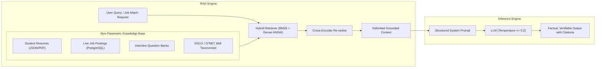
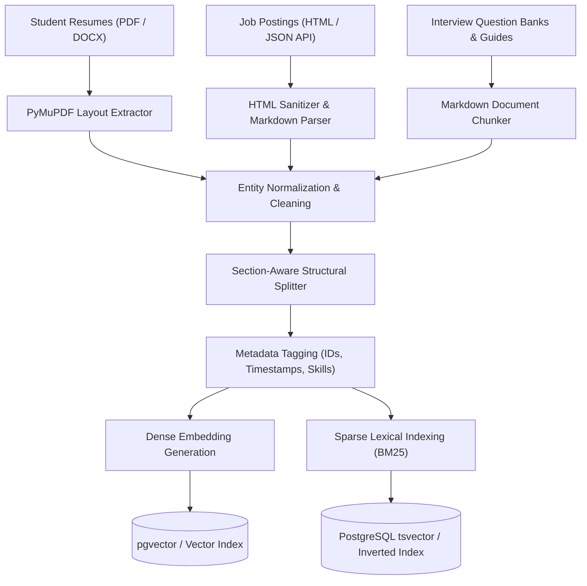
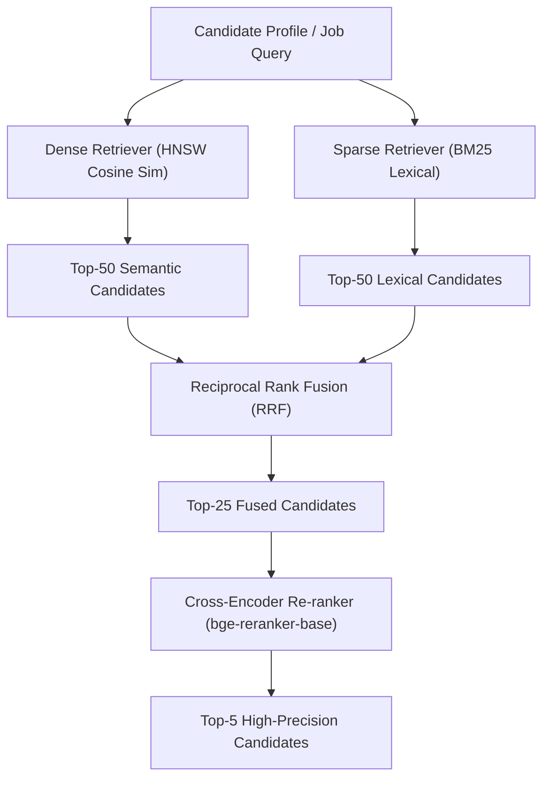
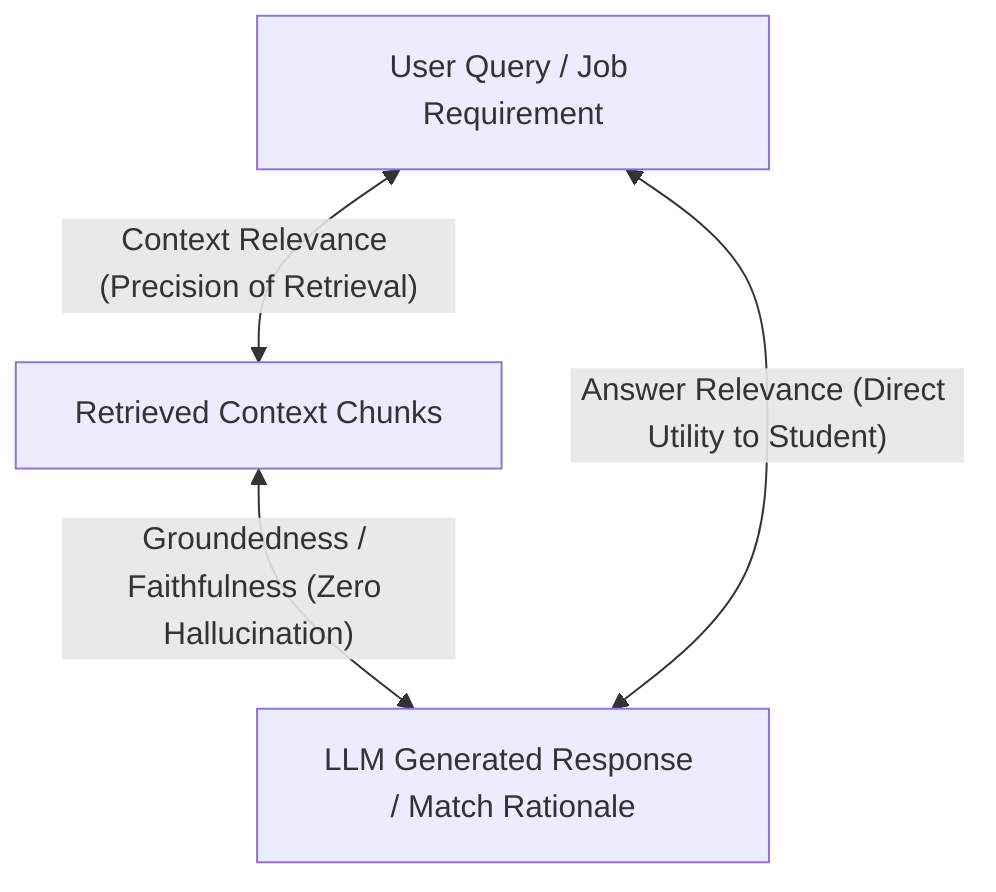

# Retrieval-Augmented Generation (RAG) Architecture for Career Intelligence

**Document Version:** 1.0.0  
**Status:** Completed  
**Author:** Senior AI Systems Architect  
**Project:** AI-Powered Internship Application and Career Assistance Platform  
**Target Milestone:** Milestone 1 — M1.1 Research & Technical Understanding  

---

## 1. Fundamentals of RAG & Problem Justification

### 1.1 What is Retrieval-Augmented Generation?

Retrieval-Augmented Generation (RAG) is an architectural pattern that bridges the gap between **parametric memory** (knowledge baked into a Large Language Model's neural weights during pre-training) and **non-parametric memory** (external, dynamic, verifiable information stored in databases, vector indexes, or document stores).

In standard generation, an LLM relies solely on its internal weights:
$$\text{Output} = \text{LLM}(\text{Prompt})$$

In a RAG-augmented system, an external retrieval pipeline fetches relevant factual context $\mathcal{D}_q$ based on the user query $q$, and injects it into the prompt context before inference:
$$\mathcal{D}_q = \text{Retriever}(q, \mathcal{K})$$
$$\text{Output} = \text{LLM}(q, \mathcal{D}_q)$$
where $\mathcal{K}$ represents the enterprise or user knowledge corpus.



### 1.2 Why Raw LLMs Fail for Internship Matching & Career Advisory

Deploying an off-the-shelf LLM without RAG in a recruitment and career intelligence platform leads to severe structural failures:

1. **Hallucination of Qualifications:** Unconstrained LLMs frequently hallucinate work experience, invent metrics, or attribute nonexistent programming proficiencies to a student's resume when attempting to make them appear competitive.
2. **Knowledge Cutoffs & Temporal Decay:** Job openings, industry compensation standards, and hiring market dynamics change daily. Base model weights cannot reflect newly posted internships or closing application deadlines.
3. **Inability to Ingest Private Corpus:** Student resumes, private academic transcripts, proprietary company job descriptions, and campus interview rubrics reside outside public training data.
4. **Context Window Degradation & Token Cost:** Dumping hundreds of raw job descriptions into a prompt context window triggers "Lost in the Middle" retrieval degradation, exceeds token limits, and causes latency and API costs to scale linearly with catalog size.
5. **Lack of Auditability & Explainability:** Recruitment systems require provable provenance. RAG enables source citation (e.g., *"Matched requirement: Docker proficiency based on candidate's project 'Cloud Native Microservices', bullet 2"*).

---

## 2. Document Ingestion & Preprocessing Pipeline

The platform handles three distinct document categories, each requiring specialized ingestion strategies:



### 2.1 Resume Extraction Pipeline
- **Tooling:** `PyMuPDF` (`fitz`) combined with Pydantic structured extraction. 
- **Preprocessing Logic:**
  1. Extract raw bounding boxes and font sizes to detect structural section headers (`EDUCATION`, `EXPERIENCE`, `PROJECTS`, `SKILLS`).
  2. Concatenate text within visual columns to eliminate multi-column interleaving bugs common in legacy parsers.
  3. Strip non-printable Unicode characters, ligature anomalies (e.g., converting `fi` to `fi`), and decorative bullets.
  4. Pass sanitized text into a structured Pydantic schema parser to produce validated JSON profiles.

### 2.2 Job Description Ingestion Pipeline
- **Tooling:** `trafilatura` for clean web scraping + `BeautifulSoup4` for HTML sanitization.
- **Preprocessing Logic:**
  1. Strip navigation bars, cookie banners, tracking scripts, and employer legal boilerplate (EEO statements).
  2. Parse the body into semantic Markdown preserving headers, lists, and required qualification sections.
  3. Extract hard constraints into metadata fields: minimum GPA, graduation year cutoffs, work authorization, location/remote policy, and compensation ranges.

---

## 3. Text Chunking Strategies & Embedding Models

### 3.1 Chunking Strategy Evaluation

Standard fixed-size chunking splits sentences arbitrarily, destroying technical semantics (e.g., separating a project's architecture description from its outcome metrics).

| Chunking Strategy | Mechanism | Pros | Cons | Platform Suitability |
| :--- | :--- | :--- | :--- | :--- |
| **Fixed-Size (Token-based)** | Slips window of $N$ tokens with $M$ overlap (e.g., 512 / 64). | Trivial to implement; uniform vector density. | Fractures semantic boundaries; splits sentences and code blocks. | ❌ Unsuitable for structured CVs |
| **Recursive Character** | Splitting on hierarchical delimiters (`\n\n`, `\n`, ` `, `""`). | Preserves natural paragraph boundaries where possible. | Still unaware of document-level domain semantics. | ⚠️ Acceptable fallback for generic text |
| **Semantic Chunking** | Splits when cosine distance between consecutive sentence embeddings exceeds threshold. | Groups conceptually coherent thoughts. | High computational cost during ingestion (embeds every sentence). | ⚠️ High latency for bulk ingestion |
| **Section-Aware Structural Chunking** | Parses document schema by functional sections (`Projects`, `Work Experience`, `Requirements`). | 100% semantic coherence; preserves entity relationships and metadata. | Requires custom parsers for each document type. | **✅ Recommended & Adopted** |

#### Implementation: Section-Aware Structural Chunking Schema
- **Resumes:** Each functional unit is an atomic chunk:
  - Header & Contact Chunk
  - Education Chunk (University, Major, GPA, Coursework)
  - Work Experience Item Chunk (Company, Role, Dates, STAR bullets)
  - Project Item Chunk (Title, Tech Stack, Problem, Implementation, Impact)
  - Skills Chunk (Categorized: Languages, Frameworks, Cloud, Databases)
- **Job Descriptions:**
  - Role Overview & Company Mission
  - Core Responsibilities
  - Minimum Qualifications (Hard requirements)
  - Preferred Qualifications (Bonus competencies)

### 3.2 Embedding Model Evaluation

Embeddings convert text chunks into high-dimensional dense vectors $\vec{v} \in \mathbb{R}^d$ where cosine distance approximates semantic similarity:
$$\text{Cosine Similarity}(\vec{u}, \vec{v}) = \frac{\vec{u} \cdot \vec{v}}{\|\vec{u}\| \|\vec{v}\|}$$

The table below evaluates candidate models against verified metrics from the Massive Text Embedding Benchmark (MTEB v1, English), explicitly separating the **Overall MTEB Average (across 56 tasks)** from the **MTEB Retrieval Sub-Benchmark (across 15 BEIR datasets, nDCG@10)**:

| Model | Dimensions ($d$) | Max Sequence | MTEB Overall Avg (56 Tasks) | MTEB Retrieval (15 BEIR Datasets) | Latency Profile | Hosting / Cost Model | Architectural Verdict |
| :--- | :--- | :--- | :--- | :--- | :--- | :--- | :--- |
| **`BAAI/bge-small-en-v1.5`** | 384 | 512 tokens | **62.17** | **51.68** | To be benchmarked during M1.3 | **100% Free** (Runs locally via HuggingFace / ONNX; zero API dependencies) | **✅ Primary Zero-Cost Baseline**: Top open-source efficiency, compact storage, zero cloud costs. |
| **`sentence-transformers/all-MiniLM-L6-v2`** | 384 | 256 tokens | **56.26** | **41.95** | To be benchmarked during M1.3 | **100% Free** (Runs locally) | ⚠️ Legacy Baseline: Fast and battle-tested, but noticeably lower retrieval recall than BGE. |
| **`text-embedding-3-small`** (OpenAI) | 1,536 (or 512) | 8,191 tokens | **62.30** | *Unverified in official release* (Vendor omitted 15-dataset BEIR score) | To be benchmarked during M1.3 (Network-bound) | Paid API: \$0.02 / 1M tokens (Requires OpenAI account & credit card) | ⚠️ Optional Cloud Alternative: High quality, but introduces paid external dependency. |
| **`text-embedding-3-large`** (OpenAI) | 3,072 (or 1024) | 8,191 tokens | **64.60** | *Unverified in official release* (Vendor omitted 15-dataset BEIR score) | To be benchmarked during M1.3 (Network-bound) | Paid API: \$0.13 / 1M tokens (Requires OpenAI account & credit card) | ❌ Unnecessary: 8x higher vector storage footprint and higher cost without proportional student CV gains. |
| **`Cohere-embed-v3-english`** | 1,024 | 512 tokens | **64.47** | **55.00** | To be benchmarked during M1.3 (Network-bound) | Paid API: \$0.10 / 1M tokens | ❌ Rejected: Commercial dependency requiring payment method. |

> [!NOTE]
> **Benchmark Sources, Versions & Latency Methodology:**
> - **Benchmark Suite:** MTEB Benchmark v1 (English), evaluating 56 tasks across 8 task categories (Classification, Clustering, PairClassification, Reranking, Retrieval, STS, Summarization). The Retrieval task specifically evaluates 15 datasets from the BEIR benchmark (measured by nDCG@10).
> - **Open-Weights Sources (MTEB v1, September 2023):** `bge-small-en-v1.5` scores (62.17 overall across 56 tasks; 51.68 on 15 BEIR retrieval datasets) and `all-MiniLM-L6-v2` scores (56.26 overall; 41.95 retrieval) are sourced directly from the BGE evaluation report (Xiao et al., arXiv:2309.07597v1, Table 1 / BAAI Hugging Face repository, Sept 2023) and Muennighoff et al. (EACL 2023).
> - **OpenAI Sources (January 25, 2024):** Overall MTEB English scores for `text-embedding-3-small` (62.3%) and `text-embedding-3-large` (64.6%) are sourced from OpenAI's official release announcement (*New embedding models and API updates*, Jan 2024). Because OpenAI's official release documentation did not report an isolated 15-dataset BEIR retrieval score, those values are formally marked as unverified rather than estimated.
> - **Cohere Source (November 2023):** Sourced from Cohere's *Introducing Embed v3* technical announcement (Nov 2023).
> - **Latency Protocol:** All provisional numerical latency estimates have been removed. Empirical inference latencies will be measured on reproducible target developer hardware during Milestone 1.3 (PoC).

**Architectural Recommendation:**
- **Primary Zero-Cost Architecture:** `BAAI/bge-small-en-v1.5` (384 dimensions). Enables 100% free, private, offline execution on student laptops without API keys, subscriptions, or credit cards.
- **Optional Cloud Variant (Not Required):** `text-embedding-3-small` (1,536 dimensions) can serve as an optional drop-in configuration for cloud deployments with active API accounts.

---

## 4. Vector Database Evaluation & Indexing Architecture

### 4.1 Indexing Algorithms: HNSW vs. IVFFlat

Vector search uses Approximate Nearest Neighbor (ANN) indexing to avoid exhaustive $O(N)$ brute-force comparisons:
- **IVFFlat (Inverted File Flat):** Partitions vector space into Voronoi cells. Fast indexing and low memory usage, but requires periodic re-indexing and suffers recall degradation at higher query loads.
- **HNSW (Hierarchical Navigable Small World):** Constructs a multi-layer graph where upper layers have long-range skips and bottom layers have dense local clustering.
  - *Recall:* Exceptional ($> 98\%$).
  - *Query Latency:* Logarithmic $O(\log N)$.
  - *Trade-off:* Higher RAM footprint and longer index construction time.
  - *Verdict:* HNSW is the industry standard for production RAG and our selected index mechanism.

### 4.2 Comparative Evaluation of Vector Stores

| Vector Database | Architecture | Scale Sweet Spot | Metadata Filtering | Operational Overhead | Fit for Platform |
| :--- | :--- | :--- | :--- | :--- | :--- |
| **ChromaDB** | Embedded SQLite / DuckDB + HNSW (Python client) | $< 100\text{k}$ vectors | Basic dictionary filters | Zero (in-process `pip install`) | **Ideal for PoC & local unit tests**, but struggles under multi-user concurrent web traffic. |
| **pgvector** (PostgreSQL extension) | Native extension in relational Postgres | Up to 10M vectors | Exceptional (Full SQL `WHERE`, relational `JOIN`s, RBAC) | Minimal (runs in existing PostgreSQL instance) | **Recommended for Production**: Eliminates dual-database synchronization issues. |
| **Qdrant** | Dedicated Rust engine, gRPC/REST | 10M to 100M+ vectors | Native payload filtering with pre-indexing | Medium (requires dedicated container service) | High-performance choice if scale exceeds 10M documents. |
| **Pinecone** | Proprietary SaaS | 100M+ vectors | Metadata filtering supported | Zero ops, but high recurring cost | ❌ Not recommended (unnecessary cost & vendor lock-in). |

**Architectural Recommendation:**
- **Development & PoC (Milestone 1.3):** `ChromaDB` for instant setup without database daemon dependencies.
- **Full Platform (Milestone 2+):** `PostgreSQL + pgvector`. Storing student profiles, job postings, application states, and vector embeddings in a single database guarantees ACID consistency, simplified backup procedures, and direct SQL joins across relational and vector columns:

```sql
-- Unified SQL + Vector Query in pgvector
SELECT j.id, j.title, j.company_name, 
       1 - (j.embedding <=> candidate.embedding) AS semantic_similarity
FROM jobs j, candidates candidate
WHERE candidate.id = 'usr_101'
  AND j.min_gpa <= candidate.gpa
  AND j.is_active = TRUE
ORDER BY j.embedding <=> candidate.embedding
LIMIT 10;
```

---

## 5. Semantic Search, Hybrid Search & Re-Ranking

### 5.1 Why Pure Dense Vector Retrieval Fails

Pure vector search matches semantic concepts, but often fails on exact technical strings:
- A student searching for `"React 19"` or `"C#"` may retrieve documents discussing `"Frontend frameworks"` or `"C++"`.
- Dense embeddings frequently overlook exact version numbers, specific licensing requirements, or precise university names.

### 5.2 Hybrid Search Architecture: BM25 + Dense Retrieval

We implement **Hybrid Search** combining dense vector retrieval with BM25 sparse lexical search using **Reciprocal Rank Fusion (RRF)**:

$$RRF(d \in \mathcal{D}) = \sum_{m \in \mathcal{M}} \frac{1}{k + r_m(d)}$$
where $\mathcal{M} = \{\text{Dense}, \text{BM25}\}$, $r_m(d)$ is the rank of document $d$ in system $m$, and $k$ is a smoothing constant (standard default: $k=60$).



### 5.3 Cross-Encoder Re-Ranking Pipeline

Bi-encoders (embedding models) process queries and documents independently to compute dot products quickly. However, they lack deep cross-attention between query tokens and document tokens.

A **Cross-Encoder** (`cross-encoder/ms-marco-MiniLM-L-6-v2` or `BAAI/bge-reranker-base`) accepts the query $q$ and document chunk $d$ simultaneously into a single transformer:
$$\text{Score} = \text{Softmax}(\text{Transformer}([q, \text{SEP}, d]))$$

- **Computational Budget:** Running a Cross-Encoder over 10,000 documents is computationally prohibitive ($O(N)$ transformer forward passes).
- **Two-Stage Retrieval Architecture:**
  1. *Stage 1 (Hybrid Candidate Retrieval):* Dense HNSW vector search + BM25 retrieve the top 25 candidates (retrieval latency to be benchmarked during M1.3).
  2. *Stage 2 (Local Cross-Encoder Re-Ranking):* `cross-encoder/ms-marco-MiniLM-L-6-v2` re-ranks only those 25 candidates locally on CPU (re-ranking latency to be benchmarked during M1.3), elevating true semantic matches to the top 5 with deep cross-attention precision.

---

## 6. Context Injection & Prompt Engineering

To guarantee reliable agent execution, context must be injected using explicit semantic delimiters and strict guardrails.

### 6.1 Structured Prompt Injection Pattern

```markdown
You are an expert AI Career and Technical Resume Evaluator.

Analyze the candidate's resume against the target job description provided below.
Base your evaluation STRICTLY on the facts presented in <candidate_resume>.
DO NOT extrapolate, assume, or fabricate any skills, degrees, or experiences not explicitly verified in the text.

<target_job>
Title: {{ job.title }}
Company: {{ job.company }}
Key Requirements:
{{ job.requirements_chunk }}
</target_job>

<candidate_resume>
{{ candidate.structured_sections }}
</candidate_resume>

Respond ONLY with a valid JSON object matching the requested schema.
```

### 6.2 Managing Context Degradation ("Lost in the Middle")
Research demonstrates that LLMs attend most strongly to tokens at the very beginning and very end of the input context. To counteract attention decay:
1. Place strict behavioral instructions and output schemas in the system prompt.
2. Inject the primary query/job requirements first.
3. Place the most semantically relevant candidate chunks at the top and bottom of the context block, placing lower-ranked background chunks in the middle.

---

## 7. RAG Evaluation & Hallucination Mitigation

### 7.1 The RAG Triad Evaluation Framework

We adopt the **RAG Triad** framework (utilized in evaluation tools like `Ragas` and `TruLens`) to measure retrieval and generation fidelity:



1. **Context Relevance:** Evaluates whether retrieved document chunks are strictly relevant to the query. Low context relevance indicates noisy retrieval or poor chunking.
2. **Groundedness (Faithfulness):** Evaluates whether every factual claim in the generated output can be directly attributed to a sentence in the retrieved context. (Threshold: $> 0.95$).
3. **Answer Relevance:** Evaluates whether the generated response directly fulfills the user's intent without superfluous filler.

### 7.2 Hallucination Mitigation Rules
1. **Low Temperature Inference:** Set sampling temperature $\le 0.2$ for all matching, evaluation, and resume optimization tasks.
2. **Structured Output Enforcement:** Utilize Pydantic schema validation (via OpenAI Structured Outputs or Instructor) to reject responses that fail typing constraints.
3. **Negative Constraints & Explicit Fallbacks:** Explicitly instruct the model: *"If the candidate has no demonstrable experience in a requested technology, flag it as a missing skill gap rather than attempting to find loose analogies."*
4. **Automated Citation Verification:** For every bullet point generated by the **Resume Agent**, run an automated verification pass comparing the generated bullet's embedding with the raw profile chunks to ensure high semantic fidelity.

---

## 8. Summary of RAG Technical Decisions

| Architectural Component | Selected Technology / Approach | Cost / Licensing | Justification |
| :--- | :--- | :--- | :--- |
| **Document Parser** | `PyMuPDF` (`fitz`) + Pydantic Extraction | **100% Free / Open Source** | Fast local C-compiled extraction; preserves layout coordinates with zero external API dependencies. |
| **Chunking Logic** | Section-Aware Structural Chunking | **100% Free / In-House** | Preserves domain coherence of resumes and job descriptions without third-party services. |
| **Embedding Model** | `BAAI/bge-small-en-v1.5` (Local CPU via SentenceTransformers) | **100% Free / Open Weights** | Top MTEB efficiency; 384 dimensions minimize memory while beating legacy baselines without API costs. |
| **Vector Storage** | `ChromaDB` (PoC) $\rightarrow$ `PostgreSQL + pgvector` (Production) | **100% Free / Open Source** | Seamless local Docker or local binary setup; unified relational + vector database eliminates sync drift. |
| **Retrieval Strategy** | Hybrid Search (Dense HNSW + BM25 via RRF) | **100% Free / Native SQL** | Combines conceptual semantic matching with exact keyword/version recall in PostgreSQL. |
| **Re-Ranking Engine** | `cross-encoder/ms-marco-MiniLM-L-6-v2` | **100% Free / Open Weights** | High-precision re-scoring of top-25 candidates runnable locally on CPU. |
| **Evaluation Framework** | `Ragas` (Context Relevance, Faithfulness, Answer Relevance) | **100% Free / Open Source** | Standardized, programmatic quality gates preventing hallucinated career advice. |

---

## 9. Architectural References & Sources

1. **Lewis, P., et al. (2020):** *Retrieval-Augmented Generation for Knowledge-Intensive NLP Tasks*. Advances in Neural Information Processing Systems (NeurIPS). [arXiv:2005.11401](https://arxiv.org/abs/2005.11401)
2. **Malkov, Y. A., & Yashunin, D. A. (2018):** *Efficient and robust approximate nearest neighbor search using Hierarchical Navigable Small World graphs*. IEEE TPAMI. [arXiv:1603.09320](https://arxiv.org/abs/1603.09320)
3. **Cormack, G. V., Clarke, C. L., & Buettcher, S. (2009):** *Reciprocal rank fusion outperforms Condorcet and individual rank learning methods*. SIGIR '09. [DOI:10.1145/1571941.1572114](https://doi.org/10.1145/1571941.1572114)
4. **Liu, N. F., et al. (2023):** *Lost in the Middle: How Language Models Use Long Contexts*. Transactions of the ACL. [arXiv:2307.03172](https://arxiv.org/abs/2307.03172)
5. **Massive Text Embedding Benchmark (MTEB):** *HuggingFace MTEB Leaderboard*. [HuggingFace Leaderboard](https://huggingface.co/spaces/mteb/leaderboard)
6. **Es, S., et al. (2023):** *Ragas: Automated Evaluation of Retrieval Augmented Generation*. [arXiv:2309.15217](https://arxiv.org/abs/2309.15217)
