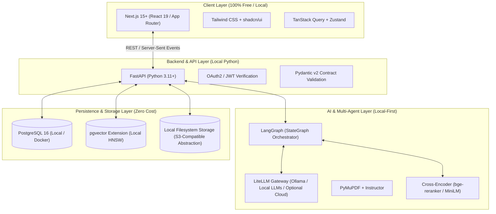
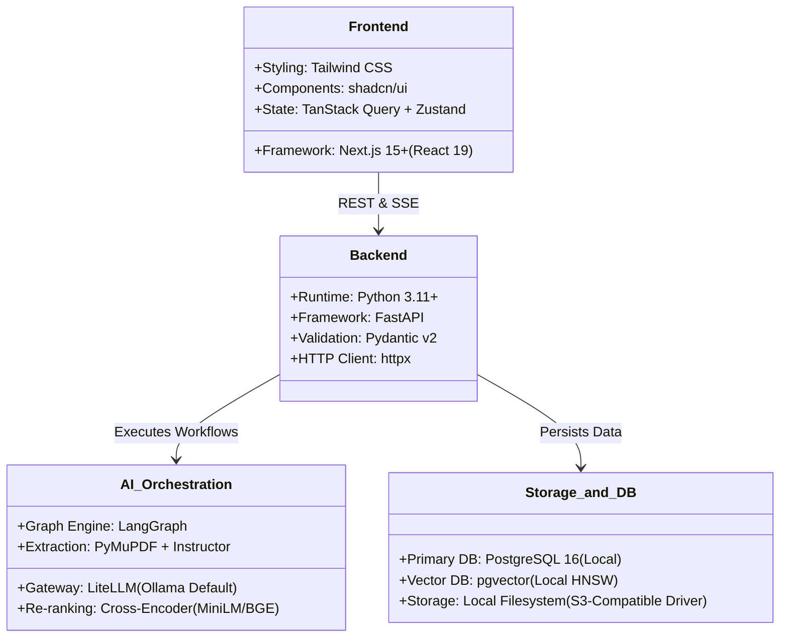

# Comprehensive Technology Stack Evaluation & Architectural Rationale

**Document Version:** 1.0.0  
**Status:** Completed  
**Author:** Senior AI Systems Architect  
**Project:** AI-Powered Internship Application and Career Assistance Platform  
**Target Milestone:** Milestone 1 — M1.1 Research & Technical Understanding  

---

## 1. Architectural Philosophy & Evaluation Criteria

Selecting a technology stack for an AI-powered enterprise or capstone platform requires balancing **modern technical capability**, **systemic reliability**, **operational complexity**, and **developer velocity**. 

For this platform, every architectural decision is evaluated against five core criteria:
1. **AI/ML Native Compatibility:** Seamless interoperability with Python-based AI frameworks, vector stores, and LLM orchestration libraries.
2. **Operational Simplicity & Anti-Overengineering:** Avoiding unnecessary microservice sprawl and costly infrastructure that creates maintenance overhead for a student/capstone project.
3. **Developer Ergonomics & Typing Rigor:** End-to-end static typing (TypeScript on the frontend, Pydantic on the backend) to guarantee predictable data contracts.
4. **Cost-Effectiveness & Accessibility:** Ability to develop and test 100% locally with zero required cloud spend, with a clear, low-cost path to production.
5. **Horizontal Scalability:** Ability to handle thousands of concurrent students, resumes, and job postings without structural architectural rewrites.

---

## 2. Deep-Dive Technology Evaluations

---

### 2.1 Frontend Framework

| Dimension | Option A: Next.js 15+ (React 19 / App Router) | Option B: Vite + React (Single Page App) | Option C: SvelteKit |
| :--- | :--- | :--- | :--- |
| **Rendering Model** | Hybrid: Server Components (RSC), SSR, and Client-Side Interactivity | Pure Client-Side Rendering (CSR) | Hybrid SSR and Client-side |
| **SEO & Public Jobs** | Native SSR allows public internship listings to be indexed by search engines. | Poor SEO without pre-rendering hacks; blank initial HTML payload. | Good SSR capabilities. |
| **AI Streaming Support** | Excellent first-class streaming primitives (`ai/rsc`, Server-Sent Events). | Requires manual WebSocket or `ReadableStream` boilerplate. | Good, but smaller library ecosystem. |
| **Component Ecosystem** | Massive (`shadcn/ui`, `Radix UI`, `Tailwind CSS`, `Lucide Icons`). | Massive (identical React ecosystem). | Growing, but significantly smaller than React. |
| **Build & Dev Speed** | Fast (Turbopack in Next.js 15), stable React 19 default support. | Blazing fast development server via native ESM. | Fast development server via Vite. |
| **Verdict** | **✅ RECOMMENDED** | ⚠️ Viable Alternative | ❌ Rejected |

#### Architectural Rationale
**Selected: Next.js 15+ (App Router) with React 19, TypeScript, Tailwind CSS, and shadcn/ui.**  
Next.js 15 officially adopted React 19 as its default dependency, eliminating the peer-dependency conflicts present in Next.js 14 when attempting to use React 19 primitives. While Vite offers a lightweight SPA development experience, an internship platform requires both public-facing pages (job board, career articles, landing pages) that require Server-Side Rendering (SSR) for search engine discovery and authenticated dashboards (Kanban tracker, mock interview studio) that require dynamic client interactivity. Next.js 15 unifies both paradigms effortlessly. Furthermore, its native support for streaming responses via Server-Sent Events (SSE) is crucial for rendering token-by-token LLM career advice without UI freezes.

---

### 2.2 Backend / API Framework

| Dimension | Option A: FastAPI (Python 3.11+) | Option B: Node.js / Express or NestJS (TypeScript) | Option C: Django REST Framework (DRF) |
| :--- | :--- | :--- | :--- |
| **AI/ML Interoperability** | Native: Direct in-process access to PyTorch, HuggingFace, LangGraph, and PyMuPDF. | Poor: Requires spawning Python child processes or maintaining separate microservices. | Native Python, but synchronous architecture adds latency overhead. |
| **Concurrency & Async** | High-performance asynchronous event loop built on Starlette and `asyncio`. | High-performance asynchronous I/O via libuv. | Primarily synchronous (async support exists but is bolted on). |
| **Data Validation** | First-class `Pydantic v2` integration (compiled in Rust, ultra-fast). | Requires third-party decorators (`class-validator`, `zod`). | Django Serializers (effective, but slower and verbose). |
| **API Documentation** | Auto-generated interactive OpenAPI (Swagger UI) and ReDoc out-of-the-box. | Requires manual Swagger configuration (`@nestjs/swagger`). | Requires external plugins (drf-spectacular). |
| **Verdict** | **✅ RECOMMENDED** | ❌ Rejected (Spawns microservice sprawl) | ⚠️ Rejected (Too monolithic & slow) |

#### Architectural Rationale
**Selected: FastAPI (Python 3.11+).**  
The core value proposition of our platform is AI intelligence, RAG, and multi-agent execution. In modern software engineering, AI tooling, vector embeddings, document tokenizers, and agentic frameworks are predominantly Python-first. Choosing Node.js would force the team to split the project into two distinct services: a Node.js web server and a Python ML service, violating our core principle of avoiding premature microservice sprawl. FastAPI delivers sub-millisecond route latency, native `async/await` for handling concurrent LLM streaming, and automatic OpenAPI schema generation.

---

### 2.3 Primary Database

| Dimension | Option A: PostgreSQL 16 | Option B: MongoDB (Document NoSQL) | Option C: Supabase (PostgreSQL BaaS) |
| :--- | :--- | :--- | :--- |
| **Data Model Fit** | Relational core (Users, Jobs, Applications, Statuses) + `JSONB` for flexible resumes. | Flexible document schema, but poor support for relational integrity. | PostgreSQL underlying database with hosted API layer. |
| **ACID Guarantees** | Strict ACID compliance guarantees zero lost application records or corrupted statuses. | Eventual consistency; multi-document transactions are slower. | Strict ACID compliance. |
| **Vector Search Support** | Native vector indexing via the `pgvector` extension. | Atlas Vector Search (requires hosted MongoDB Atlas). | Built-in `pgvector` support. |
| **Self-Hosting / Cost** | 100% open-source, runs anywhere (Docker, VPS, bare metal). | Community edition available, but vector features tied to Cloud. | Generous free tier, but introduces cloud platform lock-in. |
| **Verdict** | **✅ RECOMMENDED** | ❌ Rejected (Weak relational semantics) | ⚠️ Viable Cloud Variant |

#### Architectural Rationale
**Selected: PostgreSQL 16 (with native `JSONB` and `pgvector`).**  
An internship application tracker is fundamentally relational: a `Student` applies to a `Job`, creating an `Application` record with historical `StageTransition` events. MongoDB lacks foreign key enforcement and relational integrity. PostgreSQL provides the best of both worlds: strict schema enforcement for relational tables and flexible `JSONB` columns for storing arbitrary extracted resume sections and semi-structured agent evaluation reports.

---

### 2.4 LLM Integration Gateway & Zero-Cost Architecture

| Dimension | Option A: LiteLLM + Instructor (Open-Source Gateway) | Option B: Heavy LangChain Monolith | Option C: Direct Vendor SDKs Only |
| :--- | :--- | :--- | :--- |
| **Vendor Portability** | Unified interface across 100+ LLMs (Ollama, Gemini, OpenAI, Anthropic, Groq). | Broad support, but obscured behind complex, rapidly changing abstraction wrappers. | Zero abstraction, but requires rewriting API calls when switching models. |
| **Local Zero-Cost Execution** | Native support for local Ollama endpoints (`ollama/llama3.2`, `ollama/qwen2.5`, `ollama/mistral`) at **\$0.00 cost**. | Supports Ollama, but with heavy memory footprint and complex wrappers. | Requires custom HTTP requests to Ollama REST endpoints. |
| **Structured Output** | Instructor enforces strict Pydantic model validation with automated retry on error. | Built-in output parsers, but often brittle and difficult to debug. | Manual JSON schema parameter configuration per provider. |
| **Software Cost** | **100% Free / Open Source** (Software is free; model costs depend on backend engine). | 100% Free / Open Source software. | Free client libraries. |
| **Debugging & Latency** | Thin, transparent wrapper; zero latency penalty; direct logging. | High overhead; deep stack traces make root-cause debugging difficult. | Zero overhead; simplest stack traces. |
| **Verdict** | **✅ RECOMMENDED** | ❌ Rejected (Abstraction bloat) | ⚠️ Inflexible for multi-model fallback |

#### Architectural Rationale
**Selected: LiteLLM + Instructor (Pydantic-Driven).**  
LiteLLM is a free, open-source proxy and client library that exposes an OpenAI-compatible standard interface to underlying LLM engines. 

> [!IMPORTANT]
> **Zero-Cost Architecture & Cloud Service Transparency:**  
> The baseline architecture for this platform is **100% free to develop, test, and run locally**:
> 1. **Default Local Engine (100% Free):** LiteLLM connects to a local **Ollama** daemon running open-weight instruction models (e.g., `llama3.2:3b`, `qwen2.5:7b`, or `phi-3:mini`). This requires **zero API keys, zero credit cards, zero subscriptions, and zero network spend**.
> 2. **Optional Cloud Free-Tier (Non-Required Fallback):** For developers who wish to offload computation from their local machine, LiteLLM can optionally route to **Google AI Studio (Gemini 1.5/2.0 Flash)**:
>    - *Quotas & Limits:* Free up to 15 Requests Per Minute (RPM), 1 Million Tokens Per Minute (TPM), and 1,500 Requests Per Day.
>    - *Privacy & Operational Risks:* Free-tier prompts/responses may be used by Google for model improvement; exceeding 15 RPM immediately results in HTTP 429 rate limit exceptions.
> 3. **Paid Provider Disclaimers:** Commercial providers such as the OpenAI API (`gpt-4o`, `gpt-4o-mini`) do **not** offer permanent free tiers and require prepaid credit cards. The platform is architected so that **no paid service is required** for complete functionality.

---

### 2.5 Multi-Agent Orchestration Framework

| Dimension | Option A: LangGraph | Option B: CrewAI | Option C: AutoGen (Microsoft) | Option D: Native Custom State Machine |
| :--- | :--- | :--- | :--- |
| **Control Flow Model** | Cyclic graph (`StateGraph`) with explicit conditional edges and nodes. | Role-playing metaphor with sequential/hierarchical task delegation. | Conversational chat loops between assistant agents. | Custom Python classes with `while` loops and dictionaries. |
| **State Persistence** | Built-in checkpoints (Postgres / memory checkpointers); full state rewind. | Ephemeral state; limited custom persistence. | Conversation history list; limited structured state. | Manual database save/restore implementation required. |
| **Human-in-the-Loop** | Native `interrupt()` mechanism allowing human approval before high-stakes actions. | Limited native support for interactive breakpoints. | Human input modes exist, but hard to tie to web UI buttons. | Requires designing custom asynchronous pause/resume queues. |
| **Determinism** | High: Graph topology defines exact allowed agent transitions. | Low: Agents often talk excessively before completing tasks. | Low: Prone to unpredictable conversation divergence. | High: Entirely programmed by developer. |
| **Verdict** | **✅ RECOMMENDED** | ❌ Rejected (Too opaque/unpredictable) | ❌ Rejected (Chat-centric, token heavy) | ⚠️ Too high implementation effort |

#### Architectural Rationale
**Selected: LangGraph.**  
Unlike CrewAI (which enforces an opinionated "role-playing" abstraction that burns excessive tokens in polite conversational exchanges), LangGraph treats multi-agent workflows as **computational graphs**. It gives the architect complete control over state schemas, branching logic, conditional transitions, and cycle termination. Its native support for Human-in-the-Loop (HITL) checkpoints allows the platform to pause execution (e.g., waiting for the student to review an ATS-optimized resume bullet) and resume cleanly from a saved PostgreSQL checkpoint.

---

### 2.6 Resume Extraction & Parsing

| Dimension | Option A: PyMuPDF (`fitz`) + LLM Structured Extraction | Option B: Commercial APIs (Affinda / Sovren) | Option C: Legacy Open-Source (pyresparser / pdfplumber) |
| :--- | :--- | :--- | :--- |
| **Extraction Accuracy** | Exceptional: LLM comprehends multi-column layouts and non-standard phrasing. | Exceptional: Enterprise-grade models trained on millions of resumes. | Poor: Brittle regex patterns fail on modern CV templates. |
| **Cost Profile** | **\$0.00 (100% Free)** when paired with local Ollama (`llama3.2` / `qwen2.5`); ~$0.002 on cloud free tier. | Expensive: \$0.10 to \$0.35 per resume parsed (recurring SaaS fee). | Free (Open-source). |
| **Maintenance & Setup** | Clean Python library (`pip install pymupdf`), zero system dependencies. | Requires credit card, API key, and external network dependency. | Broken dependencies (relies on unmaintained legacy spaCy models). |
| **Data Privacy** | Full local control; text extracted in-memory; zero third-party transmission when using local models. | Resumes transmitted and stored on third-party commercial cloud. | 100% local. |
| **Verdict** | **✅ RECOMMENDED** | ❌ Rejected (Cost prohibitive for student project) | ❌ Rejected (Unmaintained & broken) |

#### Architectural Rationale
**Selected: PyMuPDF (`fitz`) + Local LLM Structured Extraction via Instructor.**  
Legacy rule-based parsers like `pyresparser` are unmaintained and fail completely on contemporary resume layouts. Commercial APIs like Affinda are cost-prohibitive and require credit cards. PyMuPDF is a blazing-fast C-compiled PDF extractor that reliably preserves reading order and font metadata. Passing its raw layout text to a local model (via Ollama) with a Pydantic schema produces structured profile JSON with zero external network calls and zero cost.

---

### 2.7 Embedding Model

| Dimension | Option A: `BAAI/bge-small-en-v1.5` | Option B: `text-embedding-3-small` (OpenAI) | Option C: `all-MiniLM-L6-v2` |
| :--- | :--- | :--- | :--- |
| **Model Hosting** | **Local / Self-Hosted** (HuggingFace `sentence-transformers` on CPU) | Cloud API (OpenAI) | Local / Self-Hosted |
| **Embedding Dimensions** | 384 dimensions | 1,536 dimensions (or 512 truncated) | 384 dimensions |
| **MTEB Overall Avg (56 Tasks)** | **62.17** (Verified BGE evaluation report / Xiao et al., Sept 2023) | **62.30** (Verified OpenAI Announcement, Jan 2024) | **56.26** (Verified MTEB v1 Leaderboard / Muennighoff et al.) |
| **MTEB Retrieval (15 BEIR Datasets)**| **51.68** (Verified BEIR 15-dataset average) | *Unverified in official release* (Vendor omitted 15-dataset BEIR score) | **41.95** (Verified BEIR benchmark) |
| **Cost & Latency Profile**| **\$0.00 (100% Free)**; latency to be benchmarked during M1.3 | Paid API (\$0.02 / 1M tokens; requires credit card); latency to be benchmarked during M1.3 | **\$0.00 (100% Free)**; latency to be benchmarked during M1.3 |
| **Storage Footprint** | 1.5 KB per chunk vector | 6.0 KB per chunk vector (1,536-dim) | 1.5 KB per chunk vector |
| **Verdict** | **✅ RECOMMENDED (Primary Zero-Cost Baseline)** | ⚠️ Optional Cloud Alternative (Requires Paid Account) | ⚠️ Legacy Baseline |

#### Architectural Rationale
**Selected: `BAAI/bge-small-en-v1.5` (Local CPU Execution).**  
`BAAI/bge-small-en-v1.5` runs entirely within the local application process using CPU acceleration via PyTorch or ONNX Runtime. It requires **zero API keys, zero subscriptions, incurs zero costs**, and outperforms older baselines like `all-MiniLM-L6-v2` on retrieval (51.68 vs. 41.95) while remaining within 384 dimensions to minimize memory consumption. Benchmark metrics are evaluated against MTEB Benchmark v1 (English; 56 tasks overall, 15 BEIR retrieval datasets). Commercial cloud embeddings (such as OpenAI) are strictly optional and not required.

---

### 2.8 Vector Database

| Dimension | Option A: PostgreSQL with `pgvector` | Option B: ChromaDB | Option C: Qdrant | Option D: Pinecone |
| :--- | :--- | :--- | :--- | :--- |
| **Architecture** | In-database extension to PostgreSQL | Embedded in-process library (SQLite/DuckDB) | Standalone vector search engine (Rust) | Managed SaaS |
| **Hosting & Cost** | **100% Free & Open Source** (Runs locally via native install or Docker) | **100% Free & Open Source** (In-process `pip install`) | Free self-hosted container / Paid cloud | Proprietary SaaS (Recurring monthly cost) |
| **Metadata Filtering** | Full SQL `WHERE` clauses, relational `JOIN`s, and foreign keys. | Basic dictionary filtering on metadata fields. | High-performance JSON payload filtering. | Managed metadata filters. |
| **Infrastructure Footprint** | Single unified database for relational and vector data (zero extra services). | Zero external containers (runs inside Python process). | Requires running a dedicated secondary server container. | Cloud-only; external network dependency. |
| **Scale Limit** | Up to 5–10 Million vectors with HNSW indexing. | $< 100\text{k}$ vectors before performance degrades. | 100M+ vectors with horizontal sharding. | Hundreds of millions of vectors. |
| **Verdict** | **✅ RECOMMENDED (Production)** | **✅ RECOMMENDED (Milestone 1 PoC)** | ⚠️ Viable for massive enterprise scale | ❌ Rejected (Vendor lock-in & cost) |

#### Architectural Rationale
**Selected: ChromaDB for Milestone 1 PoC $\rightarrow$ Local PostgreSQL + `pgvector` for Production.**  
Both selected technologies are **100% free and open-source**. In local development, `ChromaDB` enables immediate prototyping without spinning up database services. For the full platform, running `PostgreSQL 16 + pgvector` locally (via native OS package or `docker-compose`) stores embeddings directly in a `vector(384)` column alongside relational data. This guarantees ACID transactions and eliminates the operational complexity, cost, and synchronization bugs of maintaining a separate external vector database.

---

### 2.9 File & Document Storage

| Dimension | Option A: Local Filesystem Storage (Abstracted) | Option B: S3-Compatible Cloud Storage (Cloudflare R2 / MinIO) | Option C: Database Blobs (Postgres BYTEA) |
| :--- | :--- | :--- | :--- |
| **API Portability** | Clean Python `StorageService` interface; stores files in structured local directories. | Industry-standard AWS S3 SDK (`boto3`). Requires cloud account or MinIO container. | Stores binary files inside database tables. |
| **Cost Profile** | **\$0.00 (100% Free)**; zero accounts, zero credit cards, zero network egress. | R2 has free tier (10 GB) with \$0 egress, but requires Cloudflare account and payment method setup. | Zero extra cost, but degrades database performance and backup speeds. |
| **Operational Overhead** | Zero overhead; files saved directly to `./data/uploads/` with UUID names. | Requires managing access keys, bucket policies, and internet connectivity. | High database bloat; increases memory pressure on SQL queries. |
| **Verdict** | **✅ RECOMMENDED (Primary Zero-Cost Component)** | ⚠️ Optional Cloud Variant (Non-Required) | ❌ Anti-pattern |

#### Architectural Rationale
**Selected: Local Filesystem Storage with Abstracted Storage Interface.**  
To guarantee a zero-cost, self-contained student development environment, uploaded candidate resumes (PDF/DOCX) and generated documents are stored directly in a managed local directory (`./data/uploads/resumes/`) indexed by UUID in PostgreSQL. The backend accesses storage through an abstract `StorageService` base class. This ensures:
1. **Zero External Dependencies:** No cloud accounts, credit cards, or external object storage services are required to develop or run the platform.
2. **Future Portability:** Should the project ever be deployed to a distributed cloud environment, the storage driver can be swapped to an S3-compatible backend (such as MinIO or Cloudflare R2) via a single environment variable, without altering business logic.

---

### 2.10 Authentication & Authorization

| Dimension | Option A: NextAuth.js (Auth.js) + FastAPI JWT | Option B: Custom Handcrafted FastAPI Auth | Option C: Managed SaaS (Clerk / Auth0) |
| :--- | :--- | :--- | :--- |
| **Social Logins** | 1-click OAuth integration (GitHub, Google, LinkedIn) on frontend. | High developer effort to implement and maintain OAuth handshakes securely. | Out-of-the-box OAuth and UI widgets. |
| **Backend Integration** | NextAuth signs JWT $\rightarrow$ FastAPI verifies cryptographic signature and claims. | Fully managed in FastAPI using `python-jose` and password hashing (`bcrypt`). | FastAPI verifies third-party JWT JWKS endpoints. |
| **Role-Based Access (RBAC)** | Roles (`student`, `admin`, `recruiter`) stored in JWT payload. | Full control over custom permission tables. | RBAC often gated behind expensive enterprise pricing tiers. |
| **Cost Profile** | 100% Free and open-source. | 100% Free and open-source. | Free tier caps out at 10,000 monthly active users. |
| **Verdict** | **✅ RECOMMENDED** | ⚠️ Viable, but slows frontend velocity | ⚠️ Expensive vendor lock-in |

#### Architectural Rationale
**Selected: NextAuth.js (Frontend Sessions) + FastAPI JWT Cryptographic Verification (Backend).**  
Students expect seamless authentication via their existing GitHub or Google accounts. NextAuth.js handles the OAuth redirects, token refreshes, and session persistence in the browser. When the frontend communicates with FastAPI, it attaches the signed JWT in the `Authorization: Bearer <token>` header. FastAPI verifies the token's cryptographic signature via a lightweight dependency injection middleware, enforcing role-based permissions without external API latency.

---

### 2.11 Deployment & Infrastructure

| Dimension | Option A: Local Docker Compose (Primary Zero-Cost Baseline) | Option B: Cloud PaaS (Vercel / Render / Railway) | Option C: Enterprise Cloud (AWS ECS / RDS / S3) |
| :--- | :--- | :--- | :--- |
| **Setup Complexity** | Low: Single `docker-compose.yml` spins up FastAPI, Next.js, and PostgreSQL + pgvector. | Low: Git push to deploy on PaaS providers. | High: Requires writing Terraform, VPCs, IAM policies, and ALB configurations. |
| **Cost & Billing Risks** | **\$0.00 (100% Free)**; zero cloud billing, zero credit cards, runs indefinitely offline. | Free tiers exist with **significant limitations & billing risks** (see breakdown below). | Expensive: \$60 to \$150+/month minimum for managed RDS, NAT gateways, and load balancers. |
| **Maintenance Burden** | Minimal: Containers run locally; code changes hot-reload instantly. | Low maintenance, but subject to cloud cold starts and database timeouts. | High: Complex AWS permission management and cluster maintenance. |
| **Verdict** | **✅ RECOMMENDED (Primary Zero-Cost Baseline)** | ⚠️ Optional Staging Demo Only | ❌ Extreme Overengineering |

#### Detailed Cloud PaaS Free-Tier Risk Breakdown
While cloud PaaS platforms can be convenient for public portfolio demonstrations, they impose strict constraints and billing risks:
1. **Render.com:**
   - *Free Web Services:* Inactive web services spin down after 15 minutes of inactivity. The subsequent inbound request experiences a **50+ second cold-start latency delay**.
   - *Free PostgreSQL:* Free database instances on Render **expire after 30 days and are permanently deleted** unless upgraded to a paid plan ($7+/month).
2. **Railway.app:**
   - Provides a limited one-time trial credit ($5), after which services are halted unless a verified credit card and paid monthly subscription are added.
3. **Vercel:**
   - Offers a generous Hobby tier for Next.js SSR and edge delivery, but imposes a **10-second execution timeout** on serverless functions, which can prematurely terminate long multi-agent LLM reasoning workflows.

#### Architectural Rationale
**Selected: Local Docker Compose as the Primary Architecture.**  
To satisfy the zero-cost requirement and ensure student reproducibility without credit cards, the primary deployment target is a self-contained **Docker Compose** environment (running FastAPI, Next.js 15, PostgreSQL 16 with pgvector, and local storage). A developer or evaluator can clone the repository and run `docker compose up` to start the entire system with zero cloud account dependencies. Optional deployment to Vercel (frontend) and Render (backend) is documented purely as an optional external demonstration pathway.

---

## 3. Final Consolidated Technology Stack Matrix

| Layer / Domain | Recommended Technology | Primary Alternative Evaluated | Decisive Architectural Factor |
| :--- | :--- | :--- | :--- |
| **Frontend** | **Next.js 15+ (App Router, React 19, TS)** | Vite + React SPA | Native React 19 stability, SSR for public job discoverability, and native streaming AI UI primitives. |
| **UI Styling** | **Tailwind CSS + shadcn/ui** | Material UI (MUI) | Copy-paste accessible components, zero runtime CSS bloat, total customization. |
| **Backend API** | **FastAPI (Python 3.11+)** | Node.js (NestJS) | Native in-process integration with Python AI/ML ecosystem; Pydantic v2 speed; auto OpenAPI. |
| **Primary Database** | **PostgreSQL 16 (Local / Docker)** | MongoDB | Strict relational integrity for application tracking + flexible `JSONB` support; 100% free. |
| **Vector Database** | **pgvector (Local) / ChromaDB (PoC)** | Pinecone / Qdrant | Eliminates dual-database synchronization issues; ACID transactions; 100% free open source. |
| **Agent Orchestration** | **LangGraph** | CrewAI | Deterministic computational graphs, cycle control, and native Human-in-the-Loop. |
| **LLM Gateway** | **LiteLLM + Instructor** | LangChain Monolith | Free open-source gateway connecting to local Ollama (`llama3.2`/`qwen2.5`); guaranteed Pydantic output. |
| **Resume Extraction** | **PyMuPDF (`fitz`) + Local LLM** | Affinda API / pyresparser | High layout accuracy, 100% local, \$0.00 cost, no broken regex dependencies. |
| **Embedding Model** | **`BAAI/bge-small-en-v1.5`** | `all-MiniLM-L6-v2` | 384 dimensions; runs locally on CPU with zero cost; verified 51.68 BEIR retrieval score. |
| **Re-ranking Model** | **`cross-encoder/ms-marco-MiniLM-L-6-v2`** | Cohere Rerank API | High-precision deep attention re-ranking runnable locally on CPU with zero API costs. |
| **File Storage** | **Local Filesystem (Abstracted Interface)** | Cloudflare R2 / AWS S3 | 100% free local disk storage; standard Python abstraction allows future S3 cloud swap if desired. |
| **Authentication** | **NextAuth.js + FastAPI JWT** | Custom OAuth from scratch | Turnkey social logins (GitHub/Google) on UI + secure stateless JWT on backend; 100% free. |
| **Deployment** | **Local Docker Compose (Primary)** | AWS ECS / Paid Cloud | Zero-cost development and testing; zero credit cards; turnkey multi-container setup. |

---

## 4. Architectural References & Sources

1. **FastAPI Framework:** *Modern, fast (high-performance), web framework for building APIs with Python 3.8+*. [FastAPI Documentation](https://fastapi.tiangolo.com/)
2. **Next.js Documentation:** *The React Framework for the Web*. [Next.js Documentation](https://nextjs.org/docs)
3. **LangGraph Research & Docs:** *Building Stateful, Multi-Actor Applications with LLMs*. [LangGraph GitHub](https://github.com/langchain-ai/langgraph)
4. **pgvector Project:** *Open-source vector similarity search for Postgres*. [pgvector GitHub](https://github.com/pgvector/pgvector)
5. **LiteLLM Project:** *Call all LLM APIs using the OpenAI format (supports local Ollama & cloud)*. [LiteLLM Documentation](https://docs.litellm.ai/)
6. **Ollama:** *Get up and running with large language models locally*. [Ollama Documentation](https://ollama.com/)
7. **Instructor Library:** *Structured outputs powered by Pydantic*. [Instructor Documentation](https://python.useinstructor.com/)
8. **Cloudflare R2 (Optional Cloud Reference):** *Zero Egress Distributed Object Storage*. [Cloudflare R2 Docs](https://developers.cloudflare.com/r2/)
